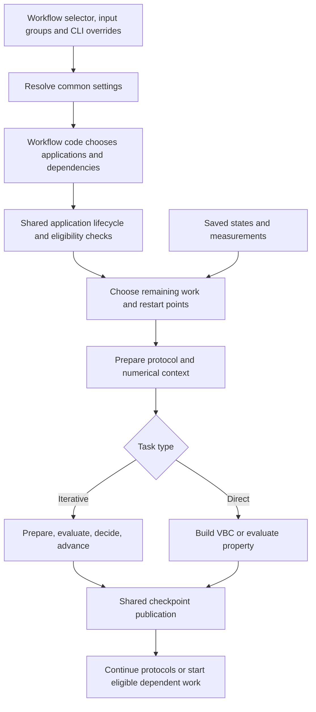

# Unified chemistry I/O, convergence, restart and metrics

**Implementation update — 2026-11-19:** executable consolidation now uses one
`WorkflowDriver.hpp` entry, with no named parser/runner. Duplicate `moldft`,
`nemo`, `molresponse`, `cis`, `oep` and `cc2` mains/targets are retired; distinct
unsupported engines and analysis/private test programs remain. SCF seed setup
is shared by SCF and response workflows. The
[driver/test migration index](docs/design/madqc-driver-test-migration.md) maps
every retired named test to retained checks or an explicit release gap. This
does not mark response/Nemo shared checkpoint adoption or optimizer restart as
complete. Historical named-source inventories below are retained as design
history; use the migration index for current file/test locations.

- **Author:** ahurta92
- **Status:** Draft — behavior and record layout accepted; scientific adapter prerequisites and independent review remain
- **Date:** 2026-11-07
- **Updated:** 2026-11-13

## Overview

`madqc` should handle input, convergence, restart and reporting consistently
across chemistry solvers. It should treat the ground state and the calculations
that depend on it as one calculation. All applications use common metric
categories and shared numerical helpers for the agreed conventions. Applications
own their state and comparison history, compute measurements with those helpers,
and pass measurements to the shared controller. Each model declares their
scientific meaning. Each solver keeps its equations, operators, starting guesses
and numerical update methods. Keep the existing workflow selectors, input groups and command-line
options. Workflow code constructs the application calculations and manages
their dependencies. Remove the named-stage input model and its separate runner;
reuse their useful lifecycle and checkpoint work in the retained workflow path.
All adopted applications use the same convergence, metrics, restart, checkpoint
and reporting contracts.

This design develops the agreed
[simplified iteration and restart policy](docs/design/madqc-simplified-policy.md).
It describes the intended behavior. The earlier document records what has
already been implemented and tested.

## Release entry point — 2026-11-19

`madqc` is the sole released executable for every engine it supports. Named-stage
input and its separate runner are not part of the release. Separate application
executables remain only for engines not yet supported by madqc; retain those
builds and tests until their capabilities are adopted. A source directory or
engine class does not imply a separately maintained executable.

The madqc driver may be rebuilt around the shared lifecycle. Preserve supported
science, madqc command-line capabilities and numerical references, not the old
driver structure or standalone-application interfaces. Reuse numerical engines
and shared infrastructure where useful. Migrate scientific tests before removing
the old callers; this is a coverage requirement, not a requirement to ship both
interfaces. This supersedes the earlier plan to preserve supported standalone
entry points and defer named-runner retirement for a separate approval.

## SCF adoption boundary — 2026-11-19

The ordinary `madqc` SCF workflow enters the shared SCF session (`SCFRun`).
The temporary standalone `moldft` entry used during adoption has been removed.
Applications retain their numerical state; the session
connects the existing evaluation/update split to shared metrics, decisions and
native checkpoints. Analysis JSON and the old coordinate-norm cache do not
authorize reuse on this path. The session qualifies occupied sources before
frozen virtual work and records virtual-count preparation separately from the
requested bundle, with its own `nv_its` allowance. Each preparation membership
has its own attempt identity; completed preparation archives are retired.
Preparation-only checkpoints can resume before the requested bundle has been
saved. A changed preparation schedule or protocol requires fresh checks;
completion from the old schedule cannot skip new work. Native seed occupations
are rebuilt for the current request before applying explicit occupation overrides.

The response workflow receives the exact qualified SCF archive plus verified
electron/spin/operator parameters. This is the ground-reference handoff, not
adoption of response's iteration/restart layer. The native reader's unsupported
core-orbital trimming with extra virtuals is rejected explicitly.
Frozen and response consumers retain that generation reference rather than
following a later `latest` pointer.

During migration, shared SCF records live in the existing application work
directory: `results.json` and `checkpoints/`, including `checkpoints/run.json`.
Existing analysis reports remain for downstream tools and numerical comparisons.
Whole-workflow output layout, evaluation-ID orchestration, other engine adoption
and replacement optimizer restart remain follow-up work. The legacy named
driver and supported engines' duplicate entry points have been removed. The
migration index records their replacement tests and remaining coverage gaps.

## The Problem

We do not yet have enough data to validate stall detection for moving between
MRA protocols. Start with the legacy threshold-dependent tolerance heuristic
for intermediate protocols, with `maxiter` as a cap. Recorded metrics and timings
will support later studies of stall detection and the tradeoff between coarse
iterations and more expensive refinement. Users should not need to set a target
for every metric at every protocol.

At the start of this design, madqc had two input paths sharing numerical engines
but separate application bindings, restart and checkpoint publication. The named
path used labeled blocks such as `moldft gs` and `molresponse optical`. That path
has now been removed. The retained [workflow path](src/apps/madqc/README.md)
selects a workflow with options such as `--wf=scf` or `--wf=response`, then builds
a `Workflow` and runs its `Driver` and `Application` objects. Migrating the
remaining [application wrappers](src/madness/chem/Applications.hpp) to the shared
lifecycle is still necessary: sharing an executable alone does not unify their
restart and result-reuse decisions.

The current solvers apply different rules. Some paths force the full coarse
iteration count while others use heuristic convergence targets, and excited-state
calculations can freeze individual roots. Work records also differ: the
reported excited-state iteration count excludes warmup, while its elapsed time
includes warmup and ground-state preparation. These differences make restarts
and convergence studies harder to interpret. The
[drift report](docs/design/2026-11-07_DRIFT_REPORT.md) and corrected
[chemistry](src/madness/chem/README.md) and
[response](src/apps/molresponse/calc/README.md) READMEs describe the current code.

## Goals

- Release one madqc entry point for supported engines; retain separate executables
  only for engines outside madqc support.
- Preserve madqc workflow selectors, input groups and command-line options; let
  workflow code manage application composition and dependencies.
- Use one shared calculation lifecycle and scientific contract across engines.
- Give supported solvers common rules for iteration, convergence and restart.
- Standardize metric reporting while preserving explicit model-specific definitions.
- Publish numerical archives and their matching metric records through one shared
  checkpoint contract.
- Reuse completed work and allow users to refine or extend a calculation.
- Keep measurements and timings useful for comparing convergence across runs.
- Preserve working scientific methods and require engines E01–E12 to adopt the
  shared layer before the initial madqc release. Preserve separate builds of
  the deferred periodic DFT and time-propagation programs E13–E15.

## Non-Goals

This first design does not choose protocols automatically, predict the cheapest
coarse iteration count, or use stall detection to stop or advance a solve.
Stall-based stopping is deferred until it has been evaluated against recorded
histories. It does not replace solver equations, KAIN, property calculations
or starting-guess methods.

A general backward-compatibility layer for old input files, checkpoints and
output formats is out of scope. The approved madqc command-line interface is an
explicit preservation requirement: keep its entry options, workflow aliases
and parameter-group overrides. Those options use the shared scientific and
convergence conventions. This does not require archive importers or schema
converters; users' existing files must not be deleted or silently rewritten.
User-defined named stages and arbitrary application graphs in input files are
out of scope. New application combinations are implemented in workflow code.
Keep scientific paths during migration; remove superseded branches after their
coverage moves to madqc. Named stages and separate executables for supported
engines are not release interfaces. The madqc workflow interface and its
scientific capabilities remain supported.

Optimizer replacement follows workflow unification. Keep the existing optimizer
and supported `--optimize` entry points during this work; adapt only their calls
to the shared electronic layer. New optimizer snapshots, Hessian-history recovery,
geometry-step restart rules and excited-state optimization are deferred. The
[optimizer follow-on requirements](docs/design/madqc-optimizer-follow-on.md)
preserve the agreed behavior for a replacement. Retire the existing optimizer
after migration, validation and collaborator approval.

Shared restart checkpoints use native MADNESS archives. HDF5 integration is
follow-on work outside parameter and I/O unification, including a shared HDF5
checkpoint backend and new analysis/export interfaces. HDF5 remains important
for future usability, analysis and access to MADNESS data. Preserve existing
HDF5 utilities, build support and standalone tests separately; this design does
not migrate them into, or certify them through, the unified lifecycle.

Passing convergence criteria is not a general bound on physical error, proof
that every root of interest was found, or chemistry release certification.

## Technical Plan

**Next milestone — complete molresponse unification:** finish driven response,
then coupled excited states and quadratic-response tasks/properties. Every path
adopts the shared metrics, convergence, restart, native checkpoints, results,
printing and timing conventions. Molresponse retains its dependency logic.
The [response milestone](docs/design/madqc-response-milestone.md) defines scope,
shared timing conventions and required validation. Optimizer work remains deferred
until workflow unification is complete. This adoption connects existing
components while preserving numerical kernels, update formulas and optimized
execution paths. Keep focused interface checks during integration, then verify
metrics and representative converged values. Historical iteration-count agreement
is not a target for this first milestone. Reference recomputation and detailed
scientific/performance calibration follow in a later validation stage. Existing
release-wide test requirements remain tracked separately. Numerical changes beyond
verified bug fixes must be identified separately.

### 1. Shared responsibilities

A **workflow** is the complete requested calculation, including its reference
and dependent properties. An **application stage**, also called an application
calculation in this document, is one application invocation within it, such as
SCF, Nemo or molresponse. It has requested properties and effective settings
from its application input block and supported command-line overrides.

An **internal task** is work managed by that application. A **solver task** is
an iterative internal task: a ground state, an independent frequency/perturbation
state, or an excited-state **bundle**. [VBC construction and property evaluation](#3-ground-state-response-states-and-properties)
are direct internal tasks without solver iterations. An **MRA protocol stage**
is one truncation threshold and polynomial order within a solver task.

Workflow code chooses application stages and their dependencies, such as
moldft supplying the reference for molresponse. Molresponse owns its internal
state, VBC and property dependencies. Keep the existing command-line options,
input groups and workflow selection. Users do not name or connect application
instances; named-stage input and the proposed `--stage` selector are not part
of this interface.

Build one madqc driver around the shared calculation lifecycle. Existing
workflow builders, drivers and application interfaces can supply reusable code;
their current structure is not a compatibility requirement. Consolidate reusable preparation,
restart, protocol and publication operations from both current paths into that
lifecycle. Do not retain a named-stage runner behind a hidden adapter or build a
new general-purpose graph system. Workflow code specifies order and references;
shared checks decide whether the supplied reference and checkpoint evidence are
eligible. Each adopted engine has one implementation of these operations,
called through madqc. Engine-specific numerical loops may still differ.

Preserve the supported command-line capabilities:

| Capability | Preservation requirement |
| --- | --- |
| Workflow selection | Keep `--wf`, `--workflow` and `--w`, default SCF selection, and supported workflows. |
| Calculation settings | Keep geometry selection and parameter-group overrides such as `--dft="..."`, `--response="..."` and `--cc2="..."`, with their existing group ownership. Preserve command-line-only calculations. |
| Geometry optimization | Keep `--optimize` and supported reference-method combinations; workflow code owns its outer algorithm and dependent calculations. |
| Input and run control | Keep positional input files, `--input`, `--prefix` and supported continuation controls. Explicit CLI settings override file settings. |
| Inspection and plotting | Keep `--help`, `--print_parameters`, `--restart_info` and read-only access to saved results/functions for supported post-processing. These operations do not start solver iterations or demand new convergence tolerances. |

Reuse the existing parser and typed parameter readers. Resolve defaults,
file settings and command-line overrides once, recording their sources. Keep
engine settings in their owning parameter groups; no stage-target selector or
implicit first-stage override is needed. Before adopting an engine, inventory
its supported flags and parameter keys, map them to the shared settings and
review any setting whose intent cannot be preserved. Retaining an option does
not retain a second convergence implementation. The approved explicit
convergence names below replace the public `dconv`/`econv` convergence inputs;
preserving workflow selectors and group overrides does not retain those aliases.
The [input-option review](input_option_mapping.md) records current behavior and
the source audit. The consolidated routing below specifies the target; it does
not claim these controls already work in the checkout.

Workflow code assigns stable internal calculation names, used directly as
calculation IDs and checkpoint locations. The ordinary ground-state → response
workflow uses `ground_state` and `response`; users do not supply these names.
Reuse still requires compatible scientific settings, reference generations and
saved progress. Repeated calculations, including geometry/displacement work,
need distinct workflow-owned occurrence names. Section 6 specifies the retained
optimizer's electronic evaluation IDs and the saved plans for displaced work.

**Migration and cleanup:** port all needed science, checkpoint operations and
regression coverage before removing named-stage parsing/dispatch and duplicate
policy branches. The other project collaborators must approve that cleanup;
record who approved it and what coverage was reviewed. Adopted calculations use
the common lifecycle while cleanup is pending. The target has no named-stage
input support or converter. At cutover, recognize unsupported named blocks and
report a clear input error instead of silently interpreting them as an ordinary
deck. Do not remove the retained workflow interface, engine algorithms or useful
shared helpers as part of this cleanup.

| Shared layer | Engine/application code |
| --- | --- |
| Validate common settings and record task relationships | Declare supported methods, parameters, metrics, defaults and required inputs |
| Provide shared metric helpers; validate measurements and decide when to continue, advance or stop | Own state and comparison history, use the helpers to compute model-specific measurements, and perform numerical updates |
| Choose what to load, resume or initialize | Check compatibility, load functions and prepare usable guesses |
| Save complete checkpoints and replace old ones safely | Write and read the numerical state needed to resume |
| Produce consistent histories and results | Calculate physical quantities and properties with their units |

A [`World`](src/madness/world/world.h) is MADNESS's parallel execution context
for a group of MPI processes. A **subworld** is a smaller group used to run an
independent task; separate groups can work concurrently. Collective operations
involve every process in the relevant group. Keep comparison and restart rules
independent of files, solver objects and `World`. Numerical operations and
checkpoint writes remain collective on an explicit `World&`.

Workflow code owns dependencies between applications, including the fully
converged ground-state reference required by response. Reuse the existing
producer/consumer context handoff, extending it with reference identity and
completion evidence rather than relying on an implicit file or current directory.
Molresponse's calculation manager continues to own seeding, VBC and property
dependencies within response. Both use the shared checkpoint interface and
eligibility rules. No second scheduler or general plugin system is required.

Use a common outer lifecycle for iterative tasks and direct computations. The
iteration loop is one operation within it; VBC construction uses a direct build
operation. Applications supply their numerical state, operations and serialization.

| Boundary | Responsibility |
| --- | --- |
| Start | Resolve defaults and overrides once; validate tasks, dependencies, protocols, limits and supported criteria. Record the effective settings. |
| Restart | Inspect saved records and choose reuse, resume, seed or fresh initialization. Load using the saved representation before any supported conversion; apply the rules in section 4. |
| Enter a protocol | Carry the functions forward in the requested representation and rebuild operators. At each protocol change, discard cached proposals/residuals, reset comparison history and start KAIN empty; establish new measurements before updating. |
| Execute | Run the iterative phases in section 7 or the direct computation once its prerequisites are satisfied. Use the same resolved criteria for live decisions, restart checks and final results. |
| Publish | Save the payload with valid measurements or completion evidence. Record intermediate completion, final convergence and direct-task completion separately. Release only dependent work whose prerequisites are satisfied. |



#### Input routing and retired controls

**Consolidated for review — 2026-11-12.** Resolve each supported input once;
use the same normalized settings for madqc file and command-line inputs.
The response group gains the shared `restart` mode as adoption work; it does
not currently have this control. Keep engine-specific seed selectors where
supported. Do not interpret a ground-state restart flag as a response override.

| Input or operation | Target behavior |
| --- | --- |
| `restart auto` (default) | Reuse or resume recognized saved work. New tasks without expected saved work initialize normally. An expected missing, corrupt or unsupported checkpoint fails strictly. |
| `restart none` | Initialize that application's tasks fresh. Keep endpoint saving; replace valid saved work only through successful publication. A changed ground reference invalidates downstream evidence even if downstream mode is auto. |
| `restart iterate` | Require an existing checkpoint for the selected existing solve, then use the same reuse-or-iterate policy. It does not force an update when measurements already pass. Newly added independent tasks still start normally. |
| `--continue` | Require a recognized run at the selected prefix and plan every task through the shared restart rules. Added states/calculations are new work. It adds no separate convergence policy; auto may also reuse a recognized run without this flag. |
| `restart read_only`, `--restart_info`, supported plot/export operations | Dispatch inspection/post-processing before solver workflow execution. Read saved context without imposing new convergence demands or rewriting solver checkpoints. An explicit request to compute new scientific properties conflicts with inspection mode and is rejected, rather than silently ignored or solved. |
| Explicit `ao`/`nwchem` or another supported seed selector | Preserve the engine's supported source selection and source failures. Start fresh comparisons/KAIN; a seed does not prove convergence. |

Reject `--continue` combined with explicit fresh/seed or inspection mode before
work starts; a default solver selection alone is not an explicit request for
new properties during inspection. Group-local restart choices apply only to
that application. Workflow code supplies the ground-state reference and output
location to response. Standalone response archive/directory flags are migration
sources, not retained public entry points. No named-stage selector or new
run-wide restart vocabulary is added.

Retain scalar `maxiter` in the existing groups. Per-protocol vectors may remain
an internal planner representation, but named-stage list syntax is not a new
public workflow option. Response uses one value for both driven states and
coupled roots. Preserve madqc protocol/k ownership; standalone-only flags do
not create additional public interfaces.

Remove public controls that select a retired policy: `convergence_criteria`,
`conv_only_dens`, `accuracy.bsh_residual`, `accuracy.kinetic_trace_change`,
`convergence.use_default_criteria`, `progress.window`,
`progress.minimum_relative_improvement`, response `stall.window`/`stall.ratio`,
`diagnostic.iterations_per_rung`, and molresponse's `excited.guess_max_iter`/
`seed.es_warmup`. Remove response `seed.start_rung` and the existing
`--seed-start-rung` test-driver flag as well: `protocol` alone specifies the
requested stages. Any explicit value, including an old disabled value, follows
the normal fatal unknown-input path. Supported seed construction remains.
The removed `save`, `checkpoint.keep_all` and `excited.maxiter` use that same
generic path. Do not register inert compatibility switches. The explicit
migration errors for `dconv` and `econv` remain separate.
Documentation explains the conceptual replacements; the parser does not alias
old names or silently translate their numeric tolerances.

Validate every original command-line occurrence before applying overrides,
including repeated top-level options and repeated parameter-group payloads.
Retain user-supplied arguments in order before the parser overwrites its key/value
maps. Use the existing tokenizer and owning workflow/application parameter
registrations for syntax, key, type and per-value range checks. An unknown,
retired or malformed earlier occurrence remains an error even when a later
occurrence is valid. Preserve the specified generic errors and `dconv`/`econv`
migration errors; do not scan only the final maps or add a second input grammar.
Validate within the owning group without rejecting other applications' groups.

Validation must not mutate resolved settings, apply superseded values, start
numerical work or write checkpoints. After all occurrences pass, keep the existing
file-then-CLI and repeated-key precedence. In particular, the final occurrence
of a CLI group still replaces that group's earlier CLI payload; validating them
does not merge the payloads. Keep path case and provenance of the winning input.
Check cross-setting conflicts and model applicability on the resolved request,
so an overridden but individually valid value does not create a fictitious
conflict. Defaults and internal derived writes are not user CLI occurrences.

For example, `--response="excited.maxiter=3" --response="maxiter=3"` fails for
the retired first key. `--response="maxiter=12" --response="maxiter=20"` remains
valid and resolves to 20. An earlier malformed value such as `maxiter=invalid`
cannot be hidden by a later valid value.

Both original-occurrence validation and final CLI reading use the file reader's
collective error-handling approach. Rank zero catches input failures and shares
the error type and message through `World::gop` on an explicit `World&`. Every
rank receives the outcome before any rank throws or leaves that input path;
on failure, all ranks throw the same error category and diagnostic. Do not let
rank zero unwind while other ranks wait for parameter data. Keep validation
non-mutating and accept resolved parameter data only on success. Failed input
must exit with a nonzero status before numerical work or checkpoint publication.
Preserve the existing diagnostics, precedence and non-MPI build support.

Do not rename scoped controls such as geometry `maxiter`, CC pair tolerances or
PNO micro/macro iterations as a side effect. Each engine's adoption inventory
must classify those inner operations before mapping their controls.

### 2. Iteration and convergence

Electronic `maxiter` caps the number of main solver updates at each executed protocol
stage in the current run. A stage may finish earlier when its required criteria
pass at that stage's tolerances. Earlier iterations remain in the history and
are not subtracted from the new allowance. Start KAIN with an empty subspace;
its history is not restored.
Prepare functions and rebuild operators for the stage's representation:
changing `FunctionDefaults` alone does neither.

**Author-approved response budget input — 2026-11-12:** `maxiter` in the
`response` group is the single configured main-update cap for driven and excited
states. Madqc routes response `maxiter` to that same setting.
Each independent driven state gets its own allowance at each executed protocol;
a coupled excited-state bundle gets an allowance for its collective updates.
The cap is not a pool shared among all states or divided among the roots.

Remove `excited.maxiter` from accepted inputs. Any explicit occurrence in an
input file or adopted CLI form follows the normal fatal unknown-input path,
without a custom migration message. It is not an alias or an override. Reject
it even when `response maxiter` is also supplied with the same value; a later
override must not hide it.

Use the resolved response cap for both execution paths; no separate excited-state
parameter default may replace it. This does not choose a new numerical default
or change existing default provenance. Geometry and distinct inner-solver
iteration controls retain their own scopes. Fresh invocation allowances,
terminal evaluation, disabled warmup and saved-state reuse follow the rules here.

Disable separate warmup iterations in the simplified implementation, including
fresh and restarted solves. Preserve supported starting-guess construction and
loading, including basis-set seeds and required preparation, without a separate
iterative warmup pass. If warmup or iterative guess refinement is added later,
it must use its own allowance and records; it never consumes `maxiter`.

The full requested protocol sequence determines which stage is final, even
when a scheduler runs one stage at a time. Every newly solved result must reach
the requested final threshold and polynomial order. This rule must not depend
on whether checkpoint recording is enabled.

**Author-approved policy revision — 2026-11-10:** use the legacy
threshold-dependent tolerance heuristic for intermediate stages. This replaces
the earlier fixed-iteration policy. Keep the shared metric definitions, selected
criteria, comparison rules and measurement point. Only intermediate tolerances
are adjusted; final convergence uses the requested tolerances without heuristic
relaxation.

The shared resolver derives intermediate absolute tolerances from the current
protocol threshold and the documented legacy rule for each model and metric.
They may relax, but must not tighten, the requested absolute tolerances. Keep
the selected relative tolerances and shared scales unchanged. Document and
validate legacy factors against the agreed metric units and reductions; a
constant from one engine or metric is not automatically valid for another.
Where no applicable legacy adjustment exists, retain the requested tolerance
and record that fact. Do not restore legacy metric selections or root freezing.

The [legacy SCF and molresponse convergence audit](docs/design/madqc-legacy-convergence.md)
records the actual engine gates, resolved defaults, measurement timing, and
their mapping to the four shared metrics. Use it to reproduce comparable legacy
requests without restoring retired inputs or stall/restart policies. In
particular, legacy response uses a combined residual norm and a protocol-dependent
relative term; identical numerical inputs do not imply an identical shared
stopping test. The audit distinguishes current shared checks during iteration
from the transitional fixed-work and outside-loop verdict paths.

At the common measurement point, record metrics for the evaluated iterate and
apply these rules:

| Situation | Action |
| --- | --- |
| Solver fails or declares divergence | Stop the task; block calculations that depend on it |
| Intermediate stage, all required criteria pass at its heuristic-adjusted tolerances | Mark the stage complete and allow advancement |
| Intermediate stage, criteria unmet and iterations remain | Continue; a plateau alone does not stop the solve |
| Intermediate stage, count reached without meeting its targets | Mark the stage's work complete at the cap and allow advancement; retain unmet criteria |
| Final stage, all required criteria pass | Mark converged, including on the last allowed iteration |
| Final stage, criteria unmet and iterations remain | Continue |
| Final stage, count reached without convergence | Mark unconverged; retain the state for restart |

Record stage completion, the criteria result and the reason for stopping
separately. Distinguish meeting intermediate targets from exhausting the cap;
neither establishes final convergence. A missing first comparison cannot pass
a required change criterion and is different from divergence or a measured
value that exceeds its tolerance. Stall detection does not change stopping or
advancement in this first implementation.

Users choose required metrics and tolerances through each application's owning
parameter group, such as `dft` for SCF and `response` for molresponse. An explicit selection
defines its required criteria; the defaults below apply when no selection is
given. Reporting a metric does not make it mandatory for stopping. This choice
is distinct from an MRA protocol stage: the same selected applicable criteria
use heuristic-adjusted tolerances at intermediate protocols and the requested
tolerances at the final protocol.

**Author-approved input naming — 2026-11-11:** require the explicit
`convergence.*` names in the adopted shared interface. Do not accept `dconv` or
`econv` as aliases, including their group-override and standalone CLI forms.
Recognize an explicitly supplied old key and stop with a migration error before
computation; do not silently ignore it or automatically translate its value.
Reject mixed old/new inputs as well, even if a later override would mask the
old key. Explain which new metric controls replace its former roles and that
old coupled factors or numerical limits are not automatically equivalent.

Keep existing workflow selectors, parameter-group ownership and file-then-CLI
precedence for supported settings. Default tolerances come from the reviewed
shared definitions, not an implicit fallback to legacy `dconv`/`econv` defaults.
Internal engine fields may remain during adaptation; they must not provide a
second public tolerance or stopping path. Review distinct inner-solver controls
such as `econv_pairs` and `dconv_6d` in their own scopes; this is not a blanket
rename or removal of engine-specific numerical parameters.

Use `convergence.criteria` for the complete active list,
`convergence.<metric>` for its absolute tolerance and
`convergence.<metric>.relative` for an optional relative tolerance. The metric names are `bsh_residual`,
`density_change`, `energy_change` and `kinetic_change`, subject
to model support. For example, inside the `response` input group (planned
settings; these numbers illustrate the format, not validated defaults):

```text
convergence.criteria [bsh_residual, density_change, kinetic_change]
convergence.bsh_residual 1e-5
convergence.density_change 1e-6
convergence.density_change.relative 1e-4
convergence.kinetic_change 1e-7
```

A tolerance override does not change the active list. A selected metric without
an explicit absolute tolerance uses its documented model default; reject the
request if no valid absolute tolerance is available for an applicable selected
metric. An omitted relative tolerance is zero, giving an absolute-only test.
Reject empty selections, unknown metrics and applicable metrics lacking
implementation before execution. Preserve supported CLI parameter forms through
the reviewed mappings in section 1 and the explicit naming rule above; do not
silently reinterpret an old metric meaning or restore a retired policy.

For a measured criterion, the stopping limit is
`absolute_tolerance + relative_tolerance * scale`, using the intermediate
stage's resolved absolute tolerance or the final requested absolute tolerance.
The absolute tolerance has the metric's units; the relative tolerance is
dimensionless. Use the scales below, computed separately for each state or
root from its prepared samples.
The application uses shared metric helpers to compute the declared scale and
supplies it with the measurement; the shared controller applies the tolerance
rule. Preserve the raw measured value, and report the requested and
resolved tolerances, any intermediate heuristic and its inputs, the scale and
the effective limit. Do not hide factors from atom count or MRA truncation in
measurements or final limits. A requested relative test cannot silently fall
back to absolute checking if its scale is unavailable.

| Metric | Relative scale |
| --- | --- |
| BSH residual | Largest per-function L2 norm in the current prepared state, over the same stored blocks used for its residual. |
| Density change | Compute each sample's density size by applying the model's declared reduction to its field L2 norms; take the larger size from the current and previous comparable samples. For SCF's spin-maximum convention, this is the maximum norm over both samples' spin densities. |
| Energy change | Larger absolute magnitude of the current and previous comparable energies: total energy for SCF or excitation energy for an excited root. Inapplicable to driven states. |
| Kinetic change | Larger magnitude of the current and previous comparable kinetic quantities, using physical SCF kinetic energy or the agreed response kinetic sum. |

These scales preserve the model's fields, weights and normalization. They do not
rescale the functions or combine measurements across states or roots. The BSH
relative test compares the worst residual with the largest function amplitude
in that state; it does not require equal fractional accuracy for every small
component. Changes require comparable prepared samples, including validated root
correspondence for excited states.

The relative term allows convergence to be judged against the quantity's size;
the absolute term keeps the test usable near zero. Use no division or artificial
minimum scale. Large negative SCF total energies can give a loose relative
allowance for small energy differences, so total-energy relative tolerance
remains an explicit opt-in, with zero as the default. These are iteration
convergence tests, not guarantees of final property accuracy.

A molresponse stage has **one criteria list and one shared set of absolute and
optional relative tolerances per metric** for all its driven states and excited
roots. Do not introduce separate driven and
excited parameter groups. Use `energy_change` for total-energy change in a ground
state and excitation-energy change `abs(omega_n - omega_previous)` for an excited
root. There is no separate `frequency_change` input metric. Within molresponse,
energy change applies only to excited states; a driven frequency is fixed input.

Each state must satisfy every selected criterion applicable to its model. Report
inapplicable metrics with the reason and exclude them from that state's required
tests; never report them as measured zero or passed. Every iterative state must
retain at least one applicable selected criterion. An applicable but unavailable
measurement still cannot pass its required test.

| Calculation | Initial shared criteria list |
| --- | --- |
| Ground state, including coupled occupied/virtual SCF | BSH residual, density change and energy change (total energy) |
| SCF virtuals with frozen occupied orbitals | BSH residual; physical occupied-density, total-energy and occupied-kinetic changes are inapplicable to convergence of the virtual functions |
| Molresponse | BSH residual, density change and energy change; energy change applies only to excited roots, so driven states require BSH residual and density change |

Report kinetic change where applicable; require it for stopping only when the
user selects it. Resolve the selected metrics, numerical defaults and user
values into one criteria set for live stopping, restart checks and final results.
Remove the current switch between engine checks and user-requested criteria.
Show which metrics are required or diagnostic and where each setting came from.
Reject unsupported required metrics before running; do not silently skip them
or relax a final tolerance because of the truncation threshold. Select and
validate numerical absolute-tolerance defaults during implementation, using the
agreed metric definitions. The design fixes the default criteria and zero
relative tolerances; it does not prescribe absolute default values.

Every iterative solver reports the BSH residual and, where applicable, energy
change, density change, and kinetic-energy change. These are
common metric categories. Each model declares the exact quantity it computes:

| Common metric category | Model-specific definition needed |
| --- | --- |
| BSH residual | Maximum of per-function L2 norms of the raw fixed-point difference within each state; declare the equation, representation, included blocks and any separate relative scaling |
| Energy change | Total-energy change for a ground state or excitation-energy change for an excited root, with the samples and root correspondence used; not applicable to driven response |
| Density change | L2 change of the model-supplied density field or fields between comparable iterations; declare the fields, physical factors, reduction and units |
| Kinetic-energy change | Orbital or response functions, derivative operators, occupation/spin weights or unweighted sum, normalization, units and compared samples |

The common absolute BSH residual is `max_i ||x_i - g_i(x)||_L2`, evaluated
before acceleration or step restriction. Include every function in the state's
actual spin and X/Y blocks, with no occupation weighting or division by the
number of functions. Record the per-function values and the largest component.
Keep separate records for independent response states and for each excited root;
bundle convergence requires a valid bundle and every required root to pass
its selected applicable criteria on that same evaluated bundle sample.

This maximum controls the worst component without accumulating a larger value
solely from adding equally small components. It can change under orbital or root
rotations, so the prepared representation remains part of the definition.
Use the declared response normalization; Nemo's proposed regularized residual
below awaits Florian's confirmation. The relative scale above leaves this raw maximum unchanged;
existing quadrature or RMS tolerances must not be silently reused
as equivalent maximum tolerances. KAIN continues to use the residual functions
and its numerical inner product, not this scalar maximum.

Keep one primary `density_change` metric per state or root. Each application
constructs its model's density field or fields from the evaluated state and
retains the previous comparable fields. It calls shared helpers for the L2 norms
of field differences and the declared reduction, then supplies the measurement
to the controller. This does not require separate charge-density and
spin-density metrics in the common interface.

A model definition includes its physical meaning, occupation and spin factors,
amplitude normalization, units and reduction across fields. For example, the
current SCF engine uses the maximum change over alpha and beta density fields;
molresponse uses one kernel-induced or transition-density field per state/root.
Combining spin fields before taking a norm is a different measurement and must
not be substituted silently. Reports should name the quantity and explain why
the model uses it; a shared label does not make these fields the same quantity.

The derivative-sensitive category reports a kinetic quantity `K` and its absolute
change `abs(K_n - K_previous)` between comparable prepared states. The application
calls shared helpers with its functions, weights and derivative operators,
retaining the previous comparable scalar for the change.
For SCF, use the physical kinetic-energy term from its total energy, including
actual orbital occupations and both spin contributions.

For molresponse, retain the positive response kinetic sum: one half of the sum
of squared L2 gradient norms over the declared stored X/Y and spin blocks of
each state or root. Use unit weights, with no extra occupation or spin factors,
no implicit Y contribution for static response, and no division by the function
count or response norm. Report it as a response kinetic sum, with the included
blocks and amplitude-dependent units; it is distinct from SCF's physical energy.
Driven amplitudes keep the scale set by their equation and perturbation. Excited
roots use the solver's existing preparation and normalization: the ordinary
metric for TDA and the signed X/Y metric for full response. The kinetic sum itself
remains positive and applies no additional rescaling. Measure it before the next
update, as for the other metrics.

This definition depends on the stored representation. For identical X with Y=X,
full response has twice the static kinetic sum because it stores both blocks.
Multiplying every amplitude by a factor multiplies the sum by its square. Keep
those conventions visible; tolerances are not interchangeable across models or
amplitude scales. Any relative stopping tolerance remains separate from the raw
quantity and its absolute change.

**Proposed Nemo definitions — pending Florian's confirmation.** Nemo stores
regularized functions `F_i`, with physical orbitals `psi_i = R F_i`. Record the
following as the proposed model definitions, not yet scientifically confirmed:

| Metric | Proposed Nemo definition |
| --- | --- |
| `bsh_residual` | Maximum per-function L2 norm of `F_i - G_F(F)_i`, without multiplication by `R`, occupation weighting or division by the function count. |
| `density_change` | L2 change in the physical per-spin density. For unit-occupation closed-shell orbitals, the field is `R^2 sum_i abs(F_i)^2`, without an additional factor of two. |
| `kinetic_change` | Absolute change in the existing physical kinetic quantity `ke0` (`energies[1]`), including its closed-shell factors and nuclear-factor correction. |

The per-spin occupation handling and supported cases, kinetic derivative and
smoothing conventions, and exact reported units remain for Florian to confirm.
Use the common prepared-state measurement point and retain total-energy change.
Validate tolerances during implementation, including the change from RMS to a
maximum residual. The [Nemo source review](docs/design/madqc-metric-validation.md)
records the existing operations and remaining confirmation points. These
proposals do not close the scientific-definition prerequisite.

Shared numerical helpers implement the agreed norms, differences, reductions
and scales. Applications supply the physical quantities and establish comparable
samples at the agreed measurement point. The shared controller validates the
measurement evidence and applies convergence rules; it does not inspect solver
functions. Adapter tests and scientific review establish that quantities,
normalization and sampling match their declared definitions. Reusing an existing
computed quantity is allowed when those conventions match; a common metric name
alone does not establish equivalence. Record physical meaning and units explicitly.

Report applicable metrics whether or not they are selected for stopping. Mark a
category the model does not define as not applicable. An applicable metric with
no valid measurement is unavailable, with a reason; this includes missing
comparison samples or an implementation that does not yet provide the metric.
Neither case is a measured zero. Recording a metric and selecting it as a
required convergence criterion are separate decisions.

Absolute and relative tolerances must be finite and nonnegative. Relative-test
scales must also be finite and nonnegative; a zero scale leaves the absolute limit.
Reported energies may be negative; do not treat every reported scalar as an
error measure. Preserve units, normalization and the comparison rule.

A change requires two comparable samples of the declared quantity. Start a new
comparison sequence after a change of metric definition, reference,
representation or relevant numerical settings, while keeping the older history.
For excited states, reuse molresponse's persistent root identities and existing
ordering, sign and near-degenerate alignment logic. After preparation and root
rotation, validate correspondence with the previous prepared roots using normalized
positive overlaps over the stored response blocks. Require a clear one-to-one
match; specify and test the minimum overlap and separation from competing matches.
Keep the signed RPA metric for the eigenproblem and root normalization. Existing
seed-diagnostic thresholds do not automatically define iteration eligibility.

The application keeps one previous comparison sample per tracked root, retaining
the previous prepared functions long enough to evaluate overlaps. A pure reorder carries the
identity and comparison data together. Use the same validated correspondence for
density, energy and kinetic changes. Align the relative sign for transition
density; excitation energy and kinetic sum are unchanged by an overall sign flip.
This validates the existing tracking without adding another solver reordering
algorithm. General root mixing cannot be handled by rotating old scalar frequency
or kinetic values as if they were functions.

When correspondence is weak or ambiguous, report affected changes as unavailable
with a reason and start a new comparison sequence from the current sample.
Replacement roots and rank-deficient placeholder roots are not unchanged states.
Continue within the existing iteration allowance; a required change that remains
unavailable prevents final convergence. Exact degeneracy can leave a settled
subspace without uniquely identifiable roots. Report that limitation explicitly;
a subspace-based convergence alternative is deferred. The current kinetic-change
records already withhold unvalidated comparisons; extend the same eligibility
rule to density and excitation-energy changes.

Evaluate the prepared current iterate **before applying the next update**.
Build its raw BSH proposal and residual, record all applicable metrics on that
same iterate, then decide whether to stop or advance. If continuing, reuse the
proposal or residual for KAIN or the plain update. A converged checkpoint stores
the evaluated iterate. An intermediate endpoint stores that evaluated state and
whether its heuristic targets were met or its update cap was reached.

Preparation includes the rotations or projections needed to define the state
being evaluated. Cached quantities must still describe that state after those
operations; otherwise recompute them. Compare changes against the preceding
comparable evaluated state. Never combine an older residual with current energy
or attach these metrics to the subsequent updated functions. Any transformation
before publication must preserve the metric evidence or trigger reevaluation.

When the iteration allowance ends, assess the last produced state without taking
another update. This can require a terminal equation evaluation; record that work
separately from solver updates. Reusing the ordinary iteration's BSH work does
not make this final assessment free.

#### Protocol changes

**Author-approved — 2026-11-18.** At each change of threshold, polynomial order
or both, carry the existing functions forward through the application's supported
conversion and preparation. Rebuild operators and other representation-dependent
data, discard the previous protocol's raw BSH proposal/residual, and reset KAIN
and convergence-comparison history. Start a fresh per-protocol update allowance.
Previous measurements remain in analysis and their original checkpoint records;
they cannot certify the newly prepared state or supply its convergence baseline.

For SCF, preserve `set_protocol` and `project`: an automatic `1e-4` to `1e-6`
transition changes k from 6 to 8, while an explicit k remains authoritative.
Project existing orbitals into the new representation, truncate and normalize
them. This transfers the existing approximation; subsequent iterations recover
the missing fine detail. Rebuild the Coulomb and derivative operators, nuclear
or pseudopotential functions and required projected atomic basis. Recompute
densities, potentials, Fock matrices and BSH work from the prepared orbitals.
Molecular smoothing remains independently controlled; do not tighten it merely
because the protocol threshold changed.

The first evaluation at the new protocol has zero completed main updates. It
can measure the current BSH residual, energy and kinetic quantity, but density,
energy and kinetic changes are unavailable until a new comparable iteration
exists. Retain that first evaluation as the baseline before an update. Apply the
same reset when only the threshold changes at fixed k; do not infer that old
history is transferable. Protocol preparation is not a main solver update, and
coarse-stage completion never substitutes for the requested final protocol.

#### SCF final orbital preparation

**Author-approved — 2026-11-18.** Preserve SCF's existing final rotations,
truncation and normalization. A possible stopping decision first triggers that
preparation; it does not yet establish convergence or authorize an endpoint
checkpoint. Evaluate the resulting orbitals, then ask the shared controller for
the definitive decision. Publish those measurements and those exact orbitals
together, with no further orbital changes between evaluation and publication.

Recompute the BSH residual and applicable density, energy and kinetic
measurements after final preparation. Changes use the preceding comparable
iteration's retained baseline, never the orbitals immediately before the final
rotation. Missing comparison evidence remains unavailable. The final evaluation
replaces the pending endpoint evidence without incrementing the main-update
counter or adding a separate evaluation identifier.

If the final measurements pass, finish without a KAIN update. If they fail and
updates remain, continue from the evaluated orbitals using their fresh residual;
reset KAIN before continuing when the final preparation changed the orbital
basis. If the allowance is exhausted, publish a valid unconverged final endpoint,
or follow the existing intermediate-cap advancement rule. Never keep an earlier
convergence claim after the rotated orbitals fail its criteria. The controller
does not request another final rotation merely because this assessment stops.

The extra endpoint evaluation is an accepted initial cost and counts as
evaluation time, not another solver update. Generalize the existing restricted-HF
saved-state evaluation through the supported SCF models and make its measurements
control the loop; it must not remain a diagnostic after stopping. Reuse earlier
work only where its validity for the prepared orbitals has been demonstrated.

### 3. Ground state, response states and properties

Finish the ground state at its final protocol and required criteria before
starting dependent response calculations. Check that its representation can
support the requested response representation.

Molresponse already uses a calculation manager with a dependency graph (DAG).
Keep that manager responsible for deciding which internal response tasks are
ready to run. Linear states, excited bundles, VBC and property contractions do
not become workflow application stages. The same ownership applies if a
supported quadratic-response solve consumes VBC; this design does not add a
new response method.
Frequency-dependent linear response states are independent and may run in
parallel; using one frequency as a starting guess for another can affect their
execution order.

At an intermediate response protocol, each iterative state or coupled bundle
advancing together must either meet its required criteria at the stage's
heuristic-adjusted tolerances or reach its update cap. Do not wait for VBC
construction or property evaluation before advancing those states. On restart,
plan each independent state separately. Only tasks still requiring work at the
current protocol participate in its barrier; states already assigned to a later
protocol or eligible for final reuse sit out earlier work. Resume unfinished
tasks at their compatible saved protocol. Do not load or project a later state
into a coarser representation merely to join a wave. A failed state does not
count as completed work.

Excited states are solved as a coupled bundle. Keep every root active, including
roots that already pass their individual criteria. The bundle converges when it
is valid, is at the requested final protocol, and every required root passes its
selected applicable metrics on the same evaluated bundle sample. There is no
additional bundle convergence metric, aggregate residual or hidden tolerance.

**Bundle validity** means the evaluated bundle contains the required distinct
roots, compatible numerical context, and a usable state under the application's
existing mathematical constraints. For example, a missing root or an unusable
linearly dependent set cannot establish a completed excited-state solve. The
application owns its numerical validity checks and preparation; the shared layer
checks expected subject membership and the supplied context. These checks do not
add another stopping policy or introduce a new shared orthogonality tolerance.
An invalid bundle follows the existing invalid-state/failure path, not a false
convergence result. On restart, validate the saved bundle definition and evidence
under the existing checkpoint rules before assessing it for reuse.

Root correspondence is a separate issue. An ambiguous match makes affected
change metrics unavailable; it does not by itself invalidate the current bundle
or a current-state BSH measurement. It prevents convergence when such a change
metric is selected. Unselected diagnostics do not become hidden stopping gates.
Record each root's frequency and metrics. Keep labels with roots when reordered,
but do not assume labels alone prove physical identity through root mixing.

In quadratic-response notation, **⟨A;B,C⟩** is the response of observable A to
perturbations B and C. Here, the **A, B and C states** are their associated
linear response states at the required frequencies. [**VBC**](src/apps/molresponse/kernels/vbc.hpp)
is the quadratic-response source assembled from the B and C states, their
perturbation operators and the ground-state reference. Saving this intermediate
lets property components with the same B/C inputs reuse it.
[Property evaluation](src/apps/molresponse/kernels/beta.hpp) combines it with
the A state and the other required terms to obtain ⟨A;B,C⟩.

VBC construction and property evaluation are direct computations. Their input
states must meet the requested convergence criteria at the final required
protocol; completing coarse iterations is not sufficient:

| Step | Ready when |
| --- | --- |
| Build VBC | B and C are converged |
| Evaluate ⟨A;B,C⟩ | A is converged and VBC from the current B and C is complete |

VBC can be built while A is still iterating. Neither VBC nor property evaluation
has its own iteration allowance or stopping criteria. The DAG waits for their
inputs, then performs the computation. Preserve the corresponding dependencies
for Raman and two-photon calculations.

**Author-approved exact inputs — 2026-11-18.** Molresponse qualifies each
iterative input through the shared metric assessment at its requested final
protocol, with matching ground reference and scientific settings. It then binds
and loads that exact published checkpoint generation for the direct computation.
Readable functions, an old `converged` flag or acceptance at an iteration cap
do not substitute for these checks. A restart loader may supply a starting guess
to a solver; VBC and property builders must not use its coarser/partial-state
fallback. A missing or corrupt bound source follows strict checkpoint failure
handling, without substituting another generation.

Record the ground reference and B/C source generations in VBC's existing
`inputs` references. Bind each property to the exact A, B, C, VBC and reference
sources its formula uses, through the existing result-source records. VBC stores
completion and settings, not iterative convergence evidence. Molresponse owns
readiness, invalidation and selective rebuilding; the shared store validates
source identity/publication and retains required archives. No second scheduler
or new input control is needed.

If only A changes, reuse VBC with unchanged qualified B/C inputs and recompute
the affected property. If B or C changes, rebuild the affected VBC and property.
Tighter tolerances alone require no rebuild when all saved inputs still qualify
and their exact generations/settings remain unchanged. Earlier results retain
their original sources even after newer checkpoints are published.

Each property must identify every state and reference used to calculate it.
Changed inputs invalidate the VBC or properties that depend on them. A partial
result contains the requested properties already computed from eligible inputs;
other requested properties are explicitly unavailable. Numerical observations
from an unconverged state, such as the last SCF energy, remain available in
analysis and the human report with their sample identity and unconverged status.
They are not numeric property values in `results.json` and cannot release
dependent work. Section 6 specifies this reporting boundary.

#### SCF virtual-orbital tasks and preparation

Include coupled occupied/virtual SCF, `freeze_occupied`, and the
`nv_extra`/`nv_step`/`nv_its` preparation schedule in the shared metric,
checkpoint and restart layer. These remain SCF-owned tasks/phases with the
existing numerical algorithms and input group. [PR #798](https://github.com/m-a-d-n-e-s-s/madness/pull/798),
merged 2026-09-23 and already present in this checkout, supplies the virtual
solver, padding and preparation work to reuse. The
[source/validation record](docs/design/madqc-metric-validation.md#scf-virtual-orbitals--pr-798-and-source-review-2026-11-13)
distinguishes that existing work from shared-layer adoption still required.

**Measurements and reference.** The coupled solve's BSH maximum includes all
iterated occupied and virtual functions in both active spin blocks, including
zero-occupation functions. The frozen-occupied solve measures the maximum raw
BSH residual of its active virtual functions; completion requires all requested
spin blocks to satisfy their applicable criteria. Physical density, total energy
and physical kinetic quantities of the fixed occupied reference do not measure
virtual improvement. Report those change categories as inapplicable for this task,
not as measured zeros that establish convergence. Use the common criteria list
and applicability rules; reject a selection leaving no applicable criterion.
Virtual eigenvalues remain model quantities/diagnostics, not an implicit new
meaning for `energy_change`. Additional virtual-specific change metrics need
reviewed definitions before they can become selectable criteria.

The fixed occupied reference must have valid convergence evidence for the current
geometry, Hamiltonian, occupations, representation and request. Record its exact
source generation. Apply and validate `aocc`/`bocc` before assessing that context;
changed occupations cannot inherit another model's energy or convergence claim.
If the reference no longer qualifies, obtain an eligible occupied solution before
freezing it, or report the incompatible reference. The frozen task's reported
occupied energy retains the source identity; it is not a newly converged SCF
energy from the virtual iteration. Preserve required reference generations under
the existing retention rules.

**Preparation and budgets.** `nv_extra=0` keeps the ordinary single pass.
Explicit extra-virtual preparation starts from the atomic guess or a padded
restart, discards the highest canonical virtuals in `nv_step` increments and
ends at the requested `nvalpha`/`nvbeta`. Treat each intermediate membership as
SCF preparation, distinct from an MRA protocol stage or an independent response
state. `nv_its` caps updates for each intermediate membership; the final membership
uses `maxiter` under the normal per-protocol allowance. Apply the shared
update-count/terminal-evaluation convention to both caps and document the change
from the legacy evaluation-count loop. A restart gives the active phase a fresh
allowance; historical counts remain separate. This explicitly requested schedule
is not automatic warmup, and completion of preparation is not final convergence.

**Checkpoint and restart.** Store current and requested orbital counts for both
spin blocks, occupation/membership context, preparation phase and whether it
finished, protocol progress and evaluated metrics in SCF-owned task records.
Keep the saved orbitals and eigenvalues together. An interrupted preparation
resumes its recorded phase; archive length alone must not skip unfinished work.
A qualifying checkpoint already at the final requested membership can skip
preparation. Adding virtuals enlarges the existing SCF task: retain a matching
saved protocol under the common restart planner, pad missing functions from the
atomic guess orthogonally to loaded functions, and require fresh evidence for the
enlarged task. Do not send this task to the first protocol merely because some
virtuals are new. Unmatched representations follow the existing conversion-as-guess
rule. Check both alpha and beta counts; insufficient occupied orbitals are an
error. Inspection never pads or solves missing orbitals. Changed membership or
schedule invalidates affected progress/comparisons; compatible functions may
still seed the reassessed task. KAIN history restarts empty.

**Numerical and storage boundaries.** Preserve PR #798's occupied-only exchange
and localization, virtual–virtual Fock coupling, occupation handling and virtual
canonicalization. Any rotation or normalization affecting the published functions
must precede their final metric evaluation, including on convergence and iteration
limits. Apply the [final-preparation decision sequence](#scf-final-orbital-preparation);
never publish metrics measured before a state-changing final rotation. Reuse
`kain_solve`/`kain_combine`/`kain_trim`; replacing them with `XNonlinearSolver`
remains separate numerical work, as agreed in the
[PR discussion](https://github.com/m-a-d-n-e-s-s/madness/pull/798#issuecomment-5786077328).
Apply shared endpoint/optional-interval checkpoint cadence and latest-required
retention. Internal preparation boundaries do not require additional heavy
archives or retaining every orbital count. Documented unbound-virtual residual
plateaus do not justify relaxing requested residual limits or relabeling an
iteration-limit stop as converged.

#### Nemo nuclear-response (CPHF) tasks and Hessian properties

Keep the analytic nuclear-response calculation inside Nemo. Each atom/Cartesian
axis identifies an independent response task once the ground state and fixed
terms are available; each task solves a coupled vector of orbital responses.
Retain sequential scheduling initially. These are analytic perturbations at one
geometry, not displaced-geometry finite differences or an optimizer Hessian update.
Nemo's madqc application uses this task boundary; its standalone main is a
migration source to retire after adoption.

The workflow supplies an eligible final ground state. Nemo records its exact
checkpoint generation, geometry/atom order, nuclear-correlation factor,
occupations, model/operator settings and representation in each task's context.
A changed reference or scientific context invalidates dependent measurements and
properties. Nemo owns the constant RHS, projectors, parallel-response correction
and protocol-dependent operators; rebuild or convert them consistently when
changing representation. No general scheduler or molresponse dependency is needed.

**Iteration.** Split `solve_cphf` into preparation, evaluation and advancement
using the common controller. Form the raw `xi - G(xi)` residual and all applicable
measurements on the same state before KAIN or the existing fixed-point fallback.
Use the maximum per-function residual under the agreed convention; its precise
regularized-response interpretation/units await Florian. Optional relative tests
use the shared scale rules, not the old implicit `RMS/norm(xi)` test. Preserve
Nemo's numerical update choices inside advancement, including any RMS diagnostic
needed by that choice. Return measurements, progress and an explicit outcome with
the application-owned state; reaching the cap is not convergence.

Replace the hardcoded ten evaluations with the Nemo application's resolved
`maxiter`, independently for each response task and protocol. Use shared update
counting, terminal evaluation and fresh restart allowances. The ground-state
solve does not consume a response task's allowance. Preserve direct RHS-based
guess construction and loading. Disable the separate iterative pass labelled LDA;
ordinary requested-model protocol stages run through the shared planner and count
normally. Saved response progress can skip completed early protocols. All final
responses must meet the requested final threshold, k and applicable criteria;
do not restore representation from the retired `econv` input after solving.

CPHF is driven response: total-ground-state `energy_change` is inapplicable.
Confirm the model's perturbed-density and kinetic quantities, weights, units and
comparison histories before exposing those criteria. Preserve the Hessian-row
change as an identified diagnostic during migration; Florian must decide whether
it also supplies a scientific acceptance check. Do not silently drop the old
check or rename it `energy_change`. That decision, its sampling point and any
required tolerance must be recorded before scientific acceptance of this adapter.
The [confirmation checklist](docs/design/nemo-metric-confirmation.md) separates
these open definitions from the already agreed iteration and restart structure.

**Checkpoint and restart.** Give each perturbation a stable task identity tied to
atom order and axis, with native numerical payloads and shared measurements,
protocol progress, counts and timings. Save the iterated response representation
that the residual measures. The current final correction changes `xi` using the
known parallel term; its resulting full response is derived work with source
identities, not the same measured unknown. Reconstruct it from eligible task and
reference data when needed, without requiring a second heavy archive. If a
transformation changes the iterated state, its metrics must be reevaluated.
Record the representation and correction convention explicitly, pending the
scientific confirmation above. KAIN history is not saved.

Keep `hessian` and `purify_hessian` as Nemo-owned property controls. Normalize
existing `read_cphf=true` or `restart_cphf=true` requests to shared `restart iterate`
semantics for CPHF tasks: require saved work for existing tasks, then reuse valid
qualifying evidence or continue solving. Neither input asserts convergence or
chooses a second reader/solver policy; when both are true they express the same
request. Without either request, use the resolved application restart policy.
Reject conflicts with explicit fresh/seed or inspection mode before work. Newly
added tasks follow the common initialization rule. Inspection may read saved
responses without new accuracy checks, but never solves CPHF or computes a newly
requested Hessian. Old `xi_guess`/`xi_` files are migration sources, not a required
legacy importer. Expected missing or invalid shared checkpoints fail strictly.

**Properties and records.** Assemble the Hessian and vibrational analysis as direct
tasks only after all required responses and the ground reference are eligible.
Preserve Nemo's electronic/nuclear/dispersion contributions, purification options,
mode projection, frequencies, normal modes, reduced masses and IR intensities
within their supported science. Use shared completion/source records and property
formats; publish requested results with contributing task metrics once. Unfinished
responses leave dependent properties unavailable, while diagnostic Hessian rows
can remain in analysis. Time response preparation, each iteration's substeps,
correction and property assembly separately. Use the common endpoint/optional
interval cadence and latest-required retention; reuse qualifying perturbations
and resume only those needing work.

#### Geometry optimization during migration

Keep the existing optimizer and supported `--optimize` combinations while
unifying workflows. Its SCF/Nemo evaluations use the shared electronic lifecycle:
a cached value is reusable only for the exact geometry and compatible settings,
with evidence satisfying the current electronic request. An optimizer return
status does not establish electronic convergence. Geometry stopping rules remain
separate legacy behavior during migration. The workflow gives each distinct
geometry/model evaluation an internal calculation ID; qualifying repeated calls
can reuse its electronic work. Section 6 defines these IDs, immutable attempt
records and selection after interruption. They add no user input and do not
restore an optimizer step, Hessian or line-search history.

Give the retained optimizer independent defaults in its `optimization` group:

| Setting | Default | Meaning |
| --- | --- | --- |
| `gtol` | `1e-4` | Geometry convergence threshold for the maximum gradient element. |
| `gradient_precision` | `1e-5` | Assumed gradient precision used by the existing optimizer. |

These preserve the effective values at the old default `dconv=1e-4`. Remove their
`dconv` derivations; do not derive them from the new electronic criteria, metric
values or protocol. Explicit optimization-group file/CLI settings override these
defaults with the existing precedence. Keep the existing protocol-based energy
defaults and `xtol` behavior. Tightening electronic criteria alone therefore does
not tighten the geometry gradient threshold or change its assumed precision.
Record the resolved settings and their default/override provenance.

The existing optimizer still clamps its effective `gtol` to at least
`gradient_precision`; explicit overrides replace defaults without removing that
clamp. Its Hessian-update and precision-limited stopping behavior also remain.
`gradient_precision` is an assumption, not a measured gradient-error bound.
Do not claim the deferred optimizer restart or stricter stopping guarantees for
the retained implementation.

Consistent cross-application energy/gradient assembly, saved optimizer history
and the replacement's restart rules are recorded in the
[follow-on requirements](docs/design/madqc-optimizer-follow-on.md). The currently
unsupported `--optimize --wf=response` combination remains unsupported until
that work supplies validated gradient and state-selection behavior.

### 4. Restart

**Author-approved operation split — 2026-11-12:** solver restarts use
reuse-or-iterate. Reuse compatible saved work when its valid measurements satisfy
the current request at the **requested final protocol**, meaning the final
truncation threshold and polynomial order k. Otherwise resume the solve from
usable saved work, preserving each task's progress and the rules below. A
missing supported measurement may first require evaluation; it does not justify
a false pass or an unnecessary update once all checks pass. Explicit fresh-start
requests and strict checkpoint failure rules remain unchanged.

Read-only is an **inspection and post-processing operation**, not a solver
restart decision. It can gather existing results and load saved functions for
plots, including functions from an unfinished calculation. Show the saved
protocol, measured metrics when available, scientific context and original
completion status. Do not test new convergence tolerances merely to display or
plot that data, and do not require final-protocol completion for inspection.
Missing metric records need not block an operation that only needs readable
saved functions.

Check that the selected data are readable, supported and sufficient for the
requested inspection or plot. Read-only must not start solver iterations,
advance protocols, rewrite solver checkpoints or change completion claims. It
may write requested plot/export files. Display old properties in their saved
scientific context; do not present them as results of a changed calculation.
New scientific computations continue to follow their existing prerequisite
rules. A request needing further solver work uses the normal restart path.

Keep read-only dispatch separate from workflow solver execution and preserve
existing inspection/plotting capabilities. Do not retain a load-only solver
branch that stops solely because a compatible checkpoint misses current
tolerances, or silently turns an inspection request into a solve. Exact legacy
entry-point routing follows section 1; no new CLI spelling is introduced
by this operation split.

Migrate existing native visualization readers with the output layout.
`VizManifest.hpp` obtains calculation/task ownership and saved geometry from
shared records and points to the matching `results.json` snapshot.
`dump_mra_trees.cpp` discovers saved ground-state, driven and excited-state
functions through shared task records and the native loading interface. Resolve
an existing result through its exact source references and a current checkpoint
through its selected generation; do not infer either from old directory names
or maintain `response_metadata.json` as a second authority. Preserve existing
supported plotting capabilities and documented limitations. Shared HDF5
checkpoints and new export features remain outside this work.

**Author-approved simplification — 2026-11-18.** Restart makes three checks:

1. **Are the saved functions usable?** Validate the selected checkpoint's shared
   format, complete files and native loading requirements. Missing, corrupt or
   unsupported selected checkpoints fail strictly; do not silently start fresh.
2. **Are the calculation settings unchanged?** The application compares saved
   and current geometry, model, reference sources, actual response frequency
   where applicable, and numerical operator/smoothing settings. Check the saved
   representation under the protocol rules below, and require matching metric
   definitions before using saved measurements. When settings change, use the
   functions as a starting point where supported, rebuild the affected numerical
   work and obtain fresh measurements. Old measurements and completion claims
   cannot certify the changed calculation.
3. **Do valid saved measurements satisfy the request?** With unchanged settings,
   qualifying measurements at the requested final protocol permit reuse without
   another evaluation. Unmet or missing measurements require continued work.
   This is unfinished work with preserved protocol progress, not a new problem.

Stopping criteria, tolerances and iteration limits are checked separately from
the settings defining the calculation. Derive the restart action from these
explicit checks; applications do not assign a discretionary compatibility label.
Add no inferred equivalence, nearest-frequency search or new restart controls.
The agreed matched 2PA continuation remains an explicit application association.

Reading old numerical functions alone does not make an archive a shared
checkpoint; automatic legacy import is out of scope. Changing the MPI process
count alone does not invalidate a checkpoint. The shared I/O layer checks the
native archive reader's actual constraints. Check metadata and archive integrity
before reuse; loading payloads is only needed when numerical work requires them.
The following iteration rules apply to solver tasks; dependent computations
follow the input-validity rules above.

| Saved work or changed request | Restart action |
| --- | --- |
| Restart disabled | Initialize fresh; still write checkpoints |
| Unchanged, interrupted intermediate stage | Resume that stage |
| Unchanged, completed intermediate stage | Advance to the next requested stage |
| Compatible final checkpoint whose valid saved measurements satisfy the current request | Reuse without another numerical evaluation or solver update, including after tightening criteria/tolerances |
| Compatible final checkpoint whose valid saved measurements do not satisfy the current request | Resume the final stage with the current criteria |
| Only selected criteria or stopping tolerances change | Reassess valid saved measurements first. Reuse a qualifying final checkpoint; otherwise apply the existing intermediate-progress rules or perform the needed final work. Obtain fresh measurements when required evidence is unavailable |
| Operator threshold, smoothing setting or another calculation setting changes | Use supported saved functions, rebuild the affected numerical work and obtain fresh measurements. Repeat the saved stage when it remains requested; do not inherit old convergence or completed-stage claims |
| Otherwise unchanged request with a tighter stage appended | Run the appended stage |
| Valid compatible checkpoint, saved threshold/order absent from the revised protocol sequence | When conversion is supported, use its functions as a guess at the first requested protocol; rebuild operators and establish fresh measurements. Other tasks retain their own compatible progress |
| Only the iteration limit changes | Apply it to needed work; keep an otherwise valid converged result |
| Refined 2PA frequency for the same tracked root and perturbation | Continue from the corresponding saved response functions at their saved protocol when it remains requested and the other scientific settings match. Rebuild equation work at the new frequency and obtain fresh convergence evidence; do not inherit old completion claims |
| Genuinely new or unmatched independent frequency state | Start at the first requested protocol using a supported guess. Do not inherit a seed state's protocol progress or reset other states |
| More excited roots requested | Load usable roots, add independent guesses, check their linear independence and iterate the enlarged bundle at the saved stage |
| Ground-state refinement changes the reference | Clear dependent convergence results and affected properties; compatible saved functions may be guesses |
| Geometry or model changes | Old measurements and properties cannot certify the new calculation. Use saved functions only where the application supports continuation; otherwise report that continuation is unsupported and preserve the checkpoint |
| Expected checkpoint missing, corrupt or unsupported saved format | Strict restart: report the failure, preserve existing files and block dependent work; no automatic fresh start or alternate selection |

**Author-approved measurement-based reuse — 2026-11-11.** Saved measurements
are evidence; a convergence decision is specific to a request. Check archive
integrity and scientific compatibility, then apply the current selected criteria
and absolute/relative tolerances to the saved metric values. If every selected
applicable criterion passes and the saved representation satisfies the requested
final protocol, reuse the checkpoint without calling `app.evaluate()`, rebuilding
a BSH proposal or recomputing its metrics. Loading the saved payload when needed
for subsequent work is still allowed. This supersedes the earlier rule that
all changes to stopping tolerances force fresh numerical evaluation.

Separate stopping-request changes from changes to the physical problem,
reference, model, metric definition, representation or relevant numerical settings.
Criteria/tolerance keys must not cause a scientific compatibility mismatch by
themselves. Changing an operator threshold or smoothing setting can invalidate
measurements even when all old values pass. Supported representation conversion
still uses the guess/fresh-check rules below. Finishing at a coarser saved
protocol never substitutes for the requested final threshold and k; intermediate
progress and cap rules continue to govern progression through the sequence.

Use available saved relative scales, or reconstruct them from sufficient saved
scalar evidence with the agreed helper rules. A newly selected supported metric
can use a saved diagnostic measurement. If a required metric, scale or valid
comparison is unavailable, obtain fresh evidence rather than declaring a pass.
A missing previous function needed for a new comparison does not invalidate an
already valid, saved scalar comparison. Unsupported criteria fail input validation;
corrupt/invalid checkpoint records still follow strict restart, not this
missing-evidence path. No unavailable value is silently replaced by zero.
When numerical work is needed, resume through the application's ordinary
prepare/evaluate path to rebuild raw equation work before an update. Saved scalar
metrics do not restore residual functions or KAIN. Do not manufacture a zero
change by comparing a loaded state with itself as its previous iterate.

The original sample/attempt and checkpoint generation remain unchanged when
reused. Record the current request and its newly computed checks/outcome in the
current run records; do not relabel old measurements as newly evaluated or rewrite
numerical archives just because tolerances changed. Historical `complete` or
`unconverged` labels neither authorize nor forbid reuse under a different request.
Keep protocol completion, iteration counts and stop reasons for progress planning.
Those records do not replace current convergence checks against measured evidence.

Reassess each independent task separately. A coupled excited-state bundle is
reusable only when its definition and validity checks pass and all required roots
meet the current selected criteria at the requested final protocol. Otherwise
continue usable saved work under the all-roots-active rule; an invalid checkpoint
still follows strict failure handling. No additional bundle metric is tested. If source states
and scientific settings are unchanged and pass the current request, their exact
generations remain valid inputs to existing VBC/property records. Refining a
source state invalidates dependent evidence under the existing dependency rules.

#### Preserve each task's protocol progress

Choose a start separately for each independent state, with one plan for an
entire coupled excited-state bundle. Identify a protocol by its exact threshold
and polynomial order, not its list position or threshold alone. Finer truncation
does not substitute for the requested k.

A compatible saved `(threshold, k)` in the requested sequence keeps its place:
resume unfinished work there, advance completed intermediate work under the
existing progress rules, or reuse a final checkpoint whose measurements meet
the current request. Tightened criteria do not send it through earlier protocols;
a simple appended-stage refinement follows the restart table above.

A genuinely new or unmatched independent state starts at the first requested
protocol. A matched response whose 2PA frequency changes after excited-state
refinement follows the continuation rule below. If a valid
compatible checkpoint's saved protocol is absent from the revised sequence,
automatically use its functions as a guess there when the engine supports the
conversion. An advanced frequency or basis-set seed transfers neither its
producer's progress nor its convergence claims. The seed supplies starting
functions; `protocol` supplies the requested stages. Importing a seed never
collapses or rewrites that sequence, and no seed-specific start-stage control
or automatic fine-entry policy is added.

#### Continue response functions after a 2PA frequency refinement

**Author-approved — 2026-11-17.** When refinement changes a tracked excited
root's energy, molresponse may continue its corresponding driven responses at
the updated photon frequency, using their saved functions and protocol. Match
by the same tracked root and perturbation, with an unambiguous root association
and unchanged ground-state reference and other relevant scientific settings.
Molresponse supplies that match; the shared planner does not search for the
nearest frequency. This adds no frequency-distance input or automatic
convergence exemption.

If the saved `(threshold, k)` is still requested, begin there even if its old
protocol was complete. Rebuild operators and raw equation work at the new
frequency, start KAIN empty, give the usual fresh main-update allowance and
establish fresh metric/comparison evidence. Old residuals, changes, relative
scales and completion flags describe the old equation and cannot certify the
new one. Follow the remaining requested protocols normally. When the frequency
and scientific context are unchanged, ordinary saved-metric reuse still applies.

For example, response functions saved at frequency `0.1500` and protocol
`{threshold: 1e-6, k: 8}` can start the refined `0.1501` calculation at that same
protocol. Their usefulness is checked by the new equation and convergence
criteria, not assumed from the small frequency difference. If that protocol is
absent from the revised sequence, use the existing supported-conversion rule
at the first requested protocol. Unmatched roots or genuinely added frequency
requests retain the ordinary new-task rule; invalid selected checkpoints still
fail strictly.

Keep molresponse's current task-ID scheme. The new task definition and
measurements record the actual updated frequency. Record the replaced response
with the optional `replaces` references defined in section 6; keep its original
task, attempt, frequency, metrics and generation unchanged. A replacement link
is provenance, not permission to reuse old convergence claims or redirect an
old checkpoint lookup. Current frequency keys are rounded: if a refinement keeps
the same task ID, publish a new generation of that task and do not retire the
task itself. Compare actual frequencies and scientific context, not ID strings,
before allowing unchanged-equation reuse.
Recompute affected 2PA sources and tensors using the updated root and response
generations. The existing publication and retention rules protect old inputs
while current results or active continuation still need them, then allow their
payloads to be reclaimed. This exception preserves numerical work for a known
2PA continuation; importing an unrelated seed still transfers no protocol
progress.

#### Imported seeds and representation conversion

For a well-converged basis-set calculation, recommend projecting its functions
and refining directly at the desired final MRA representation. Express that
choice with a single-entry protocol, for example `protocol [1e-6]`, together
with the requested final k and convergence criteria. A user who wants a coarse
stage instead requests a ladder such as `protocol [1e-4, 1e-6]`; the imported
seed then starts at its first entry. These thresholds illustrate syntax, not
validated defaults or accuracy guarantees. In madqc response the protocol still
belongs to the DFT group. Standalone response protocol flags are not a release
interface.
An imported basis-set solution must satisfy fresh MRA convergence checks.
Eligible MADNESS checkpoints retain their saved progress under the restart
rules above; supplying a seed does not confer that progress.

Load under the saved representation defaults, perform supported conversion and
model-specific preparation, and rebuild operators for the requested protocol.
Start KAIN empty and establish fresh comparisons. Keep old metric history as
historical evidence; carry no convergence or completed-protocol claims through
conversion. Evaluate the prepared functions under the current selected criteria
and ordinary main-update allowance, then follow the requested sequence in order.
Revalidate dependent results against the resulting reference/state identities.

If conversion is unsupported or fails validation, stop that continuation and
preserve the checkpoint. An explicit fresh calculation or supported seed remains
available; do not silently substitute fresh functions or another checkpoint.
This is conversion of the selected supported checkpoint, not alternate selection
or import of an old archive format. An unmatched protocol is not permission to
accept an unreadable or scientifically incompatible checkpoint: strict restart
and changed-reference/operator rules still apply. Other tasks retain their own
progress; this fallback does not reset the calculation.

For a requested sequence P1 → P2 → P3, with each P identifying threshold and k:

| Task's saved position | Entry under the current request |
| --- | --- |
| A: P3, saved metrics satisfy the request | Reuse; no evaluation or solver update |
| B: P3, current criteria unmet | Resume at P3 |
| C: unfinished P2 | Resume at P2, then proceed to P3 |
| D: completed intermediate P2 work eligible to advance | Proceed to P3 |
| E: new independent state | Start at P1 with a supported guess |
| F: matched 2PA response at P3, photon frequency refined | Continue its functions at P3 with fresh equation work and convergence checks |
| F: valid saved representation absent from P1/P2/P3 | Convert as a guess when supported and start at P1 |

Molresponse can keep its existing coarse-to-fine waves. At P1, only E/F need
work in this example; later states sit out that wave. At each subsequent level,
include tasks that still need it and satisfy their dependencies. The barrier
coordinates participating tasks without requiring a checkpoint for every earlier
protocol. Keep each task's latest usable checkpoint and its progress metadata.
Final convergence at the requested final protocol (threshold and k) is still mandatory.

Roots inside an excited bundle do not get separate entry points. Adding roots
follows the existing expanded-bundle rule: load usable roots, add guesses and
iterate the expanded bundle at its saved protocol when that protocol matches.
If the bundle's saved protocol is absent, the supported-conversion fallback
applies to the bundle as one task. Existing roots are not frozen.

Preserve response's explicit per-state planning when consolidating execution
paths. [planned_action](src/apps/molresponse/calc/calc_manager.hpp) already skips
protocols before a state's planned entry; its [tests](src/apps/molresponse/tests/test_calc_manager.cpp)
cover that behavior. Adapt plans to carry explicit threshold/order identities;
the current `start_thresh`/derived-k shortcut is insufficient for the agreed
contract. The retained workflow must supply these plans rather than relying
only on the older reconciliation path. No new scheduler or user-facing entry
control is introduced.

When settings change, reconsider the whole calculation and handle changes to
the ground state first. **Author clarification — 2026-11-19:** tightening
convergence tolerances alone does not require occupied-orbital alignment.
Ordinary continuation preserves the occupied-orbital pairing used by response.
With unchanged SCF functions, compare saved response measurements with the new
request and reuse qualifying states. If SCF is actually refined in the same
occupied representation, continue from the saved paired response functions and
obtain fresh measurements against the updated ground state; retain each state's
protocol progress.

Handle an explicit orbital rotation, changed localization representation or
imported seed through the application's supported transformation. Keep the
DALTON alignment path for those imported representations; do not make a general
alignment service or old-SCF archive retention part of ordinary tighter-tolerance
restart. Leave existing SCF orbital preparation unchanged; the proposed
canonical endpoint change and additional continuity test are not prerequisites
for ordinary response restart. Keep evaluation of the functions actually saved.
Equal array sizes alone do not establish model compatibility. Unsupported
representation changes follow the existing explicit application policy, and
model mismatches are reported. The
[response restart clarification](docs/design/madqc-response-after-scf-refinement.md)
records the distinction and implementation checks. Preserve available basis-set
seeding, including for added excited roots; convergence of the old bundle does
not carry over to the larger one.

### 5. Checkpoints and retained history

Nemo, SCF, linear response states A, B and C, excited-state bundles, and VBC use
the same checkpoint interface. It accepts application-defined numerical payloads
independently of the iteration loop, and handles records, loading, safe replacement
and retention. Each engine supplies its serialization and validity checks;
dependency ownership remains as described in section 1.

Native MADNESS archives are the sole numerical payload format for shared restart
checkpoints in this release, including ground states, response states, coupled
bundles and VBC. Keep native member inventories, checksums, archive-header checks
and collective loading under the shared publication contract. No HDF5 checkpoint
backend, automatic conversion, auxiliary HDF5 mirror or new export path is
required. An HDF5 request on an adopted unified execution path is an explicit
unsupported-backend error, even in an HDF5-enabled build; do not silently fall
back to native. Existing separate HDF5 utilities remain outside this contract.

Publish the numerical archives and their metric records as one validated
checkpoint. For iterative tasks, the metric values must describe the saved
functions, with their definitions, units, sampling point, comparison records
and available relative scales/supporting evidence. Save applicable diagnostic
measurements too, so a later request can select them. Record unavailable
measurements explicitly; checkpoint metric entries contain measurements, not
old tolerance limits or pass/fail tests. Archive and metadata files may be
separate, but they share a checkpoint identity and are validated and published
together. The records in section 6 define the information this contract carries.

A VBC checkpoint contains its functions, completion status, the identities of
the B and C checkpoints and ground-state reference used to build it, and the
protocol and relevant operator/model settings. Record build timing in
`timings.json`, using the same task identity. Molresponse reuses VBC only while
those inputs remain valid; otherwise it rebuilds VBC after B and C
meet the final requirements. VBC can report diagnostics such as norms or storage
size, but has no solver iteration allowance or convergence test.

The current VBC persistence path uses a `converged` flag and does not record B/C
checkpoint identities in its VBC entry. Adopting explicit completion and input
identities is required migration work, alongside the shared publication calls.
Likewise, `load_fd_as_xy` currently uses the guess-capable `try_load_fd_state`;
direct consumers must instead load the exact sources qualified under section 3.

Keep the latest usable numerical checkpoint for each required independent task,
coupled bundle or VBC, rather than one for every protocol. A bundle checkpoint
contains all roots together. For iterative tasks, save whether intermediate
work finished, so one completed iteration cannot be mistaken for a completed
stage.

**Approved retention rule — 2026-11-16:** keep numerical archives only while
current results or active work need them. The authoritative roots are:

- The latest usable checkpoint of every active, non-retired task, including
  unfinished tasks.
- The exact sources of the currently published root `results.json`, resolved
  through each calculation's effective attempt and immutable source map.
- Active calculation dependencies and the current workflow evaluation plan,
  including ground-state references, response inputs, VBC and displaced points.
  For the retained optimizer, use its electronic selection and evaluations still
  in use by the driver; no optimizer restart snapshot is introduced.

Protect the recursive dependency closure of these roots. A task omitted from a
new request remains registered; omission does not retire it. Superseded task
checkpoints can be reclaimed once no live root requires them. Obsolete tasks
require explicit, persisted retirement after their replacement selection or plan
is published and their last live dependency ends. This bounds heavy storage by
live work and dependencies, plus temporary replacement space, rather than by the
number of iterations, protocols or historical attempts.

**Response replacement — author-approved 2026-11-17.** Molresponse records which
saved response a refined response replaces, preserving the current task IDs.
Persist the replacement relationship before starting the continuation. While
that continuation still needs the old functions to restart, keep their exact
generation among the registered pending inputs. Once a usable replacement
checkpoint removes that need, release the temporary input; retain the replacement
relationship as lightweight history, not a permanent archive dependency.

Molresponse requests retirement only when the old task has been superseded and
is no longer requested, including by another root or property sharing the same
frequency. The store must support retiring one task without retiring its whole
calculation. Under the store lock, exclude that task's own latest checkpoint
from the retirement test and check current results, all other active tasks and
workflow dependencies transitively. Defer retirement while any still require
the old task. Superseded direct consumers must also release their dependencies
before their old response sources can retire. Persist task `retired: true`
before cleanup can remove unreferenced payloads; failed or interrupted
replacement must leave required old work available. A replacement link alone
does not retire a task. If old and new versions share a task ID, leave the task
active and use ordinary generation retention instead.

Historical result records and old source maps alone do not pin numerical
archives. Keep their values, measured metrics and original source identities as
lightweight metadata. Inspection can still explain an old result after its
payload is reclaimed; loading its functions reports that the payload is no
longer retained, without substituting a newer checkpoint or starting a solve.
Keep each published generation's small manifest and reserve its identity; a
later save cannot reuse that identity for different numerical data.
There is no historical-snapshot registry or keep-all option in this contract.

For example, while result A is current, publishing checkpoint B keeps both A's
exact sources and B. Only after the checked atomic replacement of `results.json`
with result B may A's archives be reclaimed, and only if no other live root needs
them. Publish B's immutable source map before exposing result B. Cleanup runs
only after successful publication and a complete dependency check, serialized
with changes to the live roots. Failed publication or unreadable required live
records prevents deletion and leaves existing archives intact. An interruption
may leave extra data; cleanup is repeatable on restart. Persist task retirement
before removing its unreferenced archives. Missing active or required checkpoints
remain strict errors. Historical source identities never authorize convergence;
restart still assesses the saved checkpoint measurements against the request.

A new run publishes an empty results snapshot before its inventory. Once the run
is registered, missing or unreadable scientific output disables cleanup; it does
not block loading valid numerical checkpoints or saving further progress. Do not
silently replace missing output with an empty snapshot on restart. A validated
new result snapshot can replace it and allow cleanup to resume. Abandoned writes
with no manifest can be removed only after all live references have been checked;
unrecognized or corrupt metadata is preserved for inspection.

The shared store validates full native shard checksums before accepting sources
or deleting payloads. Cache that validation only within one locked operation;
a later operation must detect even same-size corruption. Storage validity does
not depend on the current reader rank count; actual loads also enforce the native
reader's writer-count constraint.

A complete manifest alone does not prove publication: pointer replacement may
have failed. The selected `latest` proves the current generation. Before
advancing it, persist an immutable `.published-<generation>.json` receipt for the
outgoing generation, containing its calculation, task, generation and producing
attempt identities. Historical exact sources require that receipt. Keep receipts
with the lightweight metadata after payload reclamation. Failed saves cannot
become dependency or result evidence merely because their manifests exist.

For a new task with a numerical checkpoint payload, first create its `latest`
pointer as `{"generation":null}` through checked temporary-file replacement,
without overwriting an existing pointer. Then persist its registration in the
run inventory. No numerical archive write or publication may start before
registration completes. Serialize inventory updates when independent response
tasks register in parallel. Direct tasks without a numerical payload use their
completion records and do not acquire an artificial checkpoint pointer.

A stop before registration can leave an initialization pointer or temporary
file. A valid null pointer at the same new task location can finish registration;
an unexpected non-null or malformed pointer is an error, not new work to
initialize over. Unpublished temporary files never authorize state reuse.

Reuse the existing checkpoint-writing sequence after registration:

1. Write the replacement and close all its files.
2. Collectively validate the complete file set and its measurements or completion evidence.
3. Atomically replace `latest` with the new generation reference. This is publication; no separate inventory flag changes afterward.
4. Remove superseded numerical data once no dependent saved state needs it.

A failed first save leaves the null pointer. A failed replacement leaves the
previous published generation selected. An interruption after pointer replacement
still leaves a discoverable checkpoint, even if later progress output was not
written. Never reset a published pointer to null because its payload is missing
or invalid. Existing writer-lock and filesystem guarantees remain unchanged.

An interrupted or failed write must leave the prior usable checkpoint intact. Old
reference data may be needed temporarily to read or convert dependent states;
keep it until usable replacements exist. Do not delete unrelated calculations.

By default, save only at the end of each protocol stage and at controlled stops
with a valid evaluated state. This includes final convergence and reaching the
iteration limit without convergence. Archive creation can require substantial
memory and computation time, so saves inside a stage are optional.

**Author-approved checkpoint inputs — 2026-11-12:** remove `save` and
`checkpoint.keep_all` entirely from the adopted public input interface. Neither
key is accepted with any value, including `save true` or
`checkpoint.keep_all false`. Use only the normal fatal unknown-input error, such as
`Unknown input parameter: save`. Do not register aliases, deprecated options,
special migration messages or value-specific exceptions for these keys.
Apply this consistently to file input and adopted command-line forms; the
reader's old warning-and-ignore behavior is insufficient.

Endpoint/valid controlled-stop checkpoints and latest-usable retention remain
the policy, including the existing temporary and referenced-generation
exceptions. `checkpoint.every_iterations N` remains the optional in-protocol
cadence control. Internal save/publication mechanisms remain implementation
work; removing these inputs does not remove checkpoint support.

Users may enable saving every iteration or every N iterations, where N is a
positive integer and N=1 means every iteration. Save stage endpoints and
controlled stops regardless of the interval. Independent states save their own
checkpoints; coupled excited roots save the complete bundle together. Direct
tasks such as VBC save on completion and have no iteration interval. All modes
use the same safe replacement and latest-usable-checkpoint retention rules.

Optional saves require a checkpoint-writing call inside the iteration loop;
response currently saves at solve completion. Write only at a consistent
numerical point with measurements for that saved state, and coordinate subworlds
before updating shared checkpoint records. Continue recording iteration metrics
and timings independently of the numerical checkpoint frequency.

An unplanned interruption can lose numerical progress since the last usable
checkpoint. With endpoint-only saving, this can mean repeating all work in the
interrupted stage. Optional saves reduce that loss without retaining a separate
archive for every iteration or protocol.

Keeping only the latest checkpoint does not bound total disk use. Numerical
storage grows with required states, roots and VBC objects; histories grow with
iterations and runs. Replacement temporarily needs space for both old and new
files. The current [storage layer](src/madness/chem/StageCheckpoint.h) does not
promise recovery from MPI process loss or power failure; its detailed
restrictions remain in the implementation documentation.

Use checkpoints from trusted sources and run directories controlled by the
calculation. Checksums detect accidental corruption; they do not authenticate
untrusted archives. Retain the existing checks for safe relative member paths
and rejection of symlink members beneath the checkpoint root. Concurrent mutation
by another job or external process is unsupported; concurrent jobs use separate
run directories. MPI ranks and subworlds within one job still coordinate writes
through the shared publication operations.

Measurement histories can span stages and runs without retaining all numerical
states. History written after the last usable checkpoint may describe work
that must be repeated. Keep run and iteration identifiers so those attempts
remain distinguishable, and never label old functions with new measurements.

#### Strict checkpoint restart

Recovery here means an expected, selected checkpoint cannot be read or validated.
It is distinct from a valid checkpoint needing more iterations or tighter
settings. A new calculation or newly requested independent state may have no
checkpoint and initialize normally under the applicable restart mode. For a
registered numerical-checkpoint task, a valid null `latest` pointer records that
nothing was published; a missing or invalid pointer is an error. If continuation
expects a published state, missing files are an error, not evidence that a fresh
calculation was requested. A null pointer does not satisfy `restart iterate`'s
existing-checkpoint requirement; newly added independent tasks retain their
agreed initialization exception. Read-only inspection starts no solver work.

The existing agreed replacement rule still applies: a failed write leaves the
previous published checkpoint intact. On restart, that previous checkpoint is
still the selected one. This is different from searching backward after a
published checkpoint has become corrupt.

The shared reader in [StageCheckpoint.h](src/madness/chem/StageCheckpoint.h)
selects only the published generation and validates its manifest, listed files,
byte counts, checksums and archive-reader constraints. Validation failures are
reported collectively; it does not automatically try older generations.
[test_stage_checkpoint.cc](src/madness/chem/test_stage_checkpoint.cc) covers
corrupt/missing shards and preservation of the previous published generation
when a replacement write fails. This is source inspection, not a new test run.
Storage validation alone does not establish scientific compatibility or final
convergence; application and shared restart checks still enforce those rules.

**Author-approved — 2026-11-10:** use strict restart and defer alternate
checkpoint selection. If the selected checkpoint is missing, corrupt or has an
unsupported saved format, stop the affected calculation with a clear error and
block dependent work. Identify the checkpoint and the validation failure.
Leave existing files and unaffected checkpoints intact. Never silently
initialize fresh, choose an older generation or assemble a state from unrelated
archive shards or root bundles.

The user can explicitly start fresh through the supported restart controls, or
restore the selected checkpoint from their own backup. Restored files still
undergo normal validation. No alternate-generation selection interface or extra
backup retention is part of the initial design. A failed replacement that left
the previous publication usable follows the existing rule above; it is not an
alternate-generation recovery operation.

Checkpoint metadata remains the restart authority; neither `results.json` nor
analysis history can replace missing numerical state or its matching evidence.
A valid checkpoint whose numerical representation differs from a revised
protocol sequence is a separate continuation decision, described in section 4.

### 6. Records, timings and output

**Output preservation requirement — 2026-11-19.** Retain useful application
stdout while adopting shared records: energy breakdowns, orbital/state
diagnostics, progress, detailed operation timers and overall timings. Shared
summary rows supplement that information. The
[stdout preservation audit](docs/design/madqc-stdout-preservation.md) records
the source/captured-output inventory, current print levels, missing information
and pending verification. It is not a claim that every legacy diagnostic has
already survived migration.

**Record layout accepted — 2026-11-12.** Keep shared context once at its
enclosing scope: common identities, definitions, units and protocol settings.
Child records add their own values and actual differences. Share state metrics
across properties; keep source details in supporting records. Retain necessary
settings and definitions within each checkpoint so it can be validated on its
own. This section specifies the record fields for the agreed behavior. The
[SCF and response example](output_record_examples.md) walks through the contract.
It is a design specification, not a claim of implemented support or numerical
validation. The scientific conventions in sections 2–4 remain authoritative.

Use `version: 2` for these unified JSON records. The existing checkpoint
manifest already uses version 1 for a different contract; do not reinterpret it
as this one. Binary archive format versions remain the serializer's concern.
Readers reject unsupported record versions before loading numerical payloads.
There is no automatic import of the old record format.

#### Run directory layout

```text
<run-directory>/
  results.json
  timings.json
  analysis/<calculation-id>/<attempt-id>.jsonl
  checkpoints/
    run.json
    finite_difference_plan.json   # when this workflow is used
    <calculation-id>/
      attempts/<attempt-id>/stage.json
      attempts/<attempt-id>/result_sources.json
      tasks/<task-id>/
        latest
        .published-<generation>.json   # historical publication receipt
        <generation>/manifest.json
        <generation>/<application archive files>
```

Keep existing output-prefix controls. Workflow code assigns stable internal
names directly as `calculation_id` and the corresponding directory name. For
one ground-state calculation followed by response, use
`checkpoints/ground_state/` and `checkpoints/response/`. There is no separate
role-to-opaque-ID mapping or additional user naming option. Use `ground_state`
for the ordinary single-point reference as well, so adding response retains
the existing ground-state location.

Tolerances, selected metrics, iteration limits, protocol changes and requested
response frequencies do not change these calculation names. Each invocation
resolves the same locations, then validates application/model, scientific
context, exact dependencies and saved evidence before reuse or continuation.
An existing location is not itself evidence of compatibility or convergence.
New work and missing expected checkpoints remain distinguished by the run
inventory and publication records; do not silently rename missing work.

Applications own task and root identities beneath each calculation. Molresponse
matches its states/bundles and their individual checkpoint pointers, and
validates their exact ground-state generation. All IDs must be safe path
components; task/root identities must not rely on rounded frequencies or list
positions. A new invocation has a new run attempt ID. Ordinary calculations use that
attempt ID; the retained optimizer uses separately identified electronic attempts
within the run as specified below. Reusing work retains its producing attempt,
sample and generation; the current request has its own assessment.

**Single-point implementation (November 20, 2026).** SCF and response use the
run root for shared records and native checkpoints, with diagnostics in
`analysis/ground_state/` and `analysis/response/`. The shared store location is
separate from each engine's working directory. This relocation does not change
archive contents, checkpoint identities, retention or numerical execution.
Optimizer and unadopted workflows retain their existing paths until migration.

An old development layout under `task_0/moldft` is rejected collectively before
creating output. The explicit offline `bin/migrate_madqc_run.py` utility moves
those files without copying native payloads or overwriting destinations. A
versioned temporary rename plan blocks solver access until relocation finishes;
rerunning the utility resumes an interrupted move. It is not a solver restart
policy or automatic compatibility fallback. Historical analysis path text may
remain; native source references stay exact and independent of the directory.

#### Repeated geometry evaluation identities

Repeated calculations with a resumable parent plan use saved workflow-owned
occurrence names assigned before execution. Record each occurrence's exact coordinates, atom order,
units and role; duplicate names are rejected. Restart restores the saved plan
rather than reconstructing identities from execution order or rounded coordinates.
Changed geometries receive new evaluation numbers. Unchanged geometries retain
theirs, with compatibility and metric checks deciding which work is reusable.
These names do not replace the ordinary single-point ground_state/response names.
The finite-difference rule below applies this contract to displaced evaluations.

#### Electronic evaluations from the retained optimizer

Allocate internal IDs such as `opt_<run-attempt>_eval_<number>_ground_state` before
calling SCF/Nemo. The number distinguishes evaluations within the invocation;
the run prefix prevents collisions with earlier invocations. Store exact atom
order, coordinates, units and physical model/target in the evaluation's stage
settings. Do not infer compatibility from the ID, rounded coordinates or a
coordinate norm. Ordinary single-point `ground_state`/`response` names remain
unchanged. No user naming option is added.

Within an invocation, repeated calls for the exact geometry and physical model
use the same non-retired evaluation ID. Reuse available energy/gradient only
when their source evidence satisfies the current request; an energy-only result
does not supply a missing gradient. If measurements are missing or insufficient,
use the shared evaluate-or-iterate rules. A changed geometry or physical model
gets a new ID; old orbitals may seed it through supported conversion, without
carrying over convergence. A retired evaluation with reclaimed payloads is not
a reusable checkpoint; a later call may register new work explicitly.

An electronic solve/request has its own unique `attempt_id` scoped to the run,
using the existing attempt directory layout. A duplicate qualifying call can
reuse its published sources. A changed request or further work after an attempt
concluded starts a new electronic attempt under the same evaluation ID; do not
mutate old settings or `result_sources.json`. Merely calling the adapter again
within an active attempt does not replenish its iteration allowance. Carry run,
evaluation and electronic-attempt context through timing and analysis records.
Published calculation entries carry their source-map-owning attempt under the
result-field rule below; the current optimizer selector cannot resolve an older
result snapshot.

Keep one `optimizer_electronic` selector in `checkpoints/run.json`, either null
before any selection or `{calculation_id,attempt_id}` for the currently selected
electronic evaluation. Register the calculation/task and immutable request first,
then publish the selector by checked inventory replacement before electronic work
begins. This selects electronic work only; it does not mark a geometry accepted
by the optimizer. A failed selection write leaves the previous selection intact
and prevents the new call from starting. Never recover selection by scanning
directory names, picking the largest evaluation number or falling back to an
older checkpoint.

With electronic restart enabled, resolve this selector and its task's `latest`
after interruption under the usual strict/null rules before changing the inventory. If the next invocation requests
the same geometry/model, retain that evaluation ID and assess its saved evidence
under a new electronic attempt. Different requested geometry/model gets a new
ID and at most a supported starting guess from the selected data. Do not search
old evaluations for an alternate checkpoint. A newly registered null task has
no numerical progress to reuse. Old result snapshots retain their exact sources.
Explicit fresh-start requests retain their existing behavior. The optimizer
starts through its existing entry path and supplied geometry; the selected
electronic geometry is not automatically its restart geometry.

Retain selected and actively needed electronic checkpoints plus exact result and
dependency sources. Retire unneeded evaluations through section 5's rules after
publishing their replacement selection; labels do not require keeping every old
geometry archive. Lightweight identities and histories can remain inspectable.
The selection stores no accepted step, pending trial, Hessian or line-search
state. Persistent optimizer evaluation sequences and resumable optimizer history
remain in the [replacement optimizer](docs/design/madqc-optimizer-follow-on.md).

#### Finite-difference evaluations and restart

Store the standalone workflow's current plan in
`checkpoints/finite_difference_plan.json`. This is one small metadata file;
its contents select the current revision without another `latest` pointer or
separate plan-generation directory. Numerical functions remain in the child
calculations' native checkpoints. Keep one active finite-difference plan per
run directory; the workflow owns it, and users add no naming option.

| Plan field | Meaning |
| --- | --- |
| `version`, `plan_id`, `revision`, `attempt_id` | Record version 2, the fixed workflow identity `finite_difference`, a positive revision starting at 1, and the publishing run attempt. Every successful replacement increments the revision, including source-binding updates. |
| `next_evaluation` | Next unused point evaluation number. Advance it in the same publication that introduces new points; never recycle numbers from replaced plans. |
| `base`, `difference`, `request` | Exact base geometry, atom order and units; selected coordinates, formula and displacement values/units; physical target/model, requested quantity and effective numerical accuracy settings. |
| `points` | Each point's saved evaluation number, exact geometry, role-to-calculation-ID mapping and bound `sources`. Sources use the existing exact calculation/attempt/task/protocol/iteration/generation references. An empty source list means no result is bound, not that the point is complete. |

Validate the schema, unique IDs, coordinates/settings and allocation counter
before publication or restart. A source binding must match its declared point
and scientific context. Listing a point or binding a source does not certify
convergence; assess the child evidence against the current plan before assembly.
Do not put numerical payloads, copied metric histories or independent convergence
flags in the plan.

The owning workflow serializes updates. Write a temporary file beside the plan,
check the write and close, then atomically replace the plan on the same filesystem
using the existing checked-publication primitives. Validate the expected previous
revision so a stale update cannot drop another point's source binding. Report
success/failure collectively before releasing child work or cleanup. A failure
before replacement preserves the previous plan and prevents those actions;
a successful replacement selects the new revision. This uses section 5's
publication guarantee, without adding power-loss durability claims.

For first use, publish the complete initial plan, then register
`finite_difference_plan: true` in `checkpoints/run.json` before registering or
starting children. This marker records that the fixed plan file is required;
it does not select a revision or duplicate the allocation counter. If interrupted
between first-plan publication and inventory registration, validate that initial
plan and finish registration before proceeding; no child work may have started
in that window. Absence of both marker and plan means no saved plan. Once
registered, a missing, malformed or unsupported plan is a strict error, not
permission to reconstruct it from child directories. An invalid file is not
ignored merely because registration was incomplete. Temporary files and older
copies are never alternate restart candidates. Explicit fresh-start handling
still follows the existing rules and does not silently erase saved work.

Publish new point assignments and the advanced counter before child registration
or execution. Planned but unregistered points initialize through the normal
registration path; registered tasks obey the strict/null checkpoint rules.
Publish and validate a child's checkpoint/result first, then atomically update
the plan's source bindings. If interrupted between those operations, the child's
selected checkpoint remains its progress authority; assess it on restart and
bind it through a new plan revision. Keep previously bound generations protected
until replacement bindings are published and reference checks permit retirement.

Restart and retention read this same fixed file. A changed request/displacement
publishes its revised plan before new child work or retirement. Preserve exact
sources needed by the current plan, pending work and current published results. Older
derivative snapshots retain their formula/displacement/context and exact source
map, so replacing the plan cannot change their meaning. Lightweight history may
record old revisions; storing a numerical archive for each revision is not
required. Failure to read a required plan blocks both restart and plan-dependent
cleanup. D03 tests this record contract with deterministic providers; it enables
neither numerical-gradient science nor optimizer history/restart by itself.

For a supported finite-difference calculation, the parent saves its base
geometry/evaluation, atom/coordinate and units, difference formula and displacement
size, target/model and accuracy request, and the actual displaced geometries with
their saved evaluation numbers. Publish the plan and advanced allocation counter
before child calculations begin. Use the owning workflow's persistent evaluation
sequence and derive each calculation name from that occurrence and its role.
A standalone finite-difference workflow can use fd_eval_0012_ground_state and
fd_eval_0012_response. Integration with a saved optimizer evaluation sequence
belongs to the deferred replacement optimizer. The workflow namespace is part
of the name, and duplicate names are rejected. Array positions and rounded coordinates are not identities.

For example, a central difference at nuclear coordinate x0 uses:

```text
g(x0) = [E(x0 + h) - E(x0 - h)] / (2 h)
```

With an illustrative h = 0.01 bohr, evaluation 12 could be x0 - 0.01 and evaluation
13 x0 + 0.01. Each point has its own ground-state and, when needed, response
calculations. For TDHF, E is the selected state's total energy E_SCF + omega.
Each response point depends on its own exact ground-state generation; state
selection across displaced geometries must be valid under the application's policy.

| Restart change | Treatment |
| --- | --- |
| Same displacement plan and compatible request | Restore the point IDs, reuse qualifying completed results and resume unfinished points under the existing restart-mode rules. |
| Different h or another change to the actual geometries | Publish a revised plan with new evaluation numbers for changed points. Old functions may provide compatible guesses; old energies and convergence evidence do not certify a new geometry. |
| Same geometries, tighter convergence request | Retain point IDs and assess each independently against the new request. Reuse a point whose valid evidence already qualifies; evaluate/continue only the points still requiring work. |
| Same geometries, changed protocol/operator/smoothing settings | Retain IDs but apply scientific-context and representation checks. Renew invalidated measurements through evaluation/solving, using compatible saved functions as permitted; record new source generations. |
| Both geometry and accuracy changes | Allocate changed points as new evaluations and qualify every required result under the new request before assembly. |

Changes to the base geometry, atom/axis selection or difference formula require a
revised parent plan. An exactly unchanged point explicitly carried into that plan
can retain its ID; never reinterpret an ID as a different geometry or search all
historical geometries for a match.

Assemble the derivative only when every required point supplies a usable result
for the current plan, physical target and accuracy request, including final
protocol requirements. One completed side is partial work. Saved derivative
results identify the formula, h, point IDs and exact source result generations.
When the plan or a contributing source changes, reassess and reassemble the
current derivative from eligible inputs. One previously saved qualifying point
can be combined with a newly converged point. For example, reuse completed 12
while continuing 13 to meet a tighter request; both must qualify before assembly.

Record h and the input evidence. Smaller h can amplify point-energy error;
electronic convergence alone does not estimate finite-difference error. Selecting
and validating step sizes is scientific work; this contract adds no automatic
step selection or error estimator.

Atomically replace `finite_difference_plan.json` before starting new points or
retiring superseded work. Protect the exact generations required by that plan, pending work
and current published results; apply the existing retirement and strict checkpoint rules.
The standalone plan does not implement optimizer history or geometry-step
accounting. Their integration is recorded in the optimizer follow-on requirements.

This defines restart records for actual displaced calculations when supported.
The current optimizer requires an analytic-gradient provider; its numerical
subrun adapter is a future capability. Molresponse's nuclear-displacement
perturbation operators do not by themselves represent displaced geometries.

#### Stored records

| Record | Contents and authority |
| --- | --- |
| `results.json` | Requested properties grouped by calculation, with compact state metrics once alongside them. This is scientific output, not restart authority. |
| `timings.json` | Measured time, including application steps, internal tasks and steps within iterations. Keep attempts distinct. |
| Analysis JSONL | One evaluation/assessment record per event, with calculation, task, attempt, protocol and iteration identities. Store histories, root-matching diagnostics and unrequested analysis here. An incomplete last line after interruption is not a valid event. |
| `checkpoints/run.json` | Current workflow inventory and progress: `version`, `attempt_id`, `calculations`; calculation entries identify `calculation_id`, `application` and `tasks`. Each task registers `task_id`, `kind`, a `checkpoint` payload-capability flag and exact pending `inputs`. Optional `replaces` records the planned response replacement using the source-reference shape below. Tasks and repeated-evaluation calculations may record `retired: true` under section 5; omission means active. Active registered numerical-checkpoint tasks must have a valid `latest` pointer, including the null state before first publication. The inventory does not duplicate a publication flag or selected generation. For the retained optimizer, `optimizer_electronic` selects its electronic calculation/attempt (null before first selection); the task's `latest` remains numerical-generation authority. This is not optimizer history or an accepted-geometry marker. Optional `finite_difference_plan: true` registers the fixed plan file as required; it stores no plan revision, counter or child completion claims. |
| `checkpoints/finite_difference_plan.json` | Authoritative current standalone finite-difference plan: version/identity/revision, allocation counter, base geometry, formula/displacements, target/request and point/source assignments. Replace atomically; run.json records only that the file is required. Child checkpoint records remain numerical progress/convergence authority. |
| Attempt `stage.json` | Application request, effective settings, upstream inputs and current outcome. Live progress cannot authorize restart from unsaved functions. |
| Attempt `result_sources.json` | Exact state/sample/source associations for that calculation's published property snapshot. Details stay here, not on every tensor component. |
| Task `latest` and generation `manifest.json` | `latest` records either no publication yet or the selected numerical generation. A selected generation has a manifest with matching immutable evidence. Reuse complete-set validation, atomic publication and retention operations. |

`latest` contains `{"generation":null}` before first publication and, for example,
`{"generation":"g1"}` afterward. A missing or invalid pointer for an active registered
checkpoint task is a strict failure, not the null state. Section 5 defines the
registration and publication ordering. The manifest is the sole archive
inventory. Numerical archive filenames and shards remain application-defined
members listed there; do not impose a second filename convention on serializers.
Keep the latest usable checkpoint per state, coupled bundle or direct task,
plus temporary replacement and required referenced generations. This layout
introduces no archive-per-iteration or archive-per-protocol retention.

Write small JSON files through checked temporary-file replacement. Numerical
checkpoint publication still follows section 5's collective validation and
publish-last rule. Preserve metadata needed to interpret retained generations
and result snapshots. Lightweight histories may outlive their numerical archives.
The run inventory preserves known saved task identities across changed requests;
a task omitted from this request is not silently reclassified as never saved.
For repeated-evaluation workflows, `retired: true` removes obsolete evaluation
calculations from active restart work while preserving their known identities.
The same flag on a task retires only that task; other tasks in its calculation
stay active. Section 5's live-reference checks apply at either level.
It is not a missing-checkpoint fallback. Current/pending evaluations and required
dependencies cannot be retired; a conflicting retirement record is an error.
Retired records remain inspectable, but reclaimed numerical payloads are not
resumable checkpoints. Omitting a task from a request alone does not retire it.

#### Application-stage records and internal task records

The shared fields are `version`, `calculation_id` and producing `attempt_id`.
They may be inherited from their enclosing record. A generation manifest holds
these fields, `generation`, the existing `archives` inventory, a `stage` snapshot,
a `task` record and `metric_definitions`. Keep one authoritative archive list.
The stage snapshot includes the resolved settings in full: small metadata may
repeat across generations so a retained checkpoint is self-contained.

| Stage field | Content |
| --- | --- |
| `application` | Engine/application name; physical model and method are in `settings`. |
| `settings` | Immutable resolved physical, model, operator, protocol, convergence and input settings, including default/CLI provenance. An attempt's live outcome may change; its settings do not. |
| `requested_properties` | Requested quantities, components, frequencies, roots and other selections. Values belong in `results.json`. |
| `inputs` | Exact upstream application inputs. SCF normally has an empty list; response identifies its ground-state reference. |
| `outcome` | `{"complete":bool,"reason":code}` under the producing request. |

| Task field | Content |
| --- | --- |
| `task_id` | Stable application-assigned identity within the calculation. |
| `kind` | `iterative` or `direct`. |
| `definition` | Scientific task meaning, effective task settings, state/frequency/perturbation or root membership, and actual `protocol: {threshold,k}` where applicable. Iterative definitions also carry an application-provided `context_id` binding measurements to their scientific context. This internal identity is not a user option or a substitute for application compatibility checks. |
| `inputs` | Exact equation/computation dependencies. Each entry is `{role,calculation_id,task_id,generation}`. A starting guess is provenance, not a continuing dependency. |
| `replaces` | Optional list of exact `{calculation_id,task_id,generation}` references, normally one, recording earlier responses replaced by this work. It uses existing identities, adds no user input or ID scheme, and is not an equation dependency or archive-retention root. |
| `outcome` | Same complete/reason structure as the stage. |
| `iteration` | Iterative tasks only: `updates_this_attempt`, `updates_at_protocol`, `protocol_complete`, `metrics`. |

The application supplies replacement references after matching the tracked root,
perturbation and scientific context. Registration validates and records them
before work starts; the published task manifest preserves the references used
for that generation. Keep any still-needed continuation source separately in
the existing pending-input mechanism. After that temporary need ends, provenance
must remain readable without requiring the old numerical payload. Never follow
`replaces` as a load fallback or rewrite an older manifest/result source map.

`updates_this_attempt` is the iteration number: zero for the prepared initial or
restarted state, then N after N main updates at this protocol in this attempt.
Within its calculation, an iterative record is identified by
`{task_id,attempt_id,protocol:{threshold,k},iteration}`. Store the iteration number
once, as `updates_this_attempt` in the checkpoint iteration block; there is no
independently assigned `sample_id`. Comparison/source records use `iteration`
for that same number. Numerical state cannot change under this identity after
measurement; another main update, protocol or solve attempt establishes the next
identity. Reassessing saved metrics against tighter tolerances retains the old
identity and performs no additional measurement.

An attempt identifies a solve session, not its success or quality. Separate
sessions can both have iteration zero at the same protocol. Keep their identities
distinct when joining checkpoints to `analysis/<calculation>/<attempt>.jsonl`.
Checkpoint reuse must not require loading those history files. Merely rechecking
saved values does not relabel them as newly produced by the current attempt. `updates_at_protocol` includes historical attempts there.
A new attempt receives a fresh allowance. A bundle update counts once, with
individual root measurements under that same sample. Direct VBC/property work
has no iteration block, artificial residual or solver convergence flag. A direct
computation without a numerical payload records completion and sources without
inventing an archive; VBC publishes its actual payload through the shared interface.

An intermediate cap produces `protocol_complete: true` and task
`outcome: {complete:false, reason:iteration_limit}`. Final criteria passing
produces `complete:true, reason:final_criteria_met`. VBC successfully computed
from eligible inputs produces `complete:true, reason:computed`. A stage is
complete only when its prerequisites and every requested property are complete.
A completed task alone cannot set the stage complete.

Saved outcomes describe the old request. On restart, compare valid measurements
with the current request and validate scientific context and exact dependencies.
Stable IDs and a historical `complete` flag are not compatibility proofs.
Preserve independent states' progress and treat excited roots as one bundle.

#### Shared metric record

`iteration.metrics` is an array of records. One entry describes one metric and
subject at the enclosing sample; duplicate metric/subject pairs are invalid.
A single subject can inherit its identity from the task. Bundle entries carry
`subject` explicitly. Definitions are immutable objects under
`metric_definitions`, keyed by a local definition ID; `definition` names that ID.

| Field | Encoding |
| --- | --- |
| `metric` | `bsh_residual`, `density_change`, `energy_change`, or `kinetic_change`. |
| `subject` | State/root ID when not unambiguously inherited. |
| `definition` | Key resolving locally to the saved scientific definition. |
| `status` | `measured`, `unavailable`, `not_applicable`, or `invalid`. |
| `value` | Finite nonnegative number, present only for `measured`. This is the raw norm or absolute change. |
| `reason` | Required for other statuses; a stable code, with optional human-readable `detail`. |
| `comparison` | Required for a measured change: `{task_id,attempt_id,protocol:{threshold,k},iteration,subject}` for the comparable preceding sample in this task. No previous sample is needed for BSH. |
| `scale` | `{status:"measured",value:number}` or `{status:"unavailable",reason:code}`. A measured scale is finite and nonnegative. Omit for an inapplicable/invalid metric; do not silently assume zero. |
| `evidence` | Available scalar supporting observations in the fixed forms below. Omit observations that were not obtained. |

Each definition contains `metric`, `meaning`, `units`, `fields`, `weights`,
`normalization`, `reduction`, `comparison` and `scale`. These document the actual
model, evaluated functions and shared conventions. The definition ID alone is
not sufficient; the definition must be retained. Root-change evidence also
records `correspondence: {status:"matched"}` only after the approved matching
checks pass. Ambiguous correspondence makes changes unavailable, not zero.

Use these small evidence containers where applicable:

- BSH: `components: [{id,residual_norm,function_norm}]`, plus `limiting_id`.
  The metric is the maximum residual norm; its scale is the largest function
  norm over the same included blocks. Do not average over functions.
- Density: `current_norm` and `previous_norm` using the same model fields and
  reduction as the metric. These norms support the scale; they do not establish
  the density-difference value by themselves.
- Energy/kinetic: `current` and `previous` scalar quantities. Their values can
  be negative even though the reported absolute change is nonnegative.
- Comparison changes: `correspondence` when root matching is required. Full
  overlap matrices and matching diagnostics belong in analysis.

Unavailable changes can still retain a current energy or kinetic observation.
Keep computed scales even for an absolute-only request. A later relative test
may derive its scale from sufficient saved scalar evidence; otherwise it needs
fresh measurements. Comparison identities do not require retaining the previous
numerical archive. Applications own the in-memory comparison history, and must
establish a new baseline when that history cannot be reconstructed on restart.

Checkpoint metric entries contain no requested tolerance, effective limit or
pass/fail test. Current assessments belong in analysis: `info`, `action`,
`reason`, and per-subject `checks` with `metric`, `result`, `absolute`, `relative`,
`scale` when available, and `limit` when computable. Check results are `met`,
`unmet`, `unavailable`, `not_applicable` or `invalid`. At the final protocol,
`limit = absolute + relative * scale`; intermediate absolute adjustments are
also recorded with their rule and inputs. Numerical callbacks are unnecessary
when compatible saved evidence already passes every current requirement.

#### Units and availability

Use finite JSON numbers only. Missing is never zero; do not serialize NaN or
infinity. Real properties are numbers. Complex properties are two-number arrays
`[real,imaginary]`, even when the imaginary part is zero. The property's declared
`value_type` is `real` or `complex`, never inferred from the current value.

| Quantity | Canonical label |
| --- | --- |
| Total, correlation, excitation and physical kinetic energy | `hartree` |
| Length | `bohr` |
| Angular frequency | `atomic_angular_frequency` (Hartree divided by hbar) |
| Electric-dipole polarizability | `bohr^3` |
| Electric-dipole first hyperpolarizability | `e^3*bohr^3/hartree^2` |
| Dimensionless quantity | `dimensionless` |
| Timing | Seconds, encoded in the `seconds` field. |

For other metric/property dimensions, the definition declares `units` as
`{system:"atomic",dimension:string}`. Use an explicit physical dimension or
model-defined response normalization, never an unexplained `au`. SCF orbital
BSH norms are dimensionless; physical spin-density L2 differences have dimension
`bohr^-3/2`. Response amplitudes and their induced-density/kinetic measures need
their model's perturbation/normalization convention. The owner review in the
implementation prerequisites must supply this declaration before that adapter
can publish values. A unit label cannot settle an unresolved scientific definition.
Absolute tolerances use the metric's units; relative tolerances are dimensionless.
Metric values and scales must have identical units and definitions.

Shared reasons have the following meanings; applications may add namespaced
scientific detail such as `molresponse.unsupported_spin_channel`, without
inventing new shared statuses or changing their meaning.

| Scope | Codes |
| --- | --- |
| Solver decisions | `criteria_unmet`, `measurement_unavailable`, `comparison_unavailable`, `scale_unavailable`, `intermediate_criteria_met`, `final_criteria_met`, `saved_metrics_satisfy_request`, `iteration_limit`, `invalid_state`, `invalid_measurement`, `solver_failure` |
| Task/stage outcomes | Solver completion/stop codes above, plus `not_started`, `computed`, `requested_properties_complete`, `required_work_incomplete`, `dependency_unavailable`, `failed` |
| Missing/invalid evidence | `no_previous_sample`, `root_correspondence_ambiguous`, `scale_unavailable`, `not_computed`, `unsupported_metric`, `fixed_driving_frequency`, `nonfinite_value`, `invalid_definition` |
| Property availability | `required_state_unconverged`, `dependency_unavailable`, `not_computed`, `unsupported_property`, `computation_failed` |
| Timing availability | `not_measured`, `asynchronous_boundary` |

These codes explain existing decisions; they do not introduce a new stopping
policy. Inapplicable metrics are skipped; selected unsupported metrics are input
errors. Temporarily unavailable comparisons prevent a pass. Invalid measurements
cannot prove convergence or replace valid saved evidence; numerical-state and
failure handling remain subject to the application checks in section 7.

#### Requested properties and shared state metrics

`results.json` contains `{version,attempt_id,calculations:[...]}`. Its root
`attempt_id` identifies the run writing this results snapshot. Each calculation
has `calculation_id`, `application`, `model`, `protocol` where shared, `properties`,
`metric_definitions`, `metric_set` and `state_metrics`, plus an optional calculation-
level `attempt_id` defined below. Include `frequency_units` for frequency-bearing
results. `metric_set` maps each common metric name to its definition ID; a state
overrides this map or protocol only when it differs.

A calculation's `attempt_id` identifies the owner of its immutable
`result_sources.json`. If omitted, it inherits the root attempt ID. Writers
must include it when the map owner differs from that root, including separate
optimizer electronic attempts and an older result carried into a later run.
The effective calculation attempt and `calculation_id` resolve exactly
`checkpoints/<calculation_id>/attempts/<effective-attempt>/result_sources.json`.
Validate the map's version, calculation and attempt identities before accepting
that association. An invalid attempt value or missing/mismatched map is an error;
never substitute `optimizer_electronic`, `latest` or a directory search.

The map owner is distinct from the numerical producing attempts recorded for
individual states inside the map. Reused states retain those original attempts,
samples and generations. Changing the run attempt, selecting a newer electronic
attempt or publishing a new checkpoint cannot rebind an existing result entry.
A newly published result may explicitly select a new immutable map; a retained
older snapshot continues to resolve its original one. Inspection uses this
lookup; retention follows it for current published results only. A historical
map preserves provenance but does not itself retain numerical payloads. Incomplete properties still follow their availability rules;
the attempt reference is identity, not convergence evidence.

| Property shape | Encoding |
| --- | --- |
| Scalar | `{value,units,value_type,status}`; unavailable scalars have `status:"unavailable"` and `reason`, without `value`. |
| Polarizability | `{units,value_type,values:[{frequency,status,components,availability}]}`. |
| Hyperpolarizability | Same wrapper; each value retains `process`, ordered `frequencies:{B,C}`, `output_frequency`, `status`, `components`, `availability`. |
| Excited-state collection | `{roots:[{root_id,properties:{...}}],availability:[...]}`. Each root quantity uses its common property format; unproduced requested roots use request identity and reason in availability, without invented root IDs. |
| Raman / two-photon collections | Retain their existing scientific grouping, using common quantity formats. Raman values carry frequency and coordinate/mode; two-photon root records carry stable root ID and photon frequency. Adapter-specific field definitions belong to the scientific contract for that property. |

Scalar status is `complete` or `unavailable`. A tensor/context status is
`complete` or `incomplete`. `components` holds successful named numeric values;
`availability` holds `{status:"unavailable",reason:code}` for each requested but
unavailable component. The two maps are disjoint and together account for every
requested component exactly once. Unrequested components are absent; never fill
by assumed symmetry. An empty availability map means the request was met, not
that a full tensor was requested. Alpha has nine Cartesian components and beta
has twenty-seven when the full tensor is requested.

An unconverged numerical observation does not enter a property's `value` or
`components`. If SCF reaches the final update cap with unmet criteria, the
requested total energy has `status: "unavailable"` and
`reason: "required_state_unconverged"`, with no `value`. Analysis retains the
last finite measured energy and its sample/completion context; the human report
can display it as "Last SCF energy (unconverged)". Reuse existing observations
without running extra property computations merely to populate diagnostics.
Checkpoint metrics may retain that energy as supporting evidence for its change.

The same rule applies to response: do not compute VBC or a requested property
from ineligible states for the sake of filling output. Properties whose own
inputs qualify remain numeric and complete even when other requested work is
unavailable. Compact `state_metrics` can still explain the incomplete work; a
measured metric is not itself a convergence claim. An explicitly requested
analysis-derived quantity must satisfy its property's prerequisites before it
is published as a completed result. Older property snapshots retain their
original scientific context; they are not relabeled as satisfying a newer,
unmet request. This keeps the existing complete/unavailable value convention.

Property type determines shape across applications. SCF and Nemo total energies
use the same record; excitation energy remains distinct from total or correlation
energy. Related requested excited quantities stay together under each root.
Unrequested energy decompositions and transition diagnostics belong in analysis.
Any analysis-derived quantity explicitly requested by the user is a result.

Keep exact frequencies, ordered operator roles and process conventions.
`xyz` names observable A followed by perturbations B and C for beta. A driven
frequency is an input; excitation energy is an output, not a root identity.
Root IDs are stable within their bundle, not global identities across geometries.
Reordering requests must not change scientific associations. Preserve existing
static/SHG support and rounded archive-key collision checks; a new record shape
does not add response processes or remove current storage restrictions.

`state_metrics` is an array grouped by frequency where applicable:
`{frequency,states:{state_id:{values:{metric:number},availability:{metric:status_record}}}}`.
SCF omits frequency and has one `ground` entry. Each reported metric is either
in `values` or `availability`; nonmeasured status records use the same statuses
and reasons as checkpoint metrics. Include applicable diagnostic kinetic changes
when supported. Driven energy change is explicitly `not_applicable`. Excited
bundles have individual root entries with stable IDs. Labels such as x/y/z are
sufficient only when the operator and state identity are otherwise unambiguous.

Store measurements once across alpha, beta and other properties in the same
calculation. They are copied from the exact contributing evaluated states.
They are not tensor error bars, and they are not reevaluated merely for output.
`result_sources.json` contains `{version,calculation_id,attempt_id,states,tasks}`:
`states` maps the public state IDs to `{task_id,subject,attempt_id,protocol:{threshold,k},iteration,generation}`;
`tasks` lists the exact direct-task source references, where applicable. A
numerical calculation publishes its result snapshot when it concludes, including
an incomplete controlled conclusion. Its per-attempt source map is immutable
before the matching result is exposed. Incomplete results use the last published
state evidence when available; later unsaved diagnostics remain in analysis.
A later attempt writes a new map. Inspection/export resolves it using the
calculation-level attempt reference (or its root inheritance) defined above,
not a mutable current selector. Publish the map before the matching result;
retain its exact sources while the current result or active work requires them. No dependency graph
is repeated on each tensor component.

Results, checkpoint evidence and current assessments describe the same bound
states. Runtime/checkpoint records decide reuse and dependency eligibility;
neither results nor analysis can authorize restart from unsaved progress.

#### Timing breakdown

`timings.json` contains `{version,attempts:[...]}`. Each attempt has `attempt_id`,
`execution:{mpi_ranks,threads_per_rank}`, and a `timing` root. Use one small
recursive timing node rather than a separate schema for every numerical phase:

| Node field | Content |
| --- | --- |
| `name` | Human-readable stable step name: `run`, `protocol`, `prepare`, `evaluate`, `advance`, `checkpoint`, `build_vbc`, etc. |
| `seconds` | Independently measured finite nonnegative wall time; omit if unavailable. |
| `availability` | Only when seconds are absent: `{status:"unavailable",reason:code}`. |
| `children` | Ordered child nodes; omit on leaves. |
| Context, when entering a scope | `calculation_id`, `task_id`, `protocol:{threshold,k}`, `iteration`, or `subject` as applicable. Descendants inherit context. |
| `execution`, when different | `{mpi_ranks,threads_per_rank}` for a subworld or changed execution scope. |

All times use the participating scope's driver-rank monotonic wall clock at
existing work-completion boundaries. This is elapsed time, not summed CPU time
or a synchronized maximum over ranks. Record the observation scope explicitly
in the root as `clock_scope:"driver_rank"`, inherited by children. Each parent
is measured; never add it to its children. Concurrent task times can overlap.
Do not introduce extra fences to manufacture a fine timing split. When a split
cannot honestly be measured, keep the combined interval or mark it unavailable.
The existing `--es-time` fencing remains explicitly diagnostic, not a default.
The shared collector uses `std::chrono::steady_clock` internally. Existing
MADNESS timer APIs and callers remain unchanged.

The hierarchy is attempt → calculation → protocol → task/bundle → iteration →
step. Calculation-level loading, properties, VBC and publication appear where
they execute. An iteration exposes prepare/evaluate/decide/advance, with numerical
children such as BSH, metrics, KAIN and restriction where separately measurable.
Checkpoint I/O inside an iteration stays there. Direct tasks have task and step
nodes, but no iterations. Shared root-bundle work is measured once, not divided
among roots. A terminal evaluation has a sample and no `update_index` or advance.

Optional work that did not run is omitted. A measured zero is distinct from an
unavailable measurement. Reuse records current checking/loading time without
copying historical solver work into the new attempt. Keep earlier attempts as
separate entries. Human tables use these records; no timing summary is copied
to `results.json`, and timing collection never triggers an archive write.

### 7. Reuse the existing drivers

Reuse the existing workflow and response drivers. Workflow builders specify
application composition and pass references through the application context.
Consolidate preparation, restart, protocol execution and publication into shared
lifecycle helpers used by the retained application wrappers. Useful operations
currently in the named runner are migration sources, not a reason to retain its
input model or separate execution path.

| Existing code | Responsibility |
| --- | --- |
| [Workflow builders](src/madness/chem/WorkflowBuilders.hpp) and [madqc.cpp](src/apps/madqc/madqc.cpp) | Build supported application combinations and reference handoffs; keep app-layer response composition out of MADchem. |
| [Drivers.hpp](src/madness/chem/Drivers.hpp) and [Applications.hpp](src/madness/chem/Applications.hpp) | Use one prepare/load/plan/run/publish lifecycle, validate dependency evidence and publish the shared records. Preserve geometry optimization's outer algorithm. |
| [Response iteration driver](src/apps/molresponse/solvers/iterate.hpp) and [protocol driver](src/apps/molresponse/solvers/iterate_protocol.hpp) | Run main driven/excited iterations and MRA protocol stages. |
| [SCF loop](src/madness/chem/SCF.cc) | Keep the numerical loop; separate evaluation from update to adopt the common conventions. |

Nemo retains its own solve loop in [nemo.cc](src/madness/chem/nemo.cc), connected
through an engine adapter to the same metrics, policy and checkpoint interfaces.
Standalone and madqc entry points use the adopted lifecycle for their engine.
Different engines may keep different numerical loops. Shared execution means
that input form or entry point does not select a second convergence, restart or
publication implementation. Molresponse retains its internal DAG.

The [drop 6 reuse audit](drop6_reuse_audit.md) identifies existing implementations
for these boundaries. Extract the needed callbacks and operations from the
current `AppSpec` bindings into the retained lifecycle; do not copy its whole
named-stage registry into a new task framework. Keep application state and
reusable equation work in their existing types. Iterative tasks supply
prepare/evaluate/advance operations; direct tasks supply a build operation and
completion evidence. Both use the shared load, validation and publication
rules without requiring the same numerical state type.

An **adapter** connects an engine to the shared layer. The existing loops must
use the shared metric helpers, controller and recording functions at the agreed
points. Check every supported path for skipped calls or old early-exit behavior.

#### State, measurements and controller

Applications own the current state, comparison history, raw proposal/residual
and numerical workspace, including KAIN. They call shared numerical helpers and
pass measurements to the shared controller. Numerical helpers can operate on
application-supplied functions; the controller does not own or receive those
functions or their history.

| Part | Responsibility |
| --- | --- |
| Application | Construct model quantities, retain comparison data, establish root correspondence, call metric helpers and update or serialize its numerical state. |
| Shared numerical helpers | Implement the agreed field differences, norms, reductions, kinetic operations and relative scales using explicit inputs. They do not retain solver history or choose stopping tolerances. |
| Shared controller and recorder | Validate supplied measurements and comparison evidence, resolve limits, decide whether to continue/advance/stop, and generate reports and checkpoint metadata. |

An application retaining its loop submits already computed measurements. A
shared driver calls an application-provided measurement callback that captures
its state, history and context. Both feed the same typed measurement interface
and controller. A callback is an invocation mechanism, not a second metric or
convergence implementation. Existing computed quantities may be reused when
their definition and sampling agree with the contract.

Keep comparison storage in the application: BSH needs the current state and raw
proposal, density change needs previous density fields, and energy/kinetic
changes need previous scalars. Excited-root correspondence additionally needs
previous root functions or equivalent information sufficient for the agreed
check. This does not require retaining every previous solver state or archiving
comparison functions at every iteration. On restart, restore a valid comparison
only when its required data and compatibility are established; otherwise follow
the existing rules for unavailable changes and a new baseline. Valid saved
measurements can establish reuse under a tighter request without rebuilding
comparison history or calling `evaluate`. Rebuilding history matters only when
new numerical measurements or updates are needed.

Helpers preserve supplied functions, including their tree state. The controller
can check identities, availability and finite values; it cannot prove that an
application supplied the intended physical density or correctly matched roots.
Adapter tests and scientific review cover that responsibility. Direct submission
and callbacks use the criteria, metric definitions, tolerance policy and checkpoint
cadence specified above.
The [functional walkthrough](functional_design_walkthrough.md) illustrates this
boundary. Section 6 defines persisted encodings and reason codes. Concrete C++
types may follow existing interfaces without changing this contract.

#### Evaluation returned by the application

**Author-approved return structure — 2026-11-11.** `app.evaluate()` returns
one `IterationMetrics` record for the prepared state, with metrics grouped by state/root.
SCF has one ground-state subject. A coupled excited-state task returns every
required root together. The application establishes bundle validity through its
existing checks, and the shared layer checks expected subject membership and
context before making a convergence decision. A missing root cannot silently
count as completed work. Validity is a prerequisite, not another metric in the
`states` collection. Direct submission uses this same structure.

| Part | Content |
| --- | --- |
| `info` (`IterationInfo`) | Task, producing attempt, actual protocol, iteration number and application-validated scientific context. No independently assigned sample label. |
| `states` | Collection of `StateMetrics` entries for this evaluated task or bundle. |
| StateMetrics `id` | Ground-state or persistent root identity within the task; it is not a claim of physical root correspondence. |
| StateMetrics `comparison` | Previous validated sample/subject reference for its change metrics. Omit when no valid comparison exists; preserve individual comparison references if different metrics use different predecessors. BSH does not use this reference. |
| StateMetrics `metrics` | Measurements keyed by common metric name. Each is a measured value or an explicit availability result, with a relative scale when needed and supporting scalar evidence. |

A `MetricValue` is `measured(value, scale)`, `unavailable(reason)`,
`not_applicable(reason)` or `invalid(reason)`. This notation describes the
variants, not fixed C++ constructor syntax. Measured residuals/changes are finite
and nonnegative. A requested relative test needs the agreed finite, nonnegative
scale. A valid value can have an unavailable scale; preserve the value and its
scale status so the controller cannot silently fall back to an absolute test.
Absolute-only tests do not require a scale.

Definitions, units, weights and normalization bind through the exact saved task
context rather than repeated strings in every return. Helper results carry
supporting scalar evidence already required for reporting: per-function residual
norms and the limiting component, underlying energy/kinetic quantities and
comparison identities. Current scalar observations may be available even when
their changes lack a comparison. Numerical fields, raw proposal/residual functions,
KAIN and previous solver states remain in the application.

The return contains no convergence flag, tolerance or choice of required metrics.
First comparisons and ambiguous root matches use the agreed unavailable reasons;
they are not measured zeros. See the [SCF and excited-root examples](functional_design_walkthrough.md#what-appevaluate-returns-scf-and-an-excited-root).
Concrete C++ types and supporting-evidence representation follow the record
contract in section 6.

#### Controller reply

Return one `Decision` for the evaluated iterative task, containing an action and its explanation. For a coupled
excited bundle, this is one action for the entire bundle, with individual root
checks available to explain the decision. Use the existing policy from section 2;
this interface also accepts valid saved measurements under the restart rule
in section 4.

| Field | Content |
| --- | --- |
| `info` | The exact `IterationInfo` of the evaluated or saved metrics this decision describes. Any numerical action or publication must use that exact bound state. |
| `action` | `update`, `finish_protocol`, `complete` or `stop`, as described below. |
| `reason` | Machine-readable explanation, such as `criteria_unmet`, `intermediate_criteria_met`, `final_criteria_met` or `iteration_limit`. Use the vocabulary in section 6. |
| `checkpoint` | Boolean request to publish this evaluated sample before another update or protocol transition. True only when the existing checkpoint policy requires a save and the sample is eligible. It is not evidence that publication has succeeded. |
| `checks` | The controller's per-subject/metric results for selected criteria, including effective limits where available and unmet/unavailable reasons. Bundle validity is checked separately as a prerequisite; no extra bundle convergence test is added. Unselected diagnostics acquire no stopping test. |

| Action | Meaning for the application |
| --- | --- |
| `update` | Retain comparison data and perform one main update using the cached raw proposal/residual. Keep all roots active in a coupled bundle. |
| `finish_protocol` | Finish this intermediate protocol because its targets passed or its update cap was reached. Return to the existing application/protocol manager; advancement still respects its barrier across participating tasks. This is not final task completion. |
| `complete` | The bundle/state is valid, the requested final protocol is reached, and every required subject satisfies every selected applicable criterion. End this iterative task without another update. Requested properties and dependent work remain the application's/workflow's responsibility. |
| `stop` | End the current execution of the task without claiming completion, for example at an unconverged final cap or a solver failure. Preserve valid restart work according to the existing policy. |

Derive stored `protocol_complete` and `outcome.complete` from the action and
reason under the existing record rules. Do not add independent completion flags
that can disagree with the action. These outcomes describe the current request.
`checks` explain the action in current run reports/analysis; they are not stored
in checkpoint metric objects. The application does not rerun its own convergence
policy. A required unavailable comparison blocks `complete`, while an intermediate
cap can still give `finish_protocol`. Inapplicable metrics remain excluded.

For a newly evaluated valid sample, the default checkpoint request is false for
an ordinary `update` and true at protocol endpoints, final convergence and controlled final
cap stops. Optional interval saving can make it true with `update`. A diverged
or otherwise invalid current state does not replace a usable checkpoint. Failures
before a valid evaluation follow the existing failure path; do not manufacture
a sample to return this structure. Numerical-state eligibility is supplied and
validated through the application's existing checks, not inferred from a metric
status alone. Publication still requires checked close, complete-set validation
and atomic replacement of `latest` with the validated generation reference;
this decision is not a published checkpoint.

When a compatible saved final sample already satisfies the current request,
return `complete` with a reason such as `saved_metrics_satisfy_request` and
`checkpoint: false`. Recompute only the scalar criterion checks: do not call
`app.evaluate()` or rewrite its numerical archive. Keep the original producing
sample identity and record the current assessment separately. A changed request
therefore needs no fifth action such as a separate `reuse` action.

For example, a final SCF evaluation with density change above its limit and
updates remaining could return the following abbreviated result. Values and
reason strings illustrate the interface, not new defaults:

```text
Decision {
    info: metrics.info,
    action: update,
    reason: criteria_unmet,
    checkpoint: false,
    checks: { ground: { density_change: { result: unmet, limit: 1e-6 }, ... } }
}
```

An intermediate cap gives `finish_protocol / iteration_limit`; an unconverged
final cap gives `stop / iteration_limit`. Passing final criteria gives
`complete / final_criteria_met`. A root passing early is reflected in `checks`,
not a separate action to freeze or checkpoint it. Direct computations continue
to use their completion path without fabricated iteration decisions. Section 6
specifies the reason vocabulary; concrete C++ types follow existing shared interfaces.

SCF's current convergence check uses
the previous BSH residual, which does not directly establish convergence of the
newer orbitals being saved. Separating evaluation from advancement lets the
shared policy decide using measurements of the state that will be checkpointed.

Use the same four phases for applications that solve for sets of functions:

| Phase | Responsibility |
| --- | --- |
| Prepare | The application performs the rotations, projections and other work needed to define the current state. |
| Evaluate | The application builds its equation-specific raw proposal, uses shared helpers to measure the prepared state, and passes measurements to the controller. It retains proposal/residual data for reuse. |
| Decide | The shared policy uses those metrics, the protocol position and iteration allowance to stop, advance the protocol or continue updating. |
| Advance | When another update is required, the application reuses the evaluated proposal/residual in KAIN or its other update method. |

Evaluation leaves the prepared functions and KAIN history unchanged. It may
consume temporary operator data, so keep everything needed for the subsequent
update. Each adapter maps these phases onto its existing numerical operations;
only advancement changes the functions to the next iterate. Record any necessary
loop changes explicitly. The common phase structure supports later reuse of a
driver while allowing SCF to retain its own loop initially.

SCF can keep spin orbitals and occupations; driven response keeps X/Y blocks;
excited states keep a root bundle and frequencies. These remain application
objects. Reuse the response driver's existing template/`Solver::State` machinery
where useful without making it the controller's state container. Applications
supply preparation, measurement, advancement and serialization callbacks, or
invoke the same controller directly from their existing loops. Their captured
context holds an explicit `World&`, reference data, operators and workspace and
must remain valid while callbacks run. Numerical proposal/residual data stays
there; the controller receives scalar evidence and identities.

The loop calls acceleration (or uses the raw proposal when disabled), then
step restriction. Required projection or normalization remains an explicit
application operation at its declared preparation or completion point; preserve
its numerical ordering when adapting the loop. Checkpoint the evaluated state
when requested by policy, including on convergence. Preserve it while
constructing the next candidate: MADNESS function handles are shallow copies,
so passing a state by value alone does not protect its functions from mutation.
Common counters and decisions need not be fields inside the scientific state.

First freeze the conventions for **SCF and molresponse**, covering driven
response and excited states. Review the scientific definitions with Florian;
record missing support as implementation work. The current gaps are:

| Convention | Existing support and work to settle |
| --- | --- |
| BSH residual — maximum selected | Reuse the shared per-function L2 helper and maximum reduction. Migrate response quadrature and Nemo RMS reporting/checks to the common maximum. Use the largest current function norm for relative scaling. Confirm the regularized-function representation with Florian; review numerical tolerances when changing reductions. |
| Kinetic energy — definitions selected | Use SCF's physical occupation-weighted energy and molresponse's positive unit-weighted sum over stored blocks, with no extra response rescaling. Reuse shared gradient integrals and review derivative settings with Florian. Migrate SCF's unweighted explicit criterion and recorded identity without silently reinterpreting old values or tolerances; align response sampling with the prepared state. |
| Density change — reporting selected | Keep one model-defined density-change metric. Specify the field-producing operation and declared L2 reduction for each adapter, including spin/occupation factors, response normalization and units. Shared field-difference helpers exist; resolve SCF's current spin-maximum versus explicit total-charge target ambiguity. |
| Measurement timing — selected | Evaluate the prepared current state before the next update, reusing the raw BSH work. Adapt the existing loops and checkpoint records as described below. |
| Excited-state comparisons — approach selected | Reuse current root identities and alignment. Validate consecutive prepared roots with positive-overlap comparisons, carry histories through explicit permutations, and apply one eligibility decision to density, frequency and kinetic changes. Set and test overlap/ambiguity thresholds; unavailable required changes cannot certify final convergence. |

The inspected loops require these measurement-point adaptations:

| Path | Required change and reuse |
| --- | --- |
| SCF | Split `update_subspace` between residual construction and KAIN. Move the convergence decision after the current residual is available, then reuse it for KAIN when continuing. Align density/energy/kinetic samples with canonicalization and final rotations, and replace the checkpoint observer's previous-residual convention. |
| Driven response | Split `step` at its existing pre-KAIN boundary and let the shared driver decide before advancing. Move kinetic measurements and relative scales onto the evaluated input state, using the maximum per-function norm for BSH scaling. Reuse the raw proposals already built; adjust output records and saved-state validation. |
| Excited states | Evaluate the prepared, rotated root bundle used for the BSH proposal. Density is currently measured before root rotation, residual afterward and kinetic values after KAIN. Align these and the frequency comparisons in both retained execution paths, including the path that recomputes intermediates to limit memory. Bypass the existing separate TDA warmup passes; legacy warmup settings must not silently re-enable them in the shared path. Scientific review covers rotated-bundle sampling, both execution paths and warmup removal; retain the all-roots-active policy. |

For continuing iterations, the split can reuse the existing raw BSH calculation
instead of evaluating the equation twice. Additional density or derivative work
may still be needed to align samples. Keep independent saved-state validation
where required; its removal is not implied by sharing the evaluator. Preserve
streaming and release unneeded intermediates before acceleration.

Use the agreed SCF/response conventions to specify Nemo's adapter next. Its
regularized orbitals, density factors and sampling need explicit treatment,
with Florian's review where the scientific definition is unresolved.

Moving SCF into a common iteration driver is deferred. That would centralize
the execution sequence further, but requires a broader extraction of SCF steps.
The first implementation separates evaluation and advancement only as needed
for the agreed convention within the existing drivers.

### 8. Integration order

Bring **molresponse and Nemo** under the shared layer first. Molresponse includes
its existing linear-response and excited-state calculations, VBC checkpoints
and dependent property evaluation. Retain the SCF reference support needed by
molresponse, with SCF's loop kept separate as described above.

Follow with **MP2, CC2 and the remaining chemistry engines**. Existing scientific
capabilities remain available through existing paths until each application
adopts the shared layer. Madqc then owns the engine's public entry point and
uses its shared lifecycle and checkpoint contract. Preserve madqc workflow input;
remove named-stage dispatch, duplicate standalone drivers and superseded policy
branches after their scientific coverage has migrated. Reuse existing numerical
archive primitives where useful; the new interface need not support old checkpoint
or output formats or retain old convergence claims.
Inspection of representative loops supports gradual adoption:

| Path | Reuse and limits |
| --- | --- |
| [MP2 pair iteration](src/madness/chem/mp2.cc) | Raw proposal, residual and KAIN operations fit the shared phases. Align the current pre-update residual and post-update energy/checkpoint samples. |
| [CC2](src/madness/chem/CC2.cc) | Pair-function loops fit the phases, but the application retains its coupled singles/doubles iteration structure. Inner convergence alone cannot certify the whole calculation. |
| [PNO](src/madness/chem/PNO.cpp) | Coefficient-matrix iterations can share sequencing and records. Their residual has a separate definition; it is not a BSH function residual. |

The current shared function-residual helper accepts real 3D functions. Extending
it to 6D pair functions is implementation work; sharing the lifecycle does not
establish identical scientific metrics for every inner loop.

The initial madqc release requires **engines E01–E12** in the inventory below
to adopt the shared I/O, metric reporting, applicable iteration/convergence
rules, and restart/checkpoint contract. The order above defines implementation milestones; partial adoption
is a development state. Applications retain their numerical algorithms and
coupled loops, including SCF's separate loop where it follows the shared rules.

The implementation plan must enumerate every chemistry engine, its supported
methods and required integration tests. Use the maintained QC examples as a
starting inventory, then check the application and workflow registrations for
engines or scientific paths not covered by those decks. Track completion per
engine within the initial release scope. Keep E13–E15 visible as deferred
programs with separate builds; their shared-layer adoption is not a release
requirement.

## Choices and tradeoffs

- **Shared policy and checkpoint interface:** Separate implementations can
  disagree about stopping, restarting and saving state. Sharing these rules
  gives consistent behavior while each engine retains its numerical methods.
- **Workflow-owned composition:** Keep familiar workflow commands and input
  groups. Workflow code owns cross-application dependencies; molresponse owns
  its internal DAG. This removes named-stage syntax and a parallel runner.
  The tradeoff is that a new application combination requires workflow code,
  rather than an arbitrary graph written in an input file.
- **Latest usable checkpoints:** Keeping every protocol would allow direct
  rollback to earlier numerical states, but use more disk space. We retain the
  states needed for restart and keep lightweight histories for studying
  convergence.

## Code Map

These are the main integration points. The [implementation plan](#detailed-implementation-plan)
lists the proposed file changes and tests. Reuse existing residual, density,
kinetic and summary helpers. Document deliberate changes to current conventions
and validate that evaluation preserves supplied functions.

| Area | Existing code |
| --- | --- |
| Input and defaults | [ParameterManager.hpp](src/madness/chem/ParameterManager.hpp), [commandlineparser.h](src/madness/mra/commandlineparser.h), [WorkflowBuilders.hpp](src/madness/chem/WorkflowBuilders.hpp) |
| Metric evaluation | [FunctionResidual.h](src/madness/chem/FunctionResidual.h), [KineticEnergy.h](src/madness/chem/KineticEnergy.h), [DensityChanges.h](src/madness/chem/DensityChanges.h), [FunctionMetricSummary.h](src/madness/chem/FunctionMetricSummary.h) |
| Criteria and stopping rules | [ConvergenceSettings.h](src/madness/chem/ConvergenceSettings.h), [ExplicitCriteria.h](src/madness/chem/ExplicitCriteria.h) |
| Restart planning | [LadderPlanner.h](src/madness/chem/LadderPlanner.h), [ScfContinuation.h](src/madness/chem/ScfContinuation.h) |
| Application execution | [Applications.hpp](src/madness/chem/Applications.hpp), [Drivers.hpp](src/madness/chem/Drivers.hpp); RunNamedStages.hpp (retired `RunNamedStages.hpp`) supplies reusable migration work before retirement |
| SCF iteration and measurements | [SCF.cc](src/madness/chem/SCF.cc), [SCF.h](src/madness/chem/SCF.h) |
| Nemo iteration and measurements | [nemo.cc](src/madness/chem/nemo.cc), [nemo.h](src/madness/chem/nemo.h) |
| Response iteration | [iterate.hpp](src/apps/molresponse/solvers/iterate.hpp), [iterate_protocol.hpp](src/apps/molresponse/solvers/iterate_protocol.hpp), [convergence_policy.hpp](src/apps/molresponse/solvers/convergence_policy.hpp) |
| Frequency and excited-state solvers | [fd_solver.hpp](src/apps/molresponse/solvers/fd_solver.hpp), [es_solver.hpp](src/apps/molresponse/solvers/es_solver.hpp) |
| Response scheduling and properties | [calc_manager.hpp](src/apps/molresponse/calc/calc_manager.hpp), [calc_executor.hpp](src/apps/molresponse/calc/calc_executor.hpp), [response_workflow.hpp](src/apps/molresponse/orchestrator/response_workflow.hpp) |
| Excited-root tracking and comparisons | [es_root_identity.hpp](src/apps/molresponse/solvers/es_root_identity.hpp), [response_space_ops.hpp](src/apps/molresponse/kernels/response_space_ops.hpp), [es_kinetic_evidence.hpp](src/apps/molresponse/solvers/es_kinetic_evidence.hpp), [es_seed_guard.hpp](src/apps/molresponse/solvers/es_seed_guard.hpp) |
| Solver checkpoint files | [MoldftCheckpoint.hpp](src/apps/madqc/MoldftCheckpoint.hpp), [ResponseCheckpoint.hpp](src/apps/madqc/ResponseCheckpoint.hpp), [es_save_load.hpp](src/apps/molresponse/solvers/es_save_load.hpp) |
| VBC checkpoint payloads | [vbc_save_load.hpp](src/apps/molresponse/solvers/vbc_save_load.hpp) |
| Checkpoint writing and cleanup | [StageCheckpoint.h](src/madness/chem/StageCheckpoint.h), [CheckpointRetention.h](src/madness/chem/CheckpointRetention.h) |
| Reports and histories | [ConvergenceReport.hpp](src/apps/madqc/ConvergenceReport.hpp), [response_metadata.hpp](src/apps/molresponse/solvers/response_metadata.hpp), [state_metrics.hpp](src/apps/molresponse/solvers/state_metrics.hpp) |

## Validation and Release

The reviewed [acceptance checklist](docs/design/madqc-acceptance-checklist.md)
indexes the required behavior. Step 1 maps those cases to executable checks;
reviewed coverage does not establish passing tests or scientific validation.

Selecting numerical absolute-tolerance defaults is an implementation validation
task, not a prerequisite for the implementation plan. Use representative SCF and
molresponse calculations with the agreed metric definitions and reductions;
include Nemo after its remaining model definitions are settled. Start from the
maintained QC decks and compare candidate defaults with tighter calculations.
Record the chosen values, observed metrics, resulting energies or properties and
iteration costs, with the evidence supporting each model's defaults. Review
existing values when their metric meaning changes rather than carrying them
over automatically. Relative tolerances continue to default to zero.

Initial ordinary SCF defaults are now validated for the programmatic adapter:
`bsh_residual=1e-4`, `density_change=1e-4`, `energy_change=1e-5`, and
`kinetic_change=1e-5` when selected. The initial selection remains residual,
density and energy; relative defaults remain zero. The
[metric validation record](docs/design/madqc-metric-validation.md#ordinary-scf--initial-default-validation-2026-11-18)
records the curated cases, tighter comparisons and the coarse lithium failure.
These tests do not qualify every functional or the frozen-occupied solver.
Public SCF input activation must migrate the existing workflow restart gates and
both SCF paths together; registering new keys alone would expose two policies.
Nemo/response default validation remains separate.

**Inputs and entry points**

Verify that the release exposes no named-stage parser/runner and no separate
application executable for an engine supported by madqc. Test those methods
through madqc; keep private test binaries and unsupported-engine builds.

Test the iteration and restart tables through madqc. Standalone application
entry points are not release acceptance paths for supported engines. Equivalent CLI and file settings must
resolve identically and enter the same lifecycle, not merely produce equal
energies. Check dependency handoff, resolved criteria, restart decisions,
checkpoint identity and publication. Reuse depends on scientific identity and
saved evidence, not the spelling of the command or a user-defined stage name.
Keep regression coverage for selector aliases, default SCF, command-line-only
geometry/settings, file-then-CLI precedence, optimization and inspection/run
controls. Check that explicit `dconv`/`econv` requests fail with migration
messages in files and madqc group/CLI overrides, including
mixed old/new inputs. Canonical-only input uses the reviewed defaults and
preserves explicit CLI precedence. Do not automatically copy old tolerance
numbers into revised metrics when migrating regression decks. After cutover,
unsupported named blocks fail clearly. Before cleanup,
record migrated scientific coverage and the other collaborators' approval.

**Inspection**

Test read-only result collection and plotting from both converged and unfinished
saved work. New tighter tolerances must not trigger solver evaluation/updates,
protocol advancement or checkpoint publication on that path; missing unrelated
metrics do not block an otherwise supported plot. Corrupt or insufficient data
still produce an operation-specific error. Preserve saved scientific context
and completion status.

**Restart and saved progress**

The same compatible checkpoint in a solver restart
must resume when requirements are unmet, and reuse without numerical evaluation
when all current requirements and the requested final protocol already pass.
Include mixed-progress frequency states, active excited roots,
changed settings, added protocols and roots, and refined ground states. Test
mixed response progress with final reused/resumed states, partial/completed
intermediate states, new states and supported unmatched guesses. Only tasks
needing a protocol join its wave; no later state repeats an earlier protocol or
requires a retained coarse archive. Verify explicit threshold/order matching,
first-protocol entry for genuinely new/unmatched independent states, and
bundle-wide entry when roots are added. For a matched refined 2PA frequency,
preserve its requested saved protocol but require fresh equation and comparison
work, even when old saved metrics pass or its old protocol was complete. Cover
root reordering/unmatched roots, removed protocols, fresh allowances and exact
old/new source identities without relabeling old checkpoints. Check
that tighter/newly selected criteria can reuse qualifying saved measurements
with zero numerical evaluation, update and archive-write calls. Preserve the
producing sample and generation, and test dependent VBC/property reuse when
sources are unchanged. Cover saved diagnostic metrics, relative scales derived
from scalar evidence, unavailable required evidence, and changed operators that
require fresh measurements. Old outcome labels must not override the current
assessment. Checkpoint metric records must not contain old tolerance tests.

**Iteration budgets and warmup**

Verify
that fresh, seeded and restarted solves execute no separate warmup iterations,
that usable initial guesses still reach the main solve, and that main iteration
counts are capped by `maxiter` independently of preparation and historical
warmup work. Verify that one resolved response cap serves driven and excited
solves, with an independent allowance per state or coupled bundle. Reject
explicit `excited.maxiter` from files or CLI through the normal fatal unknown-input
path, including mixed old/new inputs with equal values. Verify that no custom
migration message appears and no hidden excited default overrides the shared cap.

**Intermediate and final protocols**

Cover intermediate target satisfaction before the cap, cap
exhaustion with unmet targets, and a plateau that does not trigger an exit.
Verify that the final protocol still executes and cannot pass through relaxed
intermediate tolerances. Record and check the legacy-to-shared tolerance mapping,
including unchanged relative scales and metrics without a legacy adjustment.

**Dependencies and selected metrics**

Verify that waiting VBC/property work cannot block coarse-stage advancement, VBC waits
for converged B and C, and the final property also waits for converged A. Check
that live convergence agrees with the saved state, including metric definitions,
units, applicability, missing comparisons, root correspondence and measurement
timing. Check that models report the common categories with their declared
scientific meaning, including excitation-energy change for excited states.
Verify that defaults apply without explicit selection, while independently
selected criteria for each application stage control stopping without hidden
default gates. Diagnostic-only metrics must not decide convergence. Verify that a valid bundle
whose roots pass all selected metrics has no additional aggregate stopping gate;
a missing required root cannot complete. Ambiguous correspondence blocks only
affected selected change criteria, not otherwise valid current-state metrics.
In a mixed
molresponse stage, verify that shared settings enforce energy change only for
excited roots. Reject selections leaving any iterative state without an applicable
criterion, including an energy-only selection for driven states.

**Shared metric operations**

Verify that SCF and response obtain identical metrics from identical supplied
functions and declared settings through the shared numerical helpers. Exercise
their adapters to check that norms, weights and sampling follow the frozen conventions;
changing a reporting label alone does not count as adopting a convention.
Verify that callback-produced and directly submitted equivalent measurements
produce the same controller decision and record, without recomputing numerical
work. The application retains comparison data; missing data cannot become a
passing change metric.
Check the maximum across actual blocks and components, including one bad function
among small ones, and preserve per-state/root records. Verify that changing a
reduction does not silently retain a tolerance with a different meaning.

**Relative scales**

Check that omitted or zero relative tolerances reproduce absolute-only decisions,
zero scales retain the absolute limit, and missing scales cannot pass a requested
relative test. Validate combined limits against each declared metric scale while
keeping the recorded raw measurements unchanged. Cover the largest current
function norm for BSH, the declared field reduction for density, and the larger
current/previous magnitudes for change metrics. Include negative energies,
large and small amplitudes, and states of different sizes to verify that one
state cannot loosen another's tolerance. All scales must describe the prepared
samples used for the corresponding measurements.

**Sampling and root correspondence**

Check that continuing iterations reuse the raw BSH work, stopping does not mutate
the KAIN history, and final-allowance evaluation takes no extra solver update.
Cover orbital/root rotations and both excited-state execution paths when checking
that the metrics describe the saved functions. Verify SCF kinetic-energy weights
for fractional occupations and both restricted and unrestricted spin representations.
Check response block membership, positive X/Y contributions, quadratic amplitude
scaling and the declared static/full storage difference without extra normalization.
Exercise root permutations, sign flips, identifiable and ambiguous mixing,
near/exact degeneracy, replacement and rank-deficient placeholders. Verify that
all three change metrics use the same valid correspondence, and that unavailable
comparisons cannot pass a required gate. Include full-response cases when checking
the positive similarity score separately from the signed normalization metric.

**Checkpoint publication**

Exercise the shared checkpoint interface with Nemo, SCF, A/B/C and VBC, including
reuse of valid VBC and rebuilding it when its inputs change. Verify that VBC
completion requires no solver convergence metrics and that completed coarse
work cannot release dependencies requiring final convergence. Interrupt
checkpoint replacement before and after marking it current, and verify that a
complete usable checkpoint remains.

**Checkpoint cadence**

Verify that the default writes no numerical
archives inside a running stage, while optional intervals of one and several
iterations save at the requested points. Always save endpoints and controlled
stops with valid evaluated states, even when the interval has not elapsed.

**Checkpoint inputs and resume**

Verify that `save` and `checkpoint.keep_all` are absent from accepted inputs and
that any supplied value produces only the normal fatal unknown-input error in
file/CLI paths. No deprecated-key handler, migration hint or ignored warning
should substitute for this rejection. Verify positive checkpoint intervals
still work and that removing these inputs does not disable endpoint saves.
Check that interruptions resume from the last usable checkpoint and that metric
histories remain distinct from saved numerical progress. Verify that archives
and metric records identify the same saved state and that unsupported formats
produce clear diagnostics without rewriting existing files. Test MPI and subworld
behavior separately from single-process calculations.

For molresponse, require regression evidence for all supported functionality:
all response properties, one-electron and multiple-electron systems, closed/open
shells, static/dynamic response, supported equation variants and every supported
exchange/correlation functional and interaction contribution. Test the functional
components and assembled workflows, including parallelism, seeds, restart,
convergence, outputs and dependencies. The
[test index](docs/design/madqc-test-index.md#full-molresponse-acceptance-goal)
records the coverage matrix and gaps. The selected initial alpha pair (helium HF
and DALTON-reference water LDA) starts this work; it does not satisfy the full
response acceptance requirement. Preserve existing limitations and verify their
reported rejection/unavailability behavior.

Require accuracy and performance regression evidence at comparable achieved
accuracy, with controlled execution settings and separately recorded iteration,
step and checkpoint costs. Establish timing noise from measured runs before
setting performance bounds; investigate regressions before accepting an affected
path. Keep the fast and expensive validation tiers distinct.

Use the [maintained QC decks](src/examples/qc/README.md) as the starting inventory
of supported science and regression tests. Preserve functional, open-shell and
correlated workflows throughout migration. Transfer scientific tests from the
named path before retiring it. After adoption, CLI and file input must call the
same workflow/application lifecycle; identical results from separate policy or
publication implementations are insufficient for release. During development, document adoption
status and scientific limitations for every engine. Before the initial madqc
release, require E01–E12 to pass the applicable shared-layer integration tests,
including metric/checkpoint agreement and fresh, continued and refined runs.
Any engine in that scope still depending on an unintegrated path blocks release.
E13–E15 remain separate programs; preserve their build targets and existing
coverage without requiring shared-layer adoption.
Do not regenerate numerical references merely to accommodate a changed stopping
rule.

## Detailed Implementation Plan

**Draft for review — source inventory checked on 2026-11-09; shared-execution
revision on 2026-11-10.** This section starts from the approved behavior above. It describes implementation work;
no engine is marked adopted or scientifically validated by this inspection.
File names marked **Create** are proposed. Other file names identify existing
files to modify. Paths in this section are relative to the repository root.

### Full engine inventory

The inventory combines [application builds](src/apps/CMakeLists.txt),
[chemistry library sources](src/madness/chem/CMakeLists.txt),
[workflow registration](src/madness/chem/WorkflowBuilders.hpp),
named-stage migration sources (retired `RunNamedStages.hpp`), and
[QC test registrations](src/examples/qc/CMakeLists.txt). A workflow name is
not always a separate engine: `madqc --wf=mp2` uses CC2's MP2 implementation,
whereas the standalone `mp2` executable uses the `MP2` class.

**Approved initial release scope — 2026-11-11:** E01–E12 must adopt this design.
E13–E15 (`testperiodicdft`, `tdse` and `tdse4`) are deferred from the initial
madqc release, while their standalone programs and separate builds remain
available. Their adapters, shared records and new numerical acceptance tests
are future work. Keep all fifteen entries visible so deferred work is explicit.
Existing tests are starting evidence, not proof of adoption of this design.

Treat the current-entry column below as a migration inventory, not a promise to
retain those executables. For each engine, record the madqc binding and covered
methods before retiring its old target. Similar selector names are insufficient:
the separate MP2 engine is not the CC2 implementation selected by `--wf=mp2`.
Engines without an adopted madqc path keep their separate builds. CC2/6D work
remains outside the current implementation increment.

| ID / engine | Current entry and methods | State and required adoption work | Existing numerical coverage / gap |
| --- | --- | --- | --- |
| E01 — SCF | `moldft`; madqc `scf`; current named `moldft` is a migration source. [SCF.cc](src/madness/chem/SCF.cc): HF/DFT, restricted/unrestricted and explicit occupations, coupled virtuals, frozen-occupied virtual solves, extra-virtual preparation and supported corrections. | Orbitals, occupations, model and geometry. Retain the main and virtual-only algorithms; adapt both to prepared-state evaluation, scoped budgets and shared metrics/restart/checkpoints. Record spin membership, preparation progress and exact fixed-reference dependencies. | Existing `scf_*` decks plus PR #798's `test_restart`, virtual-step and core-hole decks are source coverage. Add curated bound-virtual, padded-restart, frozen-reference and interrupted-preparation checks; a documented continuum plateau is not a successful residual-convergence reference. |
| E02 — Nemo | `nemo`; madqc `nemo`. [nemo.cc](src/madness/chem/nemo.cc): regularized HF/DFT, localization, geometry optimization and analytic nuclear-response/Hessian/vibrational properties. | Ground-state functions and per-atom/axis CPHF response vectors with nuclear-factor conventions. Adapt both loops, exact reference dependencies, native checkpoints, property completion and shared metrics; confirm response definitions and the Hessian-row check with Florian. | Existing `nemo_*` decks cover ground-state HF/DFT, localization, varying k and optimization. Add curated CPHF partial restart, reference invalidation, representation/metric agreement and Hessian/frequency/intensity cases; ground-state decks alone do not cover these paths. |
| E03 — molresponse, driven | `molresponse`; madqc response paths. [fd_solver.hpp](src/apps/molresponse/solvers/fd_solver.hpp): static and frequency-dependent linear response, supported spin/XC models. | Independent frequency/operator states, actual stored spin/X/Y blocks. Evaluate before update; share settings; retain valid individual states on restart. | `response_*alpha*`, beta/Raman/2PA cases and response unit tests. Existing open-shell quadratic-source limitations remain explicit. |
| E04 — molresponse, excited | Same application; [es_solver.hpp](src/apps/molresponse/solvers/es_solver.hpp): TDA and full response. | Coupled root bundle, excitation energies and root correspondence. Remove freezing and separate warmup solves; checkpoint the whole active bundle. | H2 TDA/RPA and no-KAIN decks, seeded/restart and root tests. Add mixing, extra-root and common-metric checks. |
| E05 — standalone MP2 | [src/apps/mp2/mp2.cc](src/apps/mp2/mp2.cc), [MP2](src/madness/chem/mp2.cc). Distinct from madqc's current MP2 route. | Real 6D pair functions and HF reference. Align pair residuals, energy and saved functions; preserve the pair algorithm. | `mp2_he_corr` exercises E06, not this engine. Add a separate standalone-engine case. |
| E06 — CC2 family | [CC2.cc](src/madness/chem/CC2.cc); standalone `cc2`, madqc `mp2`/`cc2`. Dispatch includes MP2, CC2, CIS/LRCCS (`calc_type cis`), CIS(D), ADC(2), LRCC2 and a direct MP3 correction. The experimental `test` selector is not a validated scientific method. | Coupled 3D singles/6D pairs and root-specific states. Preserve inner/outer solves; define outer convergence and complete restart bundles. Direct MP3 has completion evidence rather than iterations. | `mp2_he_corr`, `lrcc2_he_excited`; pair-function tests. Add method-specific evidence for the remaining dispatch branches. Compilation alone does not qualify them for release. |
| E07 — TDHF/CIS | `cis`; madqc `cis`; [TDHF.cc](src/madness/chem/TDHF.cc), also used by correlated methods. The exposed `calculation` option currently selects CIS/TDA; internal TDHF routines do not establish a supported full-response input path. | Coupled roots and reference. Reuse the common residual convention and root-comparison rules while preserving this engine's equations. Review removal/replacement of roots and guess iterations. | `cis_he_singlets` and symmetry tests; add bundle restart and changed root count. Full response is already tracked under E04; enabling unfinished TDHF paths is not assumed. |
| E08 — OEP | `oep`; madqc `oep`; [oep.cc](src/madness/chem/oep.cc). OAEP/OCEP/DCEP/MRKS potential-model selections on a Nemo reference. | Orbitals, effective potential and model position. Replace the current zero density-change placeholder with a real measurement; split evaluation/update and save a complete restart state. | Preserve and migrate `oep_be_oaep`; require migration evidence for supported OAEP, OCEP, DCEP and MRKS calculations. Missing tests remain release gaps; record existing limitations separately. |
| E09 — PNO | `pno`; [PNO.cpp](src/madness/chem/PNO.cpp): MP2, CIS(D), optional F12 and adaptive pair bases. | PNO functions, pair membership/ranks and coefficient amplitudes. Separate function solves from matrix-amplitude solves; a matrix residual must not be labeled BSH. | No registered QC deck for this engine. Add MP2, CIS(D), F12 and adaptive-basis restart coverage. |
| E10 — Znemo | `znemo`; [znemo.cc](src/madness/chem/znemo.cc): complex regularized orbitals in a magnetic field. | Complex spin orbitals, gauge/model factors and reference identity. The current gate precedes the new residual calculation; move it to current-state evaluation. Review physical density and magnetic kinetic definitions. | Local `test_energy.py` and reference; no shared-layer cases. Requires a build without GENTENSOR. |
| E11 — Zcis | `zcis`; [zcis.cc](src/madness/chem/zcis.cc): excited states on Znemo. | Complex coupled roots and excitation energies. Use phase-aware correspondence and per-function residuals; preserve magnetic-model definitions. | No registered QC deck. Add numerical, root/phase and restart cases. |
| E12 — Dirac–Fock | `DFdriver`; [DF.cc](src/apps/dirac/DF.cc), [fcwf.cc](src/apps/dirac/fcwf.cc). Four-component orbitals and Kramers handling. | Spinors with scaled small components. Align metrics with saved spinors; review the physical norm and relativistic kinetic quantity. Expose the existing solver through an application binding. | `test_dirac.cc`; add a numerical solve and restart case, including its nonrelativistic seed restrictions. |
| E13 — periodic DFT research program (deferred) | Built `testperiodicdft`; [testperiodicdft.cc](src/apps/moldft/testperiodicdft.cc). Separate from `periodic_old`; preserve its standalone build. | Complex Bloch functions, k points, occupations, cell and boundary conditions. Callable extraction and shared policy/archive integration are outside the initial release. | Existing executable contains its own examples/loop; no maintained QC deck or shared application binding. New adoption tests are deferred. |
| E14 — 3D TDSE (deferred) | Built `tdse`; [tdse.cc](src/apps/tdse/tdse.cc). Stationary preparation followed by real-time propagation; preserve its standalone build. | Wavefunction, time, integrator and driving field. Shared lifecycle adoption is deferred; future work must distinguish stationary convergence from physical-time completion. | Preserve existing example inputs. New preparation/propagation and shared restart checks are outside the initial release. |
| E15 — 4D TDSE (deferred) | Built `tdse4`; [tdse4.cc](src/apps/tdse/tdse4.cc). Electron/nuclear-coordinate preparation and propagation; preserve its standalone build. | 4D wavefunction and propagation context. Shared lifecycle and TDSE-specific 4D metric/archive coverage are deferred. | Preserve the existing example input. New shared-layer numerical acceptance tests are outside the initial release. |

For E08, require numerical and applicable shared-layer migration evidence for
every supported OEP model, including fresh, resumed and refined calculations.
The [current model registration](src/madness/chem/oep.h) defaults to DCEP;
the [curated QC inventory](src/examples/qc/CMakeLists.txt) currently includes
`oep_be_oaep`. Preserve that case and add the OCEP, DCEP and MRKS cases listed
in step 11. Record any pre-existing unsupported selection or limitation
separately, with its affected conditions and supporting code or documentation.
Missing migration tests remain release gaps; declaring a model unsupported does
not close them. Changing supported scope requires an explicit design revision.

The following work belongs to these engines or their workflows; it must not be
mistaken for another independently converged orbital solver.

| Work | Owner and treatment |
| --- | --- |
| VBC and final response properties | Molresponse owns its DAG. VBC waits for final-converged B/C; the property also waits for A. Use shared checkpoint/completion records without fabricated residuals or iteration counts. |
| MP3 and direct F12 contributions | Their engine owns the numerical dependency order. Record the exact converged input bundle, method settings, completion and timing. Any iterative subproblem still follows its own applicable convergence contract. |
| Geometry optimization, displaced references and numerical properties | Retain existing outer drivers and adapt their electronic calls to the shared lifecycle. Each solve retains its evaluated state and reference identity. Saved displaced-evaluation plans remain in scope; replacement optimizer composition, history and restart machinery are follow-on work. Legacy geometry stopping rules remain distinct from electronic convergence. |
| Plotting, point-group helpers, seeds and import utilities | Preserve them as consumers or guess producers. They do not acquire a solver stopping policy. |
| Dormant sources | `src/apps/periodic_old`, `src/apps/interior_bc`, `src/apps/moldft/fci`, commented moldft helper targets, Dirac `DKops.h`/`relops.cc`/`rk.cc`, and TDSE `tdse.confused.cc`/`graveyard` are recorded separately. They are not active engine registrations. Reviving them would require an explicit addition to this inventory. |

### Implementation prerequisites and final review

The behavior and record layout in sections 1 and 6 have been accepted, as
illustrated by the [complete example](output_record_examples.md). Comprehension
clarifications distinguish bundle validity from convergence and unconverged
observations from completed properties. Scientific definitions and independent
review remain separate prerequisites; accepted layout is not numerical validation
or implementation-readiness certification.

| Prerequisite | Required evidence and acceptance point |
| --- | --- |
| Model metric definitions | Before dependent implementation, Florian/relevant owners confirm Nemo physical fields, correlated/PNO outer metrics, complex/gauge quantities and Dirac spinor norms/kinetic measures. Record each as a supported definition, missing evaluator, or unsupported applicable metric. Supply exact units/normalization for response measures and other model-dependent quantities. |
| Scoped inner controls and property extensions | Before implementing the affected solves or property adapters, each adapter inventories inner/outer solves and maps their controls without conflating scopes. Raman, two-photon and other property adapters declare their scientific context fields using section 6's shared value/availability conventions. Preserve current supported science; do not invent new processes. |
| Numerical validation | During implementation, measure absolute defaults, legacy intermediate adjustments after norm changes, and root-match thresholds. Record and review this evidence before accepting the affected adapter. Do not choose untested constants in the design. |
| Final document review | Before finalizing the design, complete the independent review of the latest revision and address its findings. The behavior and record layout are accepted; earlier review stages cover only their recorded document versions. |

C++ signatures may follow the reusable interfaces within this contract. A change
to scientific meaning, ownership, restart behavior or public format is a design
revision, not an unrecorded implementation convenience. Initial-release adoption
still covers E01–E12; E13–E15 retain standalone builds. Old paths are retired only
after their science and coverage move to madqc; the release does not retain
named-stage or supported-engine standalone interfaces.

### Reuse findings that constrain this plan

Reuse and adapt the audited components, following the per-task protocol-entry
rule in section 4.

The [source audit of drop 6](drop6_reuse_audit.md), commit
`9179f5d32076a2ba555906dd146dc330ffc040d7`, separates reusable infrastructure
from missing behavior. It also distinguishes the current checkout's later
fixed-stage amendments. This is source evidence, not a claim that tests pass
or that engine adoption is complete.

| Keep and adapt | Work still required |
| --- | --- |
| Workflow/application handoff and named-runner callbacks | Extract one retained lifecycle, remove named-input coupling, and enforce strict restart and dependency eligibility. |
| Shared checkpoint publication, archive serializers and retention helpers | Attach matching current-state metrics or direct completion, exact source identities, and the selected record layout. |
| Residual, kinetic, density and scalar evidence helpers | Apply the agreed reductions, weighting, relative scales and model definitions; add only missing operations. |
| Response iteration/protocol drivers and existing SCF/Nemo loops | Split evaluation from advancement and enforce intermediate heuristic limits versus final requested criteria. |
| Root IDs, bundle persistence and VBC save/load | Validate root correspondence and direct-task dependencies; retain all active roots and disable separate warmup. |
| Existing property writers and timing measurements | Supply common property formats and the missing timing hierarchy without duplicating physical calculations. |

New shared records should connect these pieces; they do not require a new
scheduler, universal state container or numerical archive implementation.

### Implementation sequence and file changes

Prepare the shared components and lifecycle before activating engines. Each
engine's adoption includes its input, reader and test migrations. Complete
release-wide verification and retirement only after all required engines have
adopted the contract. Steps 6 and 7 deliver the first integrations with the
necessary SCF support; later engines reuse those components.

| Phase | Work | Passing checkpoint |
| --- | --- | --- |
| Shared components — steps 2–4 | Add policy, measurement and checkpoint operations while preserving existing callers. | Focused contract tests pass; existing applications still build and run. |
| Lifecycle preparation — step 5 | Connect shared operations to workflow/application interfaces. | Deterministic application-stub tests cover handoff, dependency eligibility and restart decisions without requiring all engines to be adopted. |
| Engine adoption — steps 6–9 | Activate an engine only after its required scientific and representation contracts are ready. Migrate its solver, madqc entry point, canonical inputs, record readers and scientific tests together; retire its separate executable once madqc supports it. | That engine's numerical, checkpoint and restart checks pass through the shared layer. |
| Final verification and retirement — step 11 | Verify all in-scope engines and remove named-stage and supported-engine standalone paths after scientific coverage has migrated. | Release checks pass through madqc; only unsupported engines retain separate executables. |

Step 10's standalone-build checks run whenever shared-library or build changes
affect E13–E15. Step 1 records each engine's prerequisites; this ordering does
not resolve missing definitions or certify another engine through shared code.
Every completed phase records its build configuration and focused test commands.
The migration inventory in step 11 is used during engine adoption, not postponed
until final verification. Completion of every step in 6–9 also requires
the owning engines' input, reader, fixture and test migrations from that inventory
to pass in the same phase, with the curated index accounting for every migrated
assertion and linking to its current check.

Test filenames containing `named` below identify existing migration sources.
Port their reusable numerical, restart and property assertions to workflow or
shared-contract tests before removing named-input dependencies. Do not keep
named-stage syntax merely to run those tests. Grammar-only tests can be retired;
scientific coverage must remain.

#### 1. Record model contracts and curate the release tests

Retain E01–E15 in the inventory, with E13–E15 explicitly deferred. For each
E01–E12 method, record the iterated object,
required reference, independent state or coupled bundle, inner/outer iteration
levels, applicable metrics, function representation, archive members and tests.
For a quantity without a settled scientific definition, identify the missing
operation and reviewer; do not substitute zero or a differently weighted norm.
Record current limitations, including unsupported quadratic spin/XC sources.

| Action / files | Purpose |
| --- | --- |
| Modify `design_draft.md`, `design_review_walkthrough.md` | Record decisions and adoption evidence against this inventory; keep unresolved choices visible. |
| Extend `docs/design/madqc-metric-validation.md` | One evidence record for model definitions, root-match thresholds and tested absolute defaults. Include equations, units, representation, legacy-to-shared intermediate tolerance mappings, test inputs, tighter comparison results and costs. |
| Extend `docs/design/madqc-test-index.md`, initially curated for helium HF and DALTON-reference water LDA alpha; keep its links from `src/examples/qc/README.md` and `src/apps/madqc/README.md` | Curate numerical and lifecycle tests before changing their inputs, assertions or record readers. Give each case a stable ID and document its purpose, expected behavior, evidence and current executable links using the fields below. Keep one maintained account of test intent across format changes. |
| Create `src/apps/madqc/shared_engine_cases.json` | Finite initial-release test-case list keyed by E01–E12 and method, with required build features, input path, stable test IDs from the curated index and applicable lifecycle checks. This is test data, not a second runtime engine registry. Include every supported OEP model and its required evidence; missing cases stay visible as release gaps. Record pre-existing limitations with their evidence and mark experimental selectors separately. |

The test index covers the existing QC cases and shared convergence, checkpoint
and restart tests in this migration, plus planned cases for uncovered methods.
Link applicable entries to the reviewed acceptance IDs A01–D03, with D01/D02
reserved for the deferred optimizer replacement; reuse existing
checks before adding new ones. Steps 2–3 cover policy and measurements, step 4
covers records and checkpoints, step 5 covers workflow and geometry restart,
and steps 6–7 exercise the SCF/Nemo and response adapters. Unimplemented or
unvalidated cases remain explicit gaps. Each entry records:

- **Stable ID and purpose:** the scientific behavior or failure the test guards
  against, and why it needs separate coverage. The ID survives file renames.
- **Setup and assertions:** the model, system and relevant conditions; what is
  measured or exercised; and the expected outcome. Describe quantities with
  units, frequencies, roots and components where applicable, without JSON paths.
- **Evidence and limits:** reference provenance and whether it supports a
  numerical regression, an independent scientific comparison, or a runtime
  contract. State known gaps and do not imply broader coverage.
- **Acceptance:** tolerances or expected behavior and their justification. Mark
  missing justification for review; do not invent it or relax a check to pass.
- **Current implementation:** links to inputs, executable tests, CTest names,
  assertion locations and reference files. Keep file/key mappings and schema
  versions here so they can change without redefining the test's purpose.
- **Migration record:** account for every old assertion as retained, mapped,
  replaced with a linked check, or intentionally retired with a reason. Record
  any changed scientific meaning and review it as a test change.

Use the existing QC README for run instructions and measured cost tiers; link
rather than duplicate them. The index records intent and evidence, while the
test files remain the executable checks. Update both in the same change. A
format-specific test names the schema contract it checks; retiring that schema
does not justify dropping unrelated numerical or restart coverage.

**Done when:** each E01–E12 engine and selectable method has an owner/definition
status and a test entry, and existing tests in the migration have curated intent
and assertions before their format changes. An uncovered method in that scope
is recorded as a release gap. E13–E15 remain recorded as deferred, with their
standalone builds preserved. Missing scientific definitions remain explicit
review items.

#### 2. Implement one criteria resolver, stopping policy and restart planner

Apply the input, iteration and restart tables above. One resolver serves input
validation, live decisions, saved-state validation and reports. Keep intermediate
stage completion distinct from final convergence. Count main updates per current
invocation; keep historical work and evaluation-only work in separate fields.
Resolve and report legacy threshold-dependent absolute tolerances only for
intermediate stages; keep final requested limits unchanged. Defer stall-based
exits. Reassess valid saved measurements against changed criteria/tolerances
before requesting numerical work. Reuse a qualifying final checkpoint with no
new evaluation, solver update or numerical archive write. Scientific settings
that change the meaning of measurements invalidate affected evidence even when
payloads can seed another solve. Operator identities include their numerical
settings; convergence-request keys do not themselves change scientific identity.

| Action / files | Purpose |
| --- | --- |
| Modify `src/madness/chem/ConvergenceSettings.h` | Resolve selected metrics, intermediate heuristic-adjusted absolute tolerances, final requested limits, relative scales, applicability, per-stage update caps and endpoint/optional interval checkpoint policy. Replace the engine-versus-requested decision split. |
| Modify `src/madness/chem/LadderPlanner.h`, `ScfContinuation.h`, `RestartPlan.h`, `SCFProtocol.h` in that directory | Plan each task independently using explicit threshold/order identities. Preserve matching saved positions, resume final unmet work there, and start genuinely new/unmatched states or supported removed-protocol guesses at the first requested protocol. Accept application-qualified refined-2PA continuation at its requested saved protocol with fresh evidence and no old completion claim. Keep the predecessor identity separate when the frequency-based task key changes. Keep intermediate completion and bundle expansion rules; do not subtract prior attempts from `maxiter`. |
| Modify `src/madness/chem/CalculationParameters.h`, `ParameterManager.hpp`, `InputWriter.hpp`, `InputWriter.cpp` | Supply and emit the agreed shared settings without reintroducing implicit criteria through old keywords. Keep model parameters separate. |
| Modify `src/madness/chem/ResponseParameters.hpp`, `ParameterManager.hpp`; `src/apps/madqc/ConvergenceReport.hpp` | Parse common criteria in the owning application groups and produce the resolved limits/reasons used during execution. Transfer needed validation from the named parser; reject unsupported criteria before numerical work. |
| Modify `src/madness/chem/test_convergence_settings.cc`, `test_plan_ladder.cc`, `test_iteration_restart.cc` | Table-driven tests for stopping/restart, applicable versus unavailable metrics and combined limits. Distinguish tighter criteria already met by saved evidence, unmet criteria, unavailable metric/scale/comparison evidence and changed scientific settings. Instrument callbacks to verify zero numerical evaluations/updates/archive writes on eligible reuse. Test mixed saved positions, new states, unmatched representations and changed k at the same threshold; an unrelated later seed must not advance a new task's entry. Qualified refined-2PA continuation retains its saved protocol, resets completion/comparisons and the update allowance, and cannot return saved-metric completion for the changed frequency. |
| Modify `src/apps/madqc/test_named_stages.cc`, `test_named_convergence.py`, `test_fixed_intermediate_work.py`, `test_configured_progress.py`, `test_response_configured_progress.py` | Port reusable parsing checks from named-stage tests to owning parameter groups and workflow commands. Replace fixed-count expectations with intermediate-target and cap exits; verify mandatory final k, unchanged final tolerances, fresh restart allowances and exhausted final stages. |

**Done when:** live and restart decisions agree for identical records. An
intermediate stage can finish early only when every selected applicable
criterion passes its resolved target; reaching its cap permits advancement
without claiming convergence. Neither exit skips the requested final stage or
relaxes its limits. Missing comparisons and nonfinite values cannot produce
convergence. A plateau alone does not stop iteration. A change to only
`maxiter` leaves otherwise qualifying work reusable. Changed stopping requests
are assessed from saved values first; eligible reuse invokes no numerical
evaluation or archive write, regardless of the old convergence label.

#### 3. Implement typed evaluation records and reusable metric operations

Applications own their state, comparison history, raw equation work and KAIN
workspace. Use the approved `IterationMetrics` structure: current `info` and state
entries carrying identities, comparisons, metrics/scales and scalar evidence,
without distributed functions. The same controller accepts direct measurements from
an application loop or measurements returned by its callback. Numerical helpers
remain reusable operations called by the application. Use the approved controller reply in section 7 for live and saved-measurement
assessment.

```text
app.prepare()                                  // application-owned state/context
measurements = app.evaluate()                  // shared helpers; cache raw work
choice = controller.decide(settings, progress, measurements)
controller.record(measurements, choice, progress)
controller.publish_if_due(measurements, choice, app.write_evaluated_state)
if choice requires another main update:
    app.retain_comparison_and_advance()         // reuse raw work; KAIN, constraints
    progress.main_updates += 1
    repeat from prepare
```

These are illustrative operations, not fixed C++ signatures. Application
callbacks capture their state, history and workspace; numerical operations use
an explicit `World&`. `evaluate` preserves the prepared functions and accelerator
history; C++ `const` alone does not protect shallow MADNESS function handles.
Retain necessary comparison data before mutating the current state. A publication
callback must serialize the evaluated sample before subsequent preparation or
advancement can change it. Reuse the proposal if advancing, and evaluate once
more after the last allowed update before deciding or publishing its endpoint.
A direct task uses completion and dependency records without entering this loop.

| Action / files | Purpose |
| --- | --- |
| Create `src/madness/chem/IterationMetrics.h` | Implement the approved evaluation/subject/measurement structure with shared definitions, availability reasons, relative scales, comparison identities and scalar evidence; numerical functions and history remain application-owned. Use existing metric helpers without duplicating their arithmetic. Include the small shared timing record and collector used by application and solver callbacks: parent scope, step name, existing state/sample identities, elapsed seconds and measurement status. Use `std::chrono::steady_clock` inside the shared collector for elapsed intervals; leave existing MADNESS timer APIs and callers unchanged. Keep function-bearing work out of JSON records. |
| Modify `src/madness/chem/FunctionResidual.h`, `FunctionMetricSummary.h`, `FunctionResidualReport.h` | Common maximum-per-function reduction, component identity and relative scale; support real/complex functions and the required 3D/6D instantiations. TDSE-specific 4D adoption is deferred. |
| Modify `src/madness/chem/DensityChanges.h`, `KineticEnergy.h` | Shared field-difference and derivative/integral operations called by applications with physical fields, occupation weights and operators. Preserve inputs and keep model-specific kinetic definitions explicit. |
| Modify `src/madness/chem/SCFTargetAdapter.hpp`, `ExplicitCriteria.h` | Applications use common metric helpers and submit measurements to the shared controller/resolver. Remove duplicate reductions and obsolete decision modes after the final caller migrates. |
| Create `src/madness/chem/test_iteration_metrics.cc`; modify `src/madness/chem/test_density_changes.cc` | Test phase sequence, update/evaluation counts, callback reuse, equivalent decisions for direct/callback measurements, application-owned history, non-mutation, reductions and unavailable comparisons. Use a controlled clock for timing-record tests: nesting, skipped steps, shared bundle work, parallel overlap and terminal evaluation; no sleep-based performance assertions. |
| Modify `src/madness/chem/CMakeLists.txt` | Register the new header and focused tests through existing MADNESS wrappers; instantiate feature-dependent 6D tests only in the matching build. |

**Done when:** SCF and response supplied with the same functions and declared
model quantities obtain the same norms and limits. Tests include one large
residual among small ones, complex phase changes, missing history, negative
energies, zero scales, fractional occupations and both spin blocks. Stopping
must leave KAIN untouched. Matrix-amplitude residuals use a separately declared
metric; they cannot pass as BSH function residuals.

#### 4. Publish checkpoints with matching measurements and bounded retention

Extend existing publication and retention code. A generation identifies the
problem/model, reference generations, numerical protocol, operator settings,
state or coupled-bundle membership, saved position, metrics and archive inventory.
Include the measurement's sampling convention, comparison identity and available
scales/supporting evidence; keep current criterion assessments (`Decision.checks`)
in run reports and analysis. Archive loading uses saved representation settings
first. When a revised sequence omits that protocol, automatically reuse the valid compatible functions as a guess
through a supported conversion; rebuild operators and reset metric comparisons.
Unsupported or failed conversion stops without replacing the checkpoint. KAIN
is reconstructed empty. Do not require previous numerical archives merely to retain lightweight
metric histories; if valid comparison evidence is unavailable, establish a new
baseline during resumed work.

Use `results.json` for grouped requested properties and compact state metrics
once per application calculation, with shared formats as specified in section 6.
Keep full analysis histories and runtime state separate, and publish hierarchical
timing records in `timings.json`. Use the selected run-root layout with `analysis/`
and `checkpoints/` organized by internal calculation IDs. Implement section 6's
versioned records, supporting filenames and common timing-node encoding. Apply the strict restart rule in section 5. Archives and their matching runtime
records are validated together, then published. Histories identify attempt,
application calculation, task, attempt, protocol, state and iteration number so unsaved work is never mistaken for
a resumable checkpoint. Keep the application-stage request/completion record
separate from its internal task evidence. Direct tasks store source-identity
and completion evidence in the same publication mechanism; their application
owns the internal dependency logic. A property writer consumes this evidence; it does
not become a second restart planner.

| Action / files | Purpose |
| --- | --- |
| Reuse and adapt `src/madness/chem/StageCheckpoint.h`, `CheckpointRetention.h` | Preserve checked-close, shard validation, atomic publication and retention mechanisms. Add collective task registration and pointer selection for the null-before-first-publication contract; the current published reader requires a string generation. Distinguish never-published work from a selected generation or error before constructing archives, with the same branch on every rank. Keep full manifest/file validation for selected generations. Adapt metadata and identities; compute the recursive live-reference closure defined in section 5. Keep current-result sources until atomic result replacement, protect active dependencies, and reclaim unreferenced superseded generations. Historical maps alone do not pin payloads; unreadable required records prevent deletion. Use native numerical archives only; preserve their format while adapting metadata. Do not generalize the manifest or reader for HDF5 in this work. |
| Add `src/madness/chem/CheckpointRecords.h`, `CheckpointStore.h` and `test_checkpoint_store.cc`; extend `CheckpointRetention.h` | Connect typed evaluated samples and app-owned native archive callbacks to run-level registration, exact source maps, result replacement, dependency closure and retirement. Keep workflow-specific plan interpretation in a validated callback; a registered plan without its callback disables cleanup. Cover serial and two-rank publication, failure and retention cases under CORE-CHECKPOINTS. Extend the store with persisted `replaces` metadata and collective task-level retirement, keeping calculation retirement separate. Retire only after the live-reference check succeeds; provenance alone does not retain payloads. This core increment does not activate engines or complete property/analysis readers. |
| Modify `src/madness/chem/Restart.h`, `Results.h`, `ResultsSummary.hpp`, `PathManager.hpp` | Keep representation/restart metadata in runtime records. Define shared property serializers in `Results.h`, use them across applications with the selected requested-property grouping, root collections and shared state-metric snapshots, and have human summaries read these records. Implement the selected run-root, analysis and checkpoint paths consistently for every in-scope engine and reader; reuse numerical archive primitives without legacy imports. Serialize root run attempt and per-calculation source-map attempt inheritance/overrides exactly as section 6 defines; summaries and result-backed readers preserve that association. |
| Create `src/madness/chem/FiniteDifferencePlan.h`; modify `PathManager.hpp`, `StageCheckpoint.h`, `CheckpointRetention.h` and `src/madness/chem/CMakeLists.txt` | Implement section 6's fixed plan path, version-2 record validation and single-file checked atomic replacement. Reuse/factor publication primitives; no numerical archive or second plan pointer is needed. Register first-plan presence in run.json, validate expected revision and retain referenced child generations. Prepare storage/retention in step 4; connect the workflow owner in step 5. |
| Create `src/madness/chem/test_finite_difference_plan.cc`; extend `test_checkpoint_retention.cc`, with `src/madness/chem/CMakeLists.txt` registration | Cover FD-PLAN/D03 using temporary records and deterministic sources: first-registration interruption, failed replacement, before/after-rename recovery, persistent allocation and changed-point IDs, stale-revision rejection, child publication before binding, missing/corrupt/unsupported required plans and no older-file fallback. Cleanup must protect both bound sources and required child checkpoints, with retirement only after plan replacement and reference checks. Register through the existing unit-test harness and measure the tier. |
| Modify `src/madness/chem/Drivers.hpp`, `Applications.hpp`; `src/apps/madqc/ConvergenceReport.hpp`, `ResponseProperties.hpp`; `src/apps/molresponse/solvers/response_metadata.hpp`, `state_metrics.hpp` | Transfer reusable publication logic from the named runner to the shared lifecycle. Publish grouped properties with compact shared state metrics; keep full runtime evidence and analysis separate. Move continuation/index reads away from results files; replace embedded response `engine_evidence` with measured snapshots once per contributing state and compact source references. Carry bundle-local stable root IDs into two-photon results and preserve ordered frequency context. Record application timing steps through the shared collector, preserve the iteration hierarchy and distinguish unmeasured timing from a measured zero. |
| Modify `src/madness/chem/VizManifest.hpp`; its call in `src/apps/madqc/madqc.cpp` | Build visualization discovery from shared calculation/task identities, saved geometry and exact source records; point to the matching new results snapshot. Remove old calc_info/tasks[0] and task-directory ownership assumptions. Prepare this in step 4 and activate with the SCF/response output migrations in steps 6–7, preserving unmigrated callers until their adoption. |
| Modify the native-discovery/loading portions of `src/apps/molresponse/tools/dump_mra_trees.cpp` | Discover supported ground-state, driven-state and excited-root data through shared records and reuse the shared native loading interface, including the recorded representation and original ground-reference generation. Remove reliance on response_metadata.json and es__ directory naming as authorities for adopted data. Preserve existing plotting capabilities and limitations; do not add shared HDF5 support or new exporters. Activate ground-state and response readers with their owning phases. |
| Create `src/apps/madqc/test_native_inspection.py`; modify `src/apps/madqc/CMakeLists.txt` and `src/apps/molresponse/CMakeLists.txt` as needed for fixture/tool registration | Curate INSPECT-NATIVE in the test index. Inspect a published unfinished native sample using the actual visualization writer and native loader; cover supported ground-state, driven-state and excited-root discovery as their engines adopt the layout. Verify exact calculation/task/source identity, original geometry and representation, saved metrics when present and original incomplete status. Check the matching results-snapshot link when present; absence of an available scientific property must not hide readable functions. Assert no solver evaluation/update, new convergence assessment, protocol advance, checkpoint publication or completion change. Permit requested plot files; compare solver records/pointers/payloads before and after. For result-backed inspection, apply RESULT-SOURCES to an older snapshot after another electronic attempt is selected and after it publishes; load the original bound state in both cases. Prepare shared fixtures in step 4 and require the relevant end-to-end checks before each output-layout activation in steps 6–7. |
| Modify `src/madness/chem/test_results_summary.cc`; `src/apps/madqc/test_response_properties.cc` | Move named-input-dependent request fixtures to owning parameter groups/shared request records. Validate shared formats for the same property from different engines, distinct total/correlation/excitation energies, units/components, real numbers versus two-number complex values (including a zero imaginary part), and missing/unconverged observations. An unmet final SCF request has no numeric energy property; its last finite energy remains in analysis/reporting. Independently completed response properties remain available. Check that the values and availability maps account for every requested component exactly once and contain no unrequested names. Verify that root reordering and reordered frequency requests preserve property associations, including two-photon root IDs; retain ordered quadratic frequency context. Verify that shared state metrics match the exact contributing samples, are stored once across properties, and retain model definitions/units and unavailable measurements. Cover all nine alpha and twenty-seven beta component names, multiple frequencies, partial requests and reordered states. Replacing a checkpoint cannot silently rebind an earlier result snapshot; updated results must have consistent sources. RESULT-SOURCES verifies calculation-attempt serialization and resolution independently of the root run or mutable selectors, including old and mixed-attempt snapshots. Keep full histories/runtime fields out of results and retain requested analysis-derived quantities. |
| Modify `src/apps/madqc/MoldftCheckpoint.hpp`, `ResponseCheckpoint.hpp` | Replace named-stage request dependencies with application settings, internal calculation IDs and reference evidence; bind physical payloads to matching metric records. Allow retained valid response states to coexist with newly published states without losing either. |
| Create `src/apps/madqc/EngineCheckpoints.hpp` | Thin payload/evidence bindings missing from the retained lifecycle, using existing engine serializers and the shared manifest/publication interface. Each binding declares complete state membership and compares saved/current calculation settings under section 4. Derive whether saved metrics remain valid from those checks; do not add a discretionary compatibility policy or assume validity because madqc wrote the file. Keep stopping-request changes separate and use supported saved functions when fresh measurements are required. Reuse Nemo's existing orbital save/load and workflow binding. |
| Modify `src/madness/chem/test_stage_checkpoint.cc`, `test_checkpoint_retention.cc`, `test_restart.cc` | Cover registration interruption, failed first/replacement writes and interruption immediately after publication, including collective outcomes and serialized inventory registration. A registered null pointer permits only the applicable initialization path; a missing pointer or selected payload fails strictly. Test restart-mode handling, new response states alongside saved states, and direct tasks with/without payloads. Preserve retention, representation and corruption checks without fresh-start or older-generation fallback, preserving existing files. Verify supported removed-protocol conversion enters the first requested protocol and resets convergence/comparison claims; unsupported conversion preserves the original checkpoint. Alternate-selection support is deferred. |
| Modify `src/apps/madqc/test_named_checkpoint_e2e.py`, `test_named_checkpoint_cadence.py`, `test_named_reference_from_generation.py`, `test_named_from_store.py`, `test_named_replay.cc` | Port these tests to workflow commands or direct shared-contract calls; preserve endpoint, cadence, changed-reference, partial-progress and replay assertions. |
| Modify `src/apps/madqc/test_named_replay_fixture.json`, `test_named_stages_publish_samples.json` | Replace named-input-dependent fixtures with application calculation records, including missing metrics and direct-task completion. Keep old formats only in explicitly labeled rejection tests. |
| Create `src/apps/madqc/shared_records.py`, `test_shared_records.py`; modify `src/apps/madqc/CMakeLists.txt` | Add a test reader for the shared records and focused synthetic-record tests. Resolve explicit calculation/task identities through `checkpoints/run.json`; expose requested properties, current-request assessments and immutable saved measurements separately. Resolve a published property's `result_sources.json` using its calculation ID and calculation-level `attempt_id` (root inheritance only when omitted); validate the map identities. Follow a task's `latest` only for its current checkpoint. Cover RESULT-SOURCES: inherited/explicit/mixed attempts, two concluded electronic attempts under one evaluation, an older snapshot while a newer attempt is selected but unfinished, and a numerical state produced in an older attempt than its source-map owner. Reject malformed/missing/mismatched bindings without selector/directory fallback; preserve exact source identities after permitted payload reclamation. Cover current-result protection, replacement and release of the last live dependency; report unavailable reclaimed payloads without rebinding. Recognize a valid null pointer as no published numerical evidence, distinct from a missing/invalid pointer; do not present it as a saved result. Fail missing or ambiguous requested lookups. The helper reads evidence; it does not recompute scientific metrics or make solver convergence decisions. |

**Done when:** registration/first-save failures leave new work distinguishable
from missing saved work, and replacement failures preserve the previously
published generation; a successful publication permits cleanup without removing
referenced inputs. Loading with a different MPI process count is tested subject
to the archive reader's actual constraints. No test assumes process-loss or
power-failure recovery beyond the documented guarantee. Results and checkpoint
evidence agree on source identity and validity. Runtime can decide reuse from
its own records without depending on the properties or analysis document.
The same property type has one format across producing applications. Invalid
selected checkpoints stop with a clear error and preserve existing data; no
automatic fresh start or alternate-generation recovery is implemented.
The inspection writer and native loader use the shared evidence; their unfinished
sample check passes before the corresponding engine switches output layouts.

Prepare retention checks for workflow-owned repeated and finite-difference
evaluations using section 5's authoritative live roots. RESULT-SOURCES/C02 tests
publish B's checkpoint while result A remains current, then atomically replace A
with B. Protect A until replacement and while any active dependency still needs
it; reclaim A only after the last dependency ends. Historical maps and copied old
results alone must not prevent cleanup, but must keep their original identities.
Cover transitive dependencies, task omission versus explicit retirement, failed
publication, unreadable live records, interruptions before/after retirement and
repeatable cleanup. The retained optimizer uses electronic selections; optimizer
snapshot retention remains deferred. A reader distinguishes reclaimed historical
payloads from missing active checkpoints; neither starts a new solve.

#### 5. Prepare workflow composition and the shared calculation lifecycle

Prepare the shared lifecycle while existing engine paths remain buildable and
tested. Activate each engine and its entry points in steps 6–9, together with
its input and test migrations. This preparation does not remove public inputs
or retire the named runner. Retain the existing workflow selectors, input
groups and CLI options. Workflow builders choose applications, order and
reference handoffs. Extend `StepContext`
and the existing producer/consumer hooks with the identities, representation
and completion evidence needed to validate dependencies. Merely holding a live
reference or finding an archive is insufficient to release dependent work.
Response requires a ground state converged at its final protocol; geometry and
correlated drivers keep their model-specific prerequisites and outer algorithms.

Consolidate prepare/load/plan/protocol/run/publish operations into reusable
helpers in the retained driver/application layer. Move generic operations out
of the named runner, removing dependencies on its `Stage`/`AppSpec` types.
App-layer response composition remains in madqc so MADchem does not depend on
molresponse. Workflow code and molresponse's internal DAG determine dependency
structure; the shared lifecycle enforces eligibility and common records.
No new input graph, stage registry or general scheduler is introduced.

Keep the existing optimizer as a caller of the unified electronic layer; do not
add optimizer snapshots, Hessian/line-search recovery, new geometry-step restart
accounting or SCF-response optimizer composition in this phase. Their retained
design and acceptance cases D01/D02 belong to the follow-on replacement.
Implement section 6's internal electronic evaluation IDs and durable selector in
`Drivers.hpp`/`SCFTargetAdapter.hpp`, with registration/publication through the
shared checkpoint layer. Pass evaluation and electronic-attempt context into the
SCF/Nemo binding; do not keep mutable results under the single-point ID across
geometries. Prepare deterministic coverage in step 5 and require the actual
SCF/Nemo boundary checks when step 6 activates.

Before adopting its SCF/Nemo entry points, set the independent optimization
defaults from section 3 in `ParameterManager.hpp`: keep `gtol=1e-4` and change
`gradient_precision` from its old fallback of `1e-4` to `1e-5`. Remove the two
`dconv`-based derivations and their now-unused local input from `Drivers.hpp`;
update the comments that describe all optimizer settings as derived. Do not add
an internal `dconv` substitute or connect these defaults to shared metric limits.
Preserve explicit file/CLI overrides, the other optimizer defaults and existing
`MolOpt` behavior. Verify resolved values and provenance for omitted settings,
explicit overrides and changed electronic criteria/protocols; check the existing
precision clamp when an explicit `gtol` is below `gradient_precision`. Preserve
SCF/Nemo optimization coverage and numerical references. These are compatibility
checks, not validation of a new gradient-error estimate or optimizer stopping rule.

Remove or bypass the geometry-cache shortcuts in `MolecularEnergy::value`
(`SCF.h`) and `Nemo::check_converged`/`value` (`nemo.h`, `nemo.cc`) when adopting
those electronic paths. Equality of coordinate sums of squares is not exact
geometry identity or evidence of convergence. Route reuse through the shared
assessment of exact geometry, model/reference context and current measurements.
Test the actual engine boundary for equal-norm different geometries, repeated
calls after an unconverged solve, and unchanged geometry with invalidated settings.
These are electronic-adoption checks, independent of optimizer replacement.

Prepare section 6's saved finite-difference plan through the existing
`GeometryTarget`/workflow boundary in `Drivers.hpp`/`SCFTargetAdapter.hpp`, using
`FiniteDifferencePlan.h` for storage and selection. Persist the base geometry,
formula, h and point assignments before execution; use shared child checkpoints and exact
source generations. Keep any derivative arithmetic with its provider and the
cross-application orchestration with the workflow. Validate the contract with
stub providers: completed-minus/interrupted-plus restart, changed h/base geometry,
unchanged points carried into revised plans, tighter-request partial reuse,
operator-context invalidation, source replacement, complete-set assembly, failed
plan publication and retirement. Optimizer integration and its step/history tests
are deferred. This preparation does not enable numerical gradients or select a
step size without the corresponding scientific implementation.
Extend `src/apps/madqc/test_workflow_builders.cpp` with the deterministic FD-PLAN
cases: finish one side, interrupt the other, reload the selected plan and resume
only needed work. Cover changed displacement, tighter requests, child publication
before plan binding, source replacement and complete-set assembly. The workflow
must not choose a second plan authority or infer completed points from filenames.

Reuse the existing tokenizer and typed parameter readers for both file and CLI
settings. Preserve group ownership and precedence; expose shared convergence
and requested-property settings in the owning groups. Capture original user
arguments in `commandlineparser.h` alongside its unchanged final maps, with a
read-only accessor for validation. The owning request resolver validates every
original occurrence through `QCCalculationParametersBase` and the existing
madqc option registrations before applying the winning overrides.
Use validation-only parameter candidates or equivalent non-mutating reader calls;
per-occurrence validation must not resolve cross-setting defaults/conflicts or
alter live request state. Do not reconstruct the original input from collapsed
maps, merge repeated group payloads, or duplicate CLI grammar per application.
Activate this validation with each engine's madqc adoption in steps 6–9;
final cleanup verifies it rather than introducing it.

Reuse or factor the error-status/type/message handling from `read_input` in
`QCCalculationParametersBase.cc` for both original-occurrence validation and
`read_commandline_options`. Catch rank-zero parsing/validation
exceptions, distribute the outcome to all ranks, then either distribute and
accept successful settings or throw consistently. Keep the same collective
sequence on every rank; an outer catch/fence is not a replacement for this
reader-level handling. Use `World::gop`, not raw MPI. Adopt this handling with
the madqc input migration in steps 6–9.

Property selection and validation currently embedded in `NamedStages.hpp` move
to those definitions and the response adapter. `ResponseProperties.hpp` accepts application request
information and runtime evidence, not a parsed named stage. Workflow code
supplies stable internal calculation names directly for checkpoints and
reporting, including `ground_state` and `response` in the single-point chain;
each application supplies its own internal task identities and relationships.
Workflow handoff consumes the upstream stage's validated reference and completion
evidence without taking over that application's internal task graph.

| Action / files | Purpose |
| --- | --- |
| Modify `src/apps/madqc/madqc.cpp` | Keep `--wf`/aliases, default SCF, CLI-only calculations, optimization and inspection/run controls. Prepare routing through the retained lifecycle and separate inspection/post-processing dispatch; switch each engine with its adoption phase. Remove `run_if_named` as the single madqc driver is assembled, after migrating the affected scientific assertions; it must not remain in the release. Do not add `--stage`. |
| Modify `src/madness/chem/WorkflowBuilders.hpp`, `Drivers.hpp`, `Applications.hpp`, `SCFTargetAdapter.hpp` | Keep workflow composition and outer algorithms. Prepare common lifecycle operations, upstream-evidence validation and publication through the existing handoff. Adopted engines reuse qualifying work or resume solving, with inspection outside the solver decision. Preserve unmigrated callers; remove unused restart/result branches only after their final caller migrates. No user-defined graph composition is introduced. For retained optimization, implement section 6's invocation-scoped electronic IDs, exact-context reuse and immutable electronic attempts; use run.json's optimizer_electronic selector with strict selected-task recovery and existing retirement checks. No outer optimizer state is saved. |
| Modify `src/madness/chem/ParameterManager.hpp`, `CalculationParameters.h`, `ResponseParameters.hpp`; modify `src/madness/mra/commandlineparser.h`, `QCCalculationParametersBase.h`, `QCCalculationParametersBase.cc` | Prepare canonical criteria/property definitions, setting provenance and shared response restart modes while preserving file/CLI precedence and group ownership. Retain original CLI occurrences and validate them with the owning readers before applying overrides; preserve the final-map API for other callers. Share the file reader's collective failure handling with occurrence validation and final CLI reading, preserving exception categories and messages. Contract tests verify the new rules before global parser changes. Each engine adopts section 1's validation rules with its inputs and tests in steps 6–9. Retain fields or registrations still needed by unmigrated callers; they are not aliases in the released contract. Final global removal and rejection checks belong to step 11. |
| Modify `src/apps/madqc/ResponseProperties.hpp`, `MoldftCheckpoint.hpp`, `ResponseCheckpoint.hpp` | Remove dependencies on named-stage types; consume application settings, internal identities, reference evidence and the shared checkpoint contract. |
| Modify `src/madness/chem/MoldftLib.hpp`, `CCLib.hpp` | Carry evaluated state and completion through the common engine boundary used by madqc workflow callers. Preserve saved-data access for inspection/plotting without requiring a solver run or new tolerance assessment. |
| Create in step 9: `src/apps/madqc/AdditionalEngines.hpp` | Add the Dirac workflow/application binding when its engine adapter is ready, using the interfaces prepared here. Periodic DFT and TDSE bindings are deferred. Keep app dependencies out of MADchem. |
| Modify during step 7: `src/apps/molresponse/madqc_adapter.hpp`, `deck_settings.hpp`, `GroundState.hpp`, `GroundState.cpp` | Activate response request resolution and final-reference validation through the prepared handoff. Remove the `excited.maxiter` override and use the resolved response cap together with the corresponding input and test migration. Preserve the internal response DAG and required scientific support. |
| Modify `src/apps/madqc/test_workflow_builders.cpp`; migrate reusable checks from `test_named_stages.cc` | Test workflow composition, stable calculation names, context handoff, dependency eligibility and common parameter validation using deterministic application stubs. Verify that extending SCF to response, tightening criteria and adding response frequencies preserve the applicable calculation names; reject duplicate names and retain exact reference-generation checks. Cover existing optimizer-to-electronic handoff with OPT-ELECTRONIC in the test index: two geometries (including equal-norm different coordinates), a repeated exact geometry, changed settings, missing gradients, immutable published sources, selector publication failure, interruption before/after selection and a selected null task. Verify no fallback or automatic geometry/Hessian/step restoration. Exercise the RESULT-SOURCES join when one evaluation has two electronic attempts; a newer selection cannot change the older published result's map or retained generation. Replacement optimizer composition and restart tests are deferred to D01/D02. Retire named grammar tests only at final cleanup in step 11. |
| Extend `src/madness/mra/test_QCCalculationParametersBase.cc`; modify `src/madness/mra/CMakeLists.txt` | Use actual repeated argv inputs to verify occurrence retention, accepted-key precedence, case-preserving paths and absence of live-setting mutation during validation. Cover a retired/unknown first group followed by a valid group, the reverse order, malformed accepted values hidden by later valid values, `dconv`/`econv` migration errors, valid repeated values and disjoint group payloads that must not be merged. Keep synthetic/default parameter setup separate from user-argument history. Exercise both validation and final reading directly with two ranks; assert that every rank catches the same error category/message and valid input remains consistent. Retain serial/non-MPI coverage and register MPI cases conditionally. |
| Create with the first engine adoption: `src/apps/madqc/test_input_execution.py`; modify `src/apps/madqc/CMakeLists.txt` | Test equivalent CLI/file requests, CLI-only calculations, precedence, supported options and the shared lifecycle for each adopted engine. Cover continued runs and changed-reference invalidation, auto versus explicit continuation, required-existing iterate mode, continue/fresh/inspection conflicts, and removal of warmup/stall/diagnostic policy switches for every explicit value. Verify canonical convergence inputs, explicit old-key rejection in every supported input form, mixed old/new rejection and unchanged precedence for supported keys, including repeated madqc CLI groups/options whose earlier occurrences would previously have been discarded. Confirm validation failures occur before solver work or checkpoint writes. Add a bounded two-rank failure test for a retired CLI key, including an earlier masked occurrence, and a malformed accepted value. Require the expected diagnostic and nonzero application exit; a timeout, launcher failure or unrelated abort must not count as a pass. Check that no solver work or checkpoint publication occurred. Use the configured MPI launcher, a subprocess/CTest timeout and a bounded thread budget; retain serial coverage when MPI is disabled. Exercise inspection of unfinished work with no solver calls, and solver reuse versus continuation from the same saved state. Register each engine's migrated tests with its activation; remove obsolete named-input targets in step 11. |
| Migrate with the owning engines in steps 6–7: `src/apps/madqc/test_named_stages_e2e.py`, `test_named_response_eligibility.py`, `test_named_moldft_seed.py` | Preserve scientific execution, dependency and seed assertions through workflow commands; remove two-input-path equivalence requirements after their scientific checks have a maintained destination. |

**Done when:** shared lifecycle operations and context handoff pass focused
contract tests without requiring every engine to be adopted. Tests cover
ineligible references, changed-reference invalidation and restart association
under the agreed identity contract. Existing workflows remain buildable and
covered. Engine-specific execution and CLI equivalence are acceptance checks
for steps 6–9. Collective CLI failures must pass the two-rank checks with the
first adopting input path; final cleanup is not the first validation point.
Public input removal and named-runner retirement have not occurred
merely because this preparation is complete.

#### 6. Adopt SCF and Nemo evaluation, metrics and archives

**Current implementation boundary (2026-11-18):** ordinary SCF and frozen-occupied
SCF have additive `solve(World&, IterationControl)` and
`solve_virtuals(World&, IterationControl)` entry points using explicit resolved
settings, typed measurements and the shared controller. Their observers can
publish those measurements with native orbitals. Frozen virtuals form one subject
covering all active spin blocks; occupied density, energy and kinetic changes
are inapplicable. Each shared update advances the active virtual blocks using
their separate KAIN histories. The caller must qualify the fixed occupied
reference and record its exact source; the numerical adapter does not infer
reference validity from archive precision stamps.
Frozen padding and updates use detached occupied work for orthogonalization,
preserving the original reference functions. Preflight rejects incomplete
orbital/energy/occupation arrays and empty active virtual spans before changing
the previous outcome. The legacy separate-spin schedule releases each completed
spin's KAIN storage before starting the next.
`SCFCheckpoint` now binds these controls to the shared native store and restart
planner. The binding captures scientific settings directly from SCF and Molecule;
the workflow supplies exact dependency references. The snapshot records actual
coordinates, charges, electric field, nuclear smoothing, loaded core/GTH data,
XC screening and active PCM/dispersion settings. Known iteration, tolerance,
output and seed controls are excluded; unclassified new parameters participate
conservatively. Polynomial order and truncation threshold remain in the shared
protocol record. The binding compares settings, bundle membership and sources
before reusing saved measurements, and rejects stale bindings before loading,
evaluation setup or publication. Settings and the full orbital layout must agree
across MPI ranks before constructor branches select ordinary or frozen work.
PCM retains its construction settings; a binding requires that prepared solver
to match the current geometry and PCM inputs.
Unexposed external PCM reader/cavity data and unloaded GTH data are marked
unavailable for saved-evidence reuse; supported functions can still seed fresh
checks. Capturing those external settings fully remains a release integration
obligation. The binding loads qualifying orbitals
without another evaluation or checkpoint write; unmet requests start fresh
comparisons and receive the new update allowance. The existing native reader
handles supported polynomial-order/threshold conversion, with fresh checks.
When an ordinary SCF occupation request changes, loading rebuilds the complete
default occupation vectors and applies the new explicit prefixes, including
default values for unspecified suffixes. It then regroups the orbitals. An old
occupation hole must not survive a request that removes it. Changed frozen
occupations require rebuilding from a qualified occupied source.
Frozen-source scientific qualification remains a workflow obligation; the binding
requires and records the exact occupied source rather than inferring it from
virtual convergence or the source's historical completion flag. A source that
meets today's request can remain the exact source even if its original attempt
stopped incomplete. Restart plans are immutable and belong to the binding that
made them; another context or source cannot load through that plan. Changed
frozen sources require rebuilding from the newly qualified occupied source.
The binding rejects core-potential bundle trimming until shared native loading
can preserve the active occupied prefix. This binding does not yet replace the
legacy workflow gates.
Public input/default selection, workflow restart activation, virtual-preparation
metadata and Nemo adoption remain in this phase.
The existing CLI path stays active until its inputs and restart checks migrate
together; this intermediate API adds no user-facing policy switch.
The workflow migration must also replace `MolecularEnergy`'s coordinate-norm
cache: distinct geometries can have the same sum of squared coordinates, and
even identical coordinates do not justify skipping changed scientific settings
or tighter convergence requirements.

Retain each loop. Separate equation evaluation from applying KAIN so energy,
density, kinetic quantity, residual and archive describe the same prepared
orbitals. Keep localization, orbital rotations, occupations, step restriction
and orthonormalization at their required numerical phases. Obtain Florian's
confirmation of the proposed Nemo definitions above before implementing the
dependent metric adapters; retain the recorded occupation and operator questions.
Rebuild correlation factors/operators and project state consistently at a
protocol change. Apply section 2's protocol-entry rule: reset KAIN, raw equation
work and comparison history, retain historical measurements, and establish the
new baseline without consuming a main update. Verify changed-k and fixed-k
transitions. This work supplies the references needed by step 7.
Explicitly adapt the SCF branches in section 3: coupled virtuals,
`SCF::solve_virtuals`, and `MolecularEnergy`'s virtual-count schedule. Preserve
PR #798's numerical fixes and KAIN helpers. A final canonicalization must not
invalidate already-published measurements: implement section 2's final-preparation
sequence before recording the definitive outcome or publishing its checkpoint.
Generalize the restricted-HF saved-state evaluator, retain the fresh residual for
continued updates and test the post-rotation failure/cap cases. Keep the scheduler in SCF and pass
its actual phase, membership and applicable measurements to the common controller;
replace the separate `5*dconv` check and legacy convergence stamps in the frozen
path. The current separate spin loops may remain, but their saved evidence must
cover the complete requested virtual task. No new workflow selector is needed.

Nemo already has a workflow binding and orbital serialization. Adapt those;
its missing work is the current-state evaluation/evidence boundary, shared
criteria support and reviewed physical metrics. Its existing aggregate BSH
norm divided by the square root of the function count does not satisfy the
agreed maximum-per-function convention.

Include `solve_cphf`, `compute_all_cphf` and `hessian` under section 3's Nemo
contract. Replace the ten-evaluation loop and pre/post-update mixed stopping
with shared measurements/outcomes and per-task allowances. Remove the separate
LDA preiteration pass while retaining direct guesses and requested-model protocol
solves. Checkpoint the actual iterated representation; reconstruct corrected
responses as source-linked derived work. Resolve the response scientific questions
in Florian's checklist before accepting that adapter, including the Hessian-row
check; no hidden legacy gate or unreviewed substitute metric is acceptable.

| Action / files | Purpose |
| --- | --- |
| Modify `src/madness/chem/SCF.h`, `SCF.cc` | Expose prepared-state evaluation/advancement in the main and frozen-occupied loops. Preserve virtual coupling/canonicalization and occupied-only exchange/localization. Measure the actual saved functions after any final rotation; replace stale/separate convergence checks. Supply physical occupied metrics where applicable, virtual residuals, preparation/membership progress and timing. |
| Modify `src/madness/chem/RestartPlan.h`, `CalculationParameters.h`, SCF checkpoint payload/adapter; reuse `MolecularOrbitals.h` and `exchangeoperator.cc` | Retain supported virtual/occupation controls and padding. Track both spin counts, saved preparation phase and exact occupied reference; apply shared protocol-entry, validity, strict-error and retention rules. Keep `nv_its` scoped to preparation, with shared update-count semantics; `nv_factor` remains retired. Do not change the native function archive format merely to add task metadata. |
| Extend `src/madness/chem/test_restart.cc`, `src/apps/madqc/test_moldft_restart_e2e.py`; curate `src/apps/moldft/tests/h2o_hf_nvstep.in`, `ne_hf_corehole.in` and bound-virtual fixtures through the existing QC harness | Cover alpha-only/beta-only short archives, missing occupied functions, no-work reuse, padded-task convergence, exact frozen-reference validity, changed occupations/settings, interrupted step-down and matching protocol progress. Exercise both spin blocks, `nv_extra=0`, terminal evaluation/no extra update, canonical saved eigenvalues/functions and absence of KAIN-history serialization. Compare coupled/frozen bound virtuals across supported HF/DFT, spin and localization cases; retain the water continuum case as an honest capped-result test. Preserve explicit-occupation/NWChem behavior. Link assertions to A02–A06 and record source-vs-numerical evidence before selecting tolerances. |
| Modify `src/madness/chem/nemo.h`, `nemo.cc` | After scientific confirmation, implement ground-state and CPHF prepared-state evaluators with maximum residuals and applicable model metrics. Keep response scheduling, projection/correction and scientific property arithmetic in Nemo. Replace private CPHF file selection and assumed completion with native task publication/assessment; preserve protocol transitions/localization and record actual timing scopes. |
| Modify the Nemo binding in `src/madness/chem/Applications.hpp`, existing driver/property records, and Nemo parameter resolution | Require an eligible final reference before CPHF tasks and eligible responses before direct Hessian/vibrational assembly. Normalize existing CPHF restart flags as specified in section 3, preserving the property controls and inspection/computation split. Publish explicit incomplete outcomes, source identities and requested properties through shared serializers. |
| Extend the existing QC harness and checkpoint/control fixtures with Nemo CPHF cases | Curate supported small-molecule HF/DFT cases and tighter references with Florian. Test mixed completed/interrupted perturbations, changed reference/occupation/operator context, fresh allowances and zero extra update at convergence/cap. Verify raw-versus-corrected representation identity, near-zero response scaling, missing/nonfinite metrics, strict recovery, restart-flag conflicts, no warmup and no unqualified property assembly. Compare Hessians, frequencies, modes and IR intensities using declared units/conventions; link to A02/A04–A06, B01/B02 and C01–C04. Preserve independent ground-state results when response work is unfinished. |
| Migrate `src/apps/moldft/moldft.cc`, `src/apps/nemo/nemo.cc` and their CMake targets | Extract any required setup/inspection capability into madqc or reusable engine code, then retire these separate executable targets. Keep private numerical test harnesses as needed, without maintaining a second public CLI. |
| Modify `src/apps/madqc/test_named_density_changes.py`, `test_named_econv.py`, `test_moldft_restart_e2e.py` | Migrate inputs to explicit convergence names with reviewed numerical targets; preserve tests of physical density/energy samples, final-update evaluation, changed criteria and saved-state agreement. |

**Done when:** HF/DFT, restricted/unrestricted and relevant occupation cases
pass, including coupled/frozen virtuals, padding and interrupted extra-virtual
preparation. Nemo localized/canonical and varying-k cases restart consistently.
Saving or stopping performs no extra KAIN update; virtual eigenvalues and residuals
refer to the same saved functions, and occupied-reference values retain their
source identity. Existing geometry optimization still
records and converges each electronic reference independently under section 6's
IDs and immutable attempts; OPT-ELECTRONIC covers the actual bindings. Its SCF/Nemo calls
cannot bypass the shared assessment through the old geometry-cache shortcuts;
replacement optimizer restart guarantees are not part of this acceptance gate.
The native ground-state inspection check from step 4 passes with the adopted
SCF/Nemo records before their output layout replaces the old one.
Nemo CPHF tasks also reuse/resume independently and publish no Hessian or vibrational
property from incomplete dependencies. Owner-confirmed response metrics, correction
conventions and the Hessian-row acceptance decision have recorded numerical evidence.

#### 7. Adopt response drivers, root comparisons and direct-task checkpoints

**Earlier alpha milestone (2026-11-19; subsequent coverage is recorded in
[the response milestone](docs/design/madqc-response-milestone.md)):** independent closed-shell dipole
alpha states across protocol sequences, static or dynamic, selected by explicit
response metric inputs.
FDSolver owns history and a cached BSH proposal; the shared controller decides
before KAIN and after the final allowed update. Native generations include the
exact qualified SCF input and current-state measurements. Alpha loads that exact
generation. Satisfying tighter requests reuse saved evidence without evaluation;
unmet requests resume with fresh history and update allowance. Each state retains
its own start protocol; new states start first, completed intermediate stages
advance, and qualified final states skip every solve wave. Native loading uses
the saved representation before converting to the active threshold/order. BSH
and density use the legacy intermediate floor `5 * threshold`; final limits
remain exact. Alpha tensors are grouped by frequency with qualified rows only
and one metrics record per state. This binding still rejects changed SCF source
conversion, imported response seeds, subworlds and other property families.
These remain migration work, not final design limits. Independent alpha rejects
physical frequencies that collide in an existing rounded task ID; the planned
explicit refined-frequency replacement adapter is still separate work.
At that milestone the records shared the SCF store under `task_0/moldft`.
The November 20 migration moves shared records and both engines' timings to
the run root; diagnostics use `analysis/ground_state` and `analysis/response`. See [RESPONSE-SHARED-ALPHA](docs/design/madqc-test-index.md#response-shared-alpha--driven-state-restart).

Keep the existing shared response drivers and calculation manager. Split each
solver step into the phases in step 3; use its current kernel for the physical
density and raw equation proposal. All response states share the selected
criteria/tolerances, with excitation-energy change applicable only to excited
states. Keep every excited root active in the coupled solve.
Reuse FD's raw fixed-point and saved-state evaluation operations when separating
evaluation from KAIN; avoid building a second evaluator with duplicate equation
work. Reuse VBC serialization and its existing inclusion in shared response
checkpoint generations. Add explicit completion and exact dependency evidence
to that path rather than another direct-task storage system.
Replace guess-capable loading in VBC and property builders with exact qualified
source loading, retaining guess selection for solver continuation. Keep all
readiness and invalidation decisions in molresponse. Validate this boundary with
[RESPONSE-DIRECT-INPUTS](docs/design/madqc-test-index.md#response-direct-inputs--qualified-sources-for-direct-computations).

| Action / files | Purpose |
| --- | --- |
| Modify `src/apps/molresponse/solvers/iterate.hpp`, `iterate_protocol.hpp`, `convergence_policy.hpp` | Evaluate before deciding/updating; intermediate heuristic-target or cap exits, terminal evaluation, unchanged final-stage criteria and endpoint checkpoints. Time protocol and iteration phases with state/bundle identities; record terminal evaluation separately. Disable plateau exits and prevent intermediate tolerance adjustments from relaxing final convergence. |
| Modify `src/apps/molresponse/solvers/fd_solver.hpp`, `es_solver.hpp`, `response_state.hpp` | Retain typed proposal/residual work and measure the prepared state. Remove root freezing; report measured state/root work. Add separately measurable substep timings, preserve shared-bundle accounting, and keep fence-adding detailed profiling explicitly optional. |
| Modify `src/apps/molresponse/solvers/function_residuals.hpp`, `function_kinetics.hpp`, `function_metric_diagnostics.hpp`, `fd_explicit_accuracy.hpp`, `state_metrics.hpp` | Use shared reductions, definitions, availability and limits. Preserve actual X/Y/spin membership and response amplitude normalization conventions. |
| Modify `src/apps/molresponse/solvers/es_root_identity.hpp`, `es_kinetic_evidence.hpp`, `es_seed_guard.hpp`; `src/apps/molresponse/kernels/response_space_ops.hpp` | Establish one correspondence for density/energy/kinetic changes; handle permutation and phase, and mark affected comparisons unavailable after ambiguous mixing or replacement. Keep current-bundle validity checks, including unusable rank loss, separate from comparison availability. Retain existing physical TDA/RPA normalization. |
| Modify `src/apps/molresponse/calc/calc_executor.hpp`, `calc_manager.hpp`; `src/apps/molresponse/orchestrator/response_workflow.hpp` | Disable separate warmup passes. Preserve per-state/bundle entry plans in the retained workflow and replace threshold-only start matching with explicit threshold/order identity. Match refined 2PA responses by tracked root and perturbation, validate the unchanged reference/context, and provide their exact continuation source and saved protocol to the shared planner. Keep current task IDs, register exact replacement references without relabeling the predecessor, and manage temporary continuation inputs. After publishing replacement work, retire obsolete tasks only when their remaining users release them. Same-ID frequency changes use new generations. Refresh equation work and dependent sources/properties. Barriers include only tasks still needing that protocol; later saved tasks sit out earlier waves. Time solves and direct steps without double-counting parallel work; final-only direct tasks do not block intermediate progression. |
| Modify `src/apps/molresponse/solvers/fd_save_load.hpp`, `es_save_load.hpp`, `vbc_save_load.hpp`, `response_metadata.hpp` | Serialize shared records with native payloads; VBC includes exact B/C/reference identities. Missing historical metrics stay unavailable. Adopted paths use native publication/loading and reject HDF5 selection explicitly. Existing `function_hdf5_io.hpp` utilities remain outside this migration. |
| Modify `src/apps/molresponse/ResponseProtocol.hpp`, `main.cpp`; `src/apps/madqc/ResponseProperties.hpp` | Carry application and protocol settings plus final eligibility through madqc and dependent properties; migrate remaining useful main.cpp setup before removing the molresponse executable. Keep response-specific dependency logic in molresponse. |
| Modify `src/madness/chem/ResponseParameters.hpp`; `src/apps/molresponse/madqc_adapter.hpp`, `ResponseProtocol.hpp`, `tests/test_calc_manager_run.cpp` | Remove `seed.start_rung` registration/access and the test driver's `--seed-start-rung` branch with response adoption. Remove `apply_seed_start_rung` and its ladder-collapse calls after migrating callers. Reject explicit retired values through the common unknown-input path. Preserve DALTON import, supported guess sources and the user's protocol sequence; project a new seed at its first requested entry. |
| Modify `src/apps/molresponse/tests/test_protocol_key.cpp`; `src/apps/madqc/test_input_execution.py` introduced in step 5 | Preserve protocol-key tests; replace ladder-collapse expectations with seeded single-entry and multi-entry planning checks. Cover both old coarse/fine values and hidden earlier CLI occurrences, fresh MRA measurements for imports, and unchanged matching-checkpoint progress. A single fine entry must not introduce an implicit coarse stage; a seeded ladder must not be collapsed. |
| Modify `src/apps/molresponse/docs/guides/dalton_warm_start.md` and the owning input documentation | Recommend a single final protocol for direct refinement of a well-converged basis-set seed. Show an explicit multi-stage protocol when desired; retain the supported seed-source syntax and final representation/convergence requirements. Remove start-rung examples rather than adding replacement keys. |
| Modify `src/apps/molresponse/tests/test_iteration_protocol.cpp`, `test_function_residuals.cpp`, `test_function_kinetics.cpp`, `test_function_metric_summary.cpp`, `test_state_metrics.cpp`, `test_fd_explicit_accuracy.cpp` | Validate phase ordering, metric definitions and shared stopping, including amplitude scaling and per-function maxima. |
| Modify `src/apps/molresponse/tests/test_diagonalize_slots.cpp`, `test_es_kinetic_evidence.cpp`, `test_es_kinetic_archive.cpp`, `test_es_plateau.cpp`, `test_fd_gate.cpp` | Replace old freeze/plateau expectations with active-root behavior and intermediate-target/cap exits; test correspondence, missing comparisons and continued iteration through plateaus. |
| Modify `src/apps/molresponse/tests/test_calc_manager.cpp`, `test_calc_manager_run.cpp`, `test_run_response.cpp`, `test_response_metadata.cpp`, `test_deck_settings.cpp`, `test_response_property_planner.cpp` | Verify mixed-progress states retain their own entry points, earlier waves exclude later tasks, genuinely new/unmatched independent states start first, and unrelated advanced seeds do not transfer progress. Cover refined-2PA continuation at the saved protocol with fresh checks, reordered/ambiguous roots and unchanged-frequency reuse. Exercise latest-checkpoint-only storage, explicit k matching, intact bundle entry/expansion, no warmup, direct dependencies and common settings. Test one response cap for driven and excited work, independent state/bundle allowances, generic unknown-input errors for `excited.maxiter` and no separate excited-state default fallback. |
| Modify `src/apps/molresponse/tests/test_fd_kfallback_load.cpp`; `src/apps/madqc/test_named_response_checkpoint.py`, `test_named_es_restart.py`, `test_named_es_econv.py`, `test_named_two_photon.py` | Cover representation changes, partial frequency completion, extra roots, VBC reuse/invalidation and native checkpoint records. RESPONSE-2PA-CONTINUATION covers saved-protocol entry, mandatory fresh evidence, removed-protocol fallback, updated tensor dependencies, immutable old sources and interrupted replacement/retirement. Cover rounded-frequency same-ID changes, shared old-frequency consumers, removal of temporary continuation inputs, and task retirement without retiring the calculation. Preserve existing numerical references. Verify explicit HDF5 requests fail in adopted paths without fallback or checkpoint writes. Migrate the native immutable-generation and reuse assertions from `test_named_checkpoint_hdf5.py` into the native checkpoint tests. Preserve `test_function_hdf5.cpp` as a separate utility test; shared HDF5 integration coverage is deferred. |

**Done when:** existing alpha, beta, excited-state, Raman and 2PA science remains
covered with its documented limitations, and the response coverage matrix has
linked functional, numerical and performance evidence for every supported path.
Missing supported coverage remains an acceptance gap. Tests show B/C release VBC
only after final convergence, and A plus VBC release the property. Ambiguous root matches
cannot pass selected change criteria, but unselected diagnostics cannot block
completion of an otherwise valid bundle. Restarting one driven state preserves
other valid states; extending excited roots resumes an expanded active bundle with empty KAIN.
Existing driven-state and excited-root native inspection passes the step-4 check
for supported samples before response switches output layouts.

#### 8. Adopt real correlated, TDHF, OEP and PNO engines

Keep numerical coupling and nested loops in their engines. Define one main
update at the outer level for each method, and record pair/matrix inner work
separately. A newly produced final outer state needs matching applicable metrics; the
last inner solve's success is insufficient. Preserve pairs, amplitudes and
reference data needed to reconstruct the full state. Constant-term construction
and direct corrections have measured costs even when they take no iterations.

| Action / files | Purpose |
| --- | --- |
| Modify `src/madness/chem/mp2.h`, `mp2.cc`; `src/apps/mp2/mp2.cc` | Adopt standalone MP2 with 6D residuals and aligned energy/pair snapshots. Add its distinct binding through step 5. |
| Modify `src/madness/chem/CC2.h`, `CC2.cc`, `CCParameters.h`, `CCStructures.h`, `CCStructures.cc`, `ccpairfunction.h`, `ccpairfunction.cc`; `src/apps/cc2/cc2.cc` | Apply outer/inner policy, model metric callbacks and complete pair/singles/root archives to each CC2-family dispatch branch. Keep compressed 6D representations and restart identities explicit. |
| Modify `src/madness/chem/mp3.h`, `mp3.cc` | Record direct MP3 completion and its converged pair/reference dependencies without creating an artificial iteration loop. |
| Modify `src/madness/chem/TDHF.h`, `TDHF.cc`; `src/apps/cis/cis.cpp` | Adopt current-state root evaluation and bundle restart for madqc and correlated engine callers. Replace root-freezing stopping behavior; retain necessary guess construction. |
| Modify `src/madness/chem/oep.h`, `oep.cc`; `src/apps/oep/oep.cc` | Replace zero density change, align residual/energy timing, and checkpoint orbitals, effective potential and model position. Verify the E08 migration requirements for all supported OAEP/OCEP/DCEP/MRKS calculations. |
| Modify `src/madness/chem/PNO.h`, `PNO.cpp`, `PNOStructures.h`, `PNOStructures.cpp`, `PNOParameters.h`, `PNOParameters.cpp`, `PNOF12Potentials.h`, `PNOF12Potentials.cpp`; `src/apps/pno/pno.cpp` | Bind PNO functions and coefficient amplitudes as one scientific state, expose separate residual definitions and nested work, and track direct F12 completion. Preserve adaptive pair-basis algorithms. |
| Modify `src/madness/chem/test_ccpairfunction.cc`; create `src/madness/chem/test_nested_iteration_contract.cc` | Check serialized pair state and inner/outer completion with small deterministic nested-solver cases; register through `src/madness/chem/CMakeLists.txt`. |

**Done when:** fresh/resumed/refined checks cover each method in E05–E09.
CC2's current fixed-k reference assumptions must be resolved before enabling a
multi-stage correlated run; rebuilding/projecting only the reference is not
enough. OEP cannot report density convergence from a placeholder. PNO matrix
convergence cannot certify its changing function basis or the whole calculation.

#### 9. Adopt complex and relativistic engines

Use shared complex norms and records, while the model supplies the physical
representation. Do not equate magnetic or relativistic kinetic energy with an
unweighted gradient norm. Track complex root phase in comparisons. The Dirac
binding must retain its scaled small components, Kramers treatment and supported
seed restrictions; the scientific norm decision precedes its residual adapter.

| Action / files | Purpose |
| --- | --- |
| Modify `src/madness/chem/znemo.h`, `znemo.cc`; `src/apps/znemo/znemo.cc` | Evaluate the current residual before the gate, expose reviewed physical fields and save the matching complex state. |
| Modify `src/madness/chem/zcis.h`, `zcis.cc`; `src/apps/zcis/zcis.cc` | Adopt coupled-root metrics, phase-aware histories and bundle restart on the exact Znemo reference. |
| Modify `src/apps/dirac/DF.h`, `DF.cc`, `DFParameters.h`, `DFConvergence.h`, `DFRestart.h`, `fcwf.h`, `fcwf.cc`, `DFdriver.cc` | Separate spinor evaluation/update, replace hidden convergence factors, and expose callable state/archive operations. |
| Modify `src/apps/dirac/CMakeLists.txt`, `src/apps/madqc/CMakeLists.txt` | Make existing Dirac calculation sources callable from the app-layer binding without linking app code into MADchem; retain the standalone target only until madqc supports that engine, then retire it. Use project-scoped MADNESS target wrappers. |
| Modify `src/apps/znemo/test_energy.py`, `src/apps/dirac/test_dirac.cc`; create `src/madness/chem/test_complex_iteration_metrics.cc` | Retain numerical references and add complex phase/norm and spinor-specific contract checks. Register the new test in `src/madness/chem/CMakeLists.txt`. |

**Done when:** E10–E12 have reviewed definitions and numerical/restart evidence.
Run Znemo/Zcis in the supported dense-tensor configuration, separately from the
GENTENSOR build used for correlated 6D methods.

#### 10. Keep separate builds only for unsupported engines

E13–E15 are outside the initial madqc release. Preserve `testperiodicdft`,
`tdse` and `tdse4` as standalone programs with their existing build options,
inputs and available tests. Shared-library changes must not break those builds.
No callable extraction, madqc binding, shared checkpoint migration or new
scientific acceptance suite for these programs is required in this plan.

| Action / files | Purpose |
| --- | --- |
| Check `src/apps/moldft/CMakeLists.txt`, `src/apps/tdse/CMakeLists.txt` and their existing targets | Preserve separate builds under their supported configurations when shared libraries or build wiring change. |
| Update `src/apps/README.md`, `src/apps/moldft/README.md`, `src/apps/tdse/README.md` during implementation | Distinguish the initial madqc engines from these retained standalone programs; do not claim shared-layer adoption. |

**Done when:** the three standalone targets remain available and build in their
supported configurations, existing coverage is retained, and release documents
identify them as deferred. Future adoption needs a separate plan, including
physical-time completion rules for TDSE and appropriate metric/archive tests.

#### 11. Verify the full release and retire superseded paths

Use the migration inventory below during each engine's adoption in steps 6–9.
Create common test support when its first adopting engine needs it; do not leave
input, reader or regression migrations until this final phase. Step 11's remaining
work is to run the complete release checks and retire unused paths after all
required engines and their consumers have migrated.

Run the common contract through actual engines as well as pure policy tests.
Each E01–E12 engine needs fresh, interrupted, unchanged-final, refined-settings and
added-stage checks where applicable. Add partial-frequency, expanded-root,
changed-reference and direct-task checks only to the engines that have those
states. For these engines, a retained old executable path does not count as
adoption. Deferred E13–E15 programs follow the preservation checks in step 10.

| Action / files | Purpose |
| --- | --- |
| Create `src/apps/madqc/test_shared_engine_contract.py` | Execute the finite cases in `shared_engine_cases.json` and check saved-state/metric agreement, iteration accounting and restart decisions. Reuse existing test helpers; do not build a second scheduler. |
| Modify `src/apps/madqc/make_test_store.py`, `test_store.json`, `test_named_from_store.py` | Preserve fixture generation, verification and external storage. Generate shared-format checkpoints through workflow commands and canonical convergence inputs; update the listing's schema and preserve source revision, input hashes, file sizes, checksums and MPI rank counts. Read copied fixtures through `shared_records.py`. Keep the existing one-/two-rank H2 and He cases and the iteration-limited H2 case; verify the latter is actually unconverged under the new metrics. Fixture regeneration is reviewed implementation work, not automatic reference replacement. |
| Create `src/apps/madqc/shared_h2_plumbing.in`, `shared_he_alpha.in` | Replace the generator's named-stage input decks with retained workflow inputs. Preserve the scientific systems and continuation purposes; review convergence targets where changed metric conventions prevent a literal input rename. |
| Create `src/apps/madqc/test_store_legacy.json` from the current v1 listing | Preserve old fixture provenance for explicit old-format rejection checks only. Keep numerical fixture archives outside Git; no old-format success path or checkpoint conversion is introduced. |
| Modify the helper consumers listed below; retire `src/apps/madqc/named_records.py` after their migration | Move each consumer to `shared_records.py` during its owning engine's activation. Preserve its scientific assertions and use identities from the new records instead of old stage directory names or a root `stages` index. Retire the old reader only after its callers are gone and migrated tests pass. |
| Reuse `src/apps/madqc/named_workdir.py` unchanged | Continue deleting successful-test scratch directories and preserving failed ones for inspection. This helper does not depend on the record layout. |
| Modify `src/apps/madqc/CMakeLists.txt`, `src/apps/molresponse/CMakeLists.txt`, `src/madness/chem/CMakeLists.txt`, `src/examples/qc/CMakeLists.txt` | Register new/changed checks with measured cost tiers and required features. Keep expensive chemistry out of short/medium tests. |
| Modify `bin/run_qctest.py`, `bin/test_utilities.py`, `bin/test_run_qctest.py` | Select actual and reference files/fields independently using the mapping below. Read requested properties through the shared record reader and validate current completion from separate runtime records. Preserve numerical comparison semantics, existing reference values and provenance protection; test the mapping and update safeguards together. |
| Modify `src/apps/madqc/test_molresponse_h2o_alpha_beta_z.py`, `test_molresponse_h2o_alpha_beta_z.in`, `test_molresponse_lih_alpha_raman_beta_xyz.py`, `test_molresponse_lih_alpha_raman_beta_xyz.in`; `test_cis_symmetry_h2o.py` | These active scripted consumers also need owning-phase input/output migration: response in step 7 and CIS in step 8, with SCF-reference effects handled in step 6. Curate and map every assertion through the shared reader; preserve existing numerical reference values and comparison tolerances. Replace retired convergence inputs with reviewed explicit criteria. Replace CIS's reference-only read_only control with the approved solver reuse mode, preserving the changed-irrep and reused-reference checks. They remain in the full suite even though the first alpha pair is smaller. |
| Modify the existing QC input, runner and assertion files listed below | Move each supported scientific case to the adopted shared contract when its engine is ready. Keep CLI and file-input coverage through the retained workflows, and preserve scientific coverage and numerical oracles. |
| Create the new QC case files listed below | Supply missing method and engine evidence; scientific reference values require reviewed calculations during implementation. |
| Modify `src/apps/madqc/test_convergence_modes.py`, `test_response_convergence_modes.py`, `test_explicit_accuracy.py`, `test_response_explicit_accuracy.py`, `test_forced_rungs.py`, `test_molresponse_excited_restart_mode_compat.py` | Replace expectations for retired policy modes with the single contract. Preserve the approved CLI forms; replace old convergence inputs with explicit names using reviewed target values, and assert migration errors for `dconv`/`econv`. Record and review other mappings that cannot preserve intent. Old file/checkpoint schemas still have no general compatibility guarantee. |
| Modify at final cleanup: `src/madness/chem/ParameterManager.hpp`, `CalculationParameters.h`, `ResponseParameters.hpp`; modify `src/madness/mra/commandlineparser.h`, `QCCalculationParametersBase.h`, `QCCalculationParametersBase.cc` | After per-engine adoption and test migration, complete global registration cleanup and verify the final input contract. Preserve file/CLI precedence and existing parameter-group ownership. Adopt shared criteria/property definitions and setting provenance. Verify canonical convergence registration; recognize and reject explicitly supplied `dconv`/`econv` with migration guidance, including mixed old/new inputs. Keep legacy internal fields out of shared default resolution. Remove public registration for `excited.maxiter`, `save` and `checkpoint.keep_all`; reject every explicit occurrence through the normal fatal unknown-input path, without custom migration handling. Apply section 1's complete retired-control list and restart routing. Register shared response restart modes; retain scoped inner controls for their reviewed operations. Recheck original-occurrence validation after registration cleanup; retain the existing syntax and precedence without a separate parser or named-stage targeting. |
| Final cleanup in `src/apps/madqc/madqc.cpp`, `src/madness/chem/WorkflowBuilders.hpp`, `Drivers.hpp`, `Applications.hpp`; `src/apps/madqc/CMakeLists.txt` | Remove `run_if_named`, unsupported named-block dispatch, unused restart/result and policy branches, and obsolete named-input test targets after their callers and scientific assertions have migrated. Keep madqc workflow selectors and inspection support. Remove separate executable targets for engines supported by madqc; preserve unsupported-engine targets. |
| Retire `src/apps/madqc/NamedStages.hpp`, `RunNamedStages.hpp` after scientific test migration | Extract reusable validation, lifecycle, archive and publication code first. Remove the named parser/runner as a supported interface and execution model; keep no hidden named-stage adapter. |
| Modify `src/apps/madqc/README.md`, `named-stages.md`, `HDF5_IO.md`; `src/apps/molresponse/README.md`, `calc/README.md`, `solvers/README.md`; `src/madness/chem/README.md`; `src/examples/qc/README.md`; `docs/design/madqc-simplified-policy.md` | Document retained workflow/CLI options, group ownership and precedence; retire the named-stage guide after its reusable scientific examples migrate. Document new settings, metric meanings, native-only shared restart, storage cost, supported models and executable test commands. Explain the separation between existing HDF5 utilities and deferred shared HDF5/analysis support in `HDF5_IO.md`. Link the validation evidence rather than repeating it. |
| Modify `src/apps/README.md`; `src/apps/moldft/README.md`, `src/apps/nemo/README.md`, `src/apps/mp2/README.md`, `src/apps/cc2/README.md`, `src/apps/cis/README.md`, `src/apps/oep/README.md`, `src/apps/pno/README.md`, `src/apps/znemo/README.md`, `src/apps/zcis/README.md`, `src/apps/dirac/README.md` | Update each in-scope engine's actual entry points, applicable metrics, dependencies and remaining limitations after adoption. |

The shared checkpoint-test migration has these existing consumers under
`src/apps/madqc/`; migrate them with the owning engines, using the shared reader
from step 4. This includes the previously unlisted `test_named_dalton_leg.py`.

| Consumer group | Files to modify |
| --- | --- |
| SCF/reference | `test_named_density_changes.py`, `test_named_econv.py`, `test_named_moldft_seed.py` |
| Response | `test_named_response_eligibility.py`, `test_named_es_econv.py`, `test_named_es_restart.py`, `test_named_two_photon.py`, `test_named_response_checkpoint.py`, `test_named_dalton_leg.py` |
| Policy and progress | `test_fixed_intermediate_work.py`, `test_configured_progress.py`, `test_response_configured_progress.py`, `test_named_convergence.py`, `test_convergence_modes.py`, `test_response_convergence_modes.py`, `test_forced_rungs.py`, `test_explicit_accuracy.py`, `test_response_explicit_accuracy.py` |
| Checkpoint and execution | `test_named_checkpoint_e2e.py`, `test_named_checkpoint_cadence.py`, `test_named_reference_from_generation.py`, `test_named_from_store.py`, `test_named_stages_e2e.py`, `test_named_checkpoint_hdf5.py` (native assertions migrate; HDF5 integration assertions are recorded as deferred) |

Reader tests cover current assessments alongside measurements from an older
producing attempt, exact property-source generations, missing/ambiguous records,
partial state completion and old-format rejection. They must not merge a saved
convergence label into the current request's assessment or turn missing evidence
into zero. From-store tests copy verified fixtures into temporary directories,
then exercise eligible reuse and unmet-request continuation through the solver.
Eligible reuse retains the saved sample/generation and performs no solver update
or numerical checkpoint write; an unmet request proceeds with fresh update
allowances and newly measured evidence.

Preserve the fixture generator's source-revision and integrity checks and the
existing policy for unavailable external stores. Generate new fixtures with
reviewed inputs during implementation and verify them before updating their
listing. Retain old fixture decks until their consumers migrate; final cleanup
may retain them only as explicit rejection fixtures. This does not add solver
backward compatibility.

**Preserve numerical references across record formats.** Extend the test
configuration without converting historical reference files:

| Test setting | Meaning | Default when omitted |
| --- | --- | --- |
| `output` | Produced file in the test work directory | Existing case-based filename |
| `reference` | Reference file relative to the case's `reference/` directory | Produced file's basename, preserving unmigrated tests |
| `key` | Field path in the produced record, per assertion | Required |
| `reference_key` | Corresponding field path in the reference, per assertion | Same as `key` |

Preserve the harness's existing `tol`, `rtol`, exact-match and `max` rules;
these are test acceptance rules, separate from solver convergence settings.
Bounds-only assertions inspect the actual value without looking up a reference
value. Keep missing-key failures and near-zero reference safeguards, including
explicit `allow_zero` cases. A missing or unavailable expected property fails;
never substitute zero. Existing external-reference provenance protection stays
in force. Reject `--update` when it would replace a differently mapped reference
with the new output schema. A new reference requires an explicitly reviewed
numerical update; changing a format alone never justifies new values or looser
tolerances.

For the single-calculation `scf_he_hf` energy check, use `output: results.json`
and `reference: scf_he_hf.calc_info.json`. Map
`calculations[0].properties.total_energy.value` to the retained
`tasks[0].properties.energy`, keeping the existing `1e-5` hartree tolerance.
This illustrates one assertion only: preserve the model and eigenvalue checks
in their appropriate result/analysis readers. The example's single-result array
index is not a calculation identity rule. Match multi-state comparisons by
scientific quantity, units, frequency, root and component, not row order alone.

Use the curated test index to link every old assertion to its destination.
Move completion/refusal checks to the current records through
`shared_records.py`; `run_qctest.py` must check the current run's outcome as well
as property agreement. Detailed restart, state and update-accounting checks
belong in the shared engine contract tests. Old convergence flags cannot stand
in for newly defined criteria. Activate these checks with each engine migration.

Harness tests cover different filenames and field paths, unchanged selections
for unmigrated cases, missing fields on either side, unavailable properties,
absolute/relative/exact/bounds comparisons, zero-reference handling, protected
reference updates, external provenance, and current completion/refusal checks.
This is test-only support for preserved references, not solver checkpoint
compatibility. Repeated-calculation lookup still requires the calculation
identity contract; it is not settled by this field mapping.

For existing QC cases, inspect the `.in` input, `run.sh` and `check.json` in
each directory below. Edit inputs or runners only where supported options or
invocation change, and edit assertions where the new output contract requires
it. Use the curated test index from step 1 to verify that each new assertion
checks the same quantity or behavior, including units and state/component
identity. Record changed meanings and unmapped assertions for review. Preserve
unaffected decks and scientific coverage. Existing numerical reference files
are comparison evidence and are not scheduled for automatic replacement.

| Engine group | Existing case directories under `src/examples/qc/` |
| --- | --- |
| SCF | `scf_h2o_hf`, `scf_h2o_lda_optimize`, `scf_he_hf`, `scf_he_hf_mpi`, `scf_he_pbe0`, `scf_he_tpss`, `scf_li_tpss`, `scf_lih_optimize`, `scf_lih_optimize_tight`, `scf_lih_pbe_d3`, `scf_lih_pcm_water` |
| Nemo | `nemo_h2o_boys`, `nemo_h2o_canon`, `nemo_h2o_new`, `nemo_he_hf`, `nemo_he_pbe`, `nemo_he_tpss`, `nemo_he_varyk`, `nemo_lih_optimize`, `nemo_lih_pbe_weak` |
| Correlated/CIS/OEP | `mp2_he_corr`, `lrcc2_he_excited`, `cis_he_singlets`, `oep_be_oaep` |
| Response | `response_c_triplet_beta`, `response_f_doublet_beta`, `response_h2_es_rpa`, `response_h2_es_rpa_nokain`, `response_h2_es_tda`, `response_h2o_lda_alpha`, `response_h2o_pbe0_alpha`, `response_h2o_raman_tpa`, `response_h2o_tpa`, `response_h2o_tpa_seeded`, `response_he_alpha`, `response_he_beta_or_refused`, `response_he_lda_alpha`, `response_he_lda_beta_refused`, `response_he_pbe0_alpha`, `response_he_raman_bad_atom`, `response_lih_beta`, `response_lih_raman_full` |

Create a directory for each missing case below with `<case>.in`, `run.sh`,
`check.json` and a reviewed `reference/results.json` containing scientific
properties. Store any required supporting validation records separately using
the layout settled in step 4. These are planned tests, not
claims that their numerical parameters or values have already been validated.

| Engine / method | Proposed new case directories under `src/examples/qc/` |
| --- | --- |
| Separate MP2 and CC2-family branches | `mp2_standalone_he`, `cc2_he_corr`, `cc2_he_lrccs`, `cc2_he_cispd`, `cc2_he_adc2`, `cc2_he_mp3` |
| PNO | `pno_he_mp2`, `pno_he_f12`, `pno_he_cispd` — include adaptive-basis continuation in the shared contract checks |
| OEP models | `oep_be_ocep`, `oep_be_dcep`, `oep_be_mrks` |
| Complex and relativistic | `znemo_he_field`, `zcis_he_field`, `dirac_he` |

Before removing a named-stage path, duplicate policy branch or old reader,
search for remaining callers and migrate their reusable checks. Cleanup requires
the migrated coverage evidence. The approved release entry-point policy above
replaces the earlier separate cleanup-approval gate. The
named parser/runner and grammar-only tests are explicit retirement targets;
other scientific code is retained or refactored. Workflow commands remain
supported after cleanup. Do not leave an old path as the only route to a released scientific method.
If implementation reveals an additional file or scientific branch, update this
file inventory before changing it.

**Done when:** the E01–E12 engine/method inventory has no unaccounted release gaps and
the following evidence is recorded in `madqc-metric-validation.md`:

- Reviewed absolute defaults and root-match thresholds, compared with tighter
  runs; raw quantities, resulting properties and work costs are recorded.
- Dense/complex and GENTENSOR configurations cover their respective engines;
  MPI-enabled and `ENABLE_MPI=OFF` builds preserve supported behavior. Native
  payloads pass the shared publication/recovery contract across adopted engines.
  HDF5 integration is outside release acceptance; adopted execution paths reject
  HDF5 requests explicitly without silently substituting a backend.
- The curated test index has current executable links and no unaccounted old
  assertions. Any changed expectations, tolerances or retired checks have a
  recorded rationale and review; a format migration alone is not justification.
- Focused tests and maintained QC regressions pass, with expensive cases run
  separately. Reuse configured builds, prefer Ninja and run CTest serially
  unless the thread budget is explicitly bounded. Run clang-tidy on changed
  nontrivial C++ translation units.
- Failed final convergence remains a visible failed requirement, even when an
  energy is close to its reference. Existing scientific reference changes, if
  justified, receive separate numerical review.
- Fresh, resumed and refined runs agree on physical results within the reviewed
  tolerances; metrics identify the saved state, and archive counts obey retention.
- Requested properties appear by application calculation in `results.json`, using the same
  format for the same property across engines. Compact state metrics appear once
  alongside grouped properties and match their exact contributing states. Full
  analysis/runtime records remain separate; requested quantities produced by
  analysis routines are included.
  `timings.json` holds the complete timing breakdown, distinguishes new work
  from reused work, and supplies human timing tables without duplicating totals
  in `results.json`.
  Its calculation/protocol/state-or-bundle/iteration/step hierarchy exposes measured
  costs without adding nested or parallel durations into false elapsed totals;
  collecting it does not trigger extra numerical archives or default fences.
- Retained workflow commands and file inputs use the same application lifecycle
  and publication code. CLI aliases, parameter groups and precedence have
  regression coverage. Canonical convergence inputs work across adopted entry
  points; explicit `dconv`/`econv` inputs fail with migration guidance. Named-stage
  parsing/dispatch is removed from the target;
  read-only inspection/plotting preserves saved status without solver work, while
  solver restarts reuse qualifying work or resume unmet requests. Reusable
  scientific tests remain covered. Cleanup has recorded migration
  evidence and collaborator approval; neither removes the supported CLI.

A further design review is required after the open choices are resolved. This
implementation draft has not undergone that review, and no numerical tests or
builds were run while writing it.

*Drafted with EGM*
